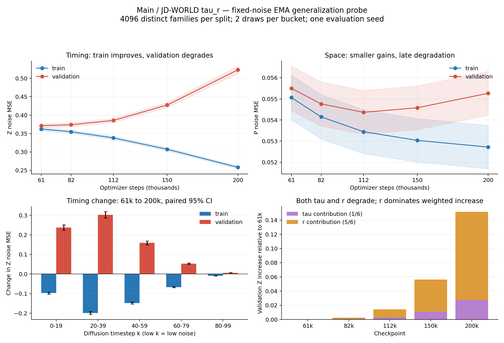

# main WORLD tau_r 固定噪声泛化诊断结果

数据来源：本目录 report.json、plan.json 和 checkpoint-000..004.npz。当前只发现 main / WORLD tau_r 的这一组正式结果；不将结论外推到 multiworld 或其他模型。

## 核对与结论

- complete=true；EMA / eval / FP32 / CUDA；两个 split 各 4096 个独立 family，每个 family 一行，互不重叠。5 个 k 桶、每桶 2 次固定噪声；5 个 checkpoint 使用相同配方。
- 已由逐样本 NPZ 重算整体均值，与 report.json 一致；噪声计划 SHA256 重现一致。
- 61k→200k：训练 Z 降低 28.72%，验证 Z 增加 40.84%；Z 泛化差距由 0.00914 扩大到 0.26485。四个相邻区间的训练 Z 配对差均为负、验证均为正，近似 95% 区间均不跨 0。
- 这支持明确的时间过拟合/泛化退化，但没有证明逐样本记忆机制，也没有定位到时间头或某一个共享模块。

## 整体误差

| step | train P | validation P | train Z | validation Z | Z gap |
|---:|---:|---:|---:|---:|---:|
| 61000 | 0.055060 | 0.055502 | 0.362286 | 0.371427 | 0.009141 |
| 82000 | 0.054149 | 0.054761 | 0.354930 | 0.373913 | 0.018982 |
| 112000 | 0.053443 | 0.054363 | 0.338161 | 0.385713 | 0.047552 |
| 150000 | 0.053034 | 0.054580 | 0.307296 | 0.427574 | 0.120278 |
| 200000 | 0.052718 | 0.055264 | 0.258247 | 0.523100 | 0.264853 |

61k→82k：验证 P 改善约 1.33%，Z 恶化约 0.67%；61k→112k：验证 P 改善约 2.05%，Z 恶化约 3.85%。112k 是本次 5 个点中验证 P 最低的点。150k、200k 的验证 P/Z 都比 112k 差，已被它在这两个指标上支配。

## 变化分布

- 61k→200k，89.94% 的训练 family Z 降低，79.79% 的验证 family Z 上升；验证差值中位数 +0.08403。
- 去掉差值分布上下各 5% 后，验证 Z 差值均值仍为 +0.12317，说明退化不只来自尾部异常样本。
- 验证 tau 误差 +45.57%，r 误差 +39.92%；两者都退化。按 Z=(tau+5r)/6，r 贡献总体 Z 增量的 81.85%，tau 贡献 18.15%，并非只需要修复 duration 相关的 tau。

## diffusion timestep 分桶（61k→200k）

| k 桶 | train Z 起点→终点 | validation Z 起点→终点 | 对整体 validation Z 增量贡献 |
|---|---:|---:|---:|
| 0-19 | 0.7801 → 0.6829 | 0.7923 → 1.0293 | 31.24% |
| 20-39 | 0.5289 → 0.3298 | 0.5489 → 0.8517 | 39.92% |
| 40-59 | 0.3267 → 0.1786 | 0.3364 → 0.4954 | 20.96% |
| 60-79 | 0.1493 → 0.0825 | 0.1530 → 0.2062 | 7.01% |
| 80-99 | 0.0265 → 0.0174 | 0.0265 → 0.0330 | 0.86% |

0–59 桶贡献 92.13% 的整体 Z 增量，20–39 最突出。低 k 是低噪声、反向采样后段，不是物理执行时间。所有桶都有训练下降、验证上升；不能将问题仅归于某一个桶，也不能仅凭这项诊断决定关掉某个桶的训练损失。

## 行动建议及边界

1. 对本次 main WORLD tau_r，保留 61k 为时间/总噪声 MSE 基准，并以 82k 做轻度空间/时间折中；61k/82k 的部署取舍仍应比较相同预算下的物理规划指标。
2. 不建议沿相同配方继续训练 150k/200k。若测试正则化，优先从过拟合前或较早 checkpoint 开独立对照，避免把晚期已经退化的状态当作干净基线。
3. 不能据此证明“空间参数更多导致时间过拟合”，也不能定位到独占时间输出头；时间预测依赖共享 encoder/fusion。大规模重构仍需独立消融。
4. 补做 evaluation seeds 20261024/20261025，并运行 multiworld 的同口径评估；换评估 seed 不能替代独立训练 seed。
5. 当前置信区间条件于固定噪声，未做多重比较校正；没有 test split 或物理规划成功率结果。数据难度与 family 分布的差异仍不能由本诊断完全排除。

