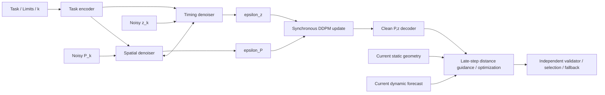
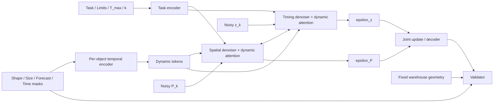
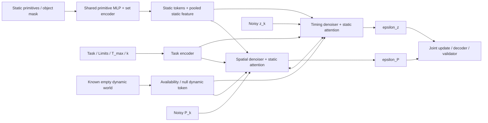
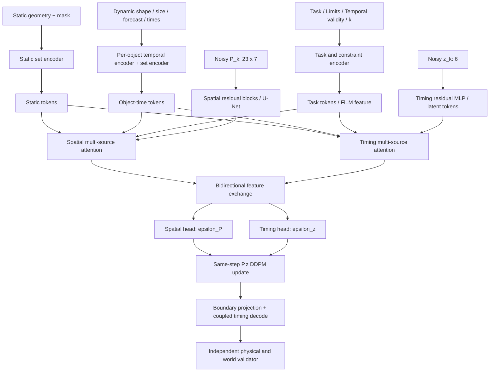
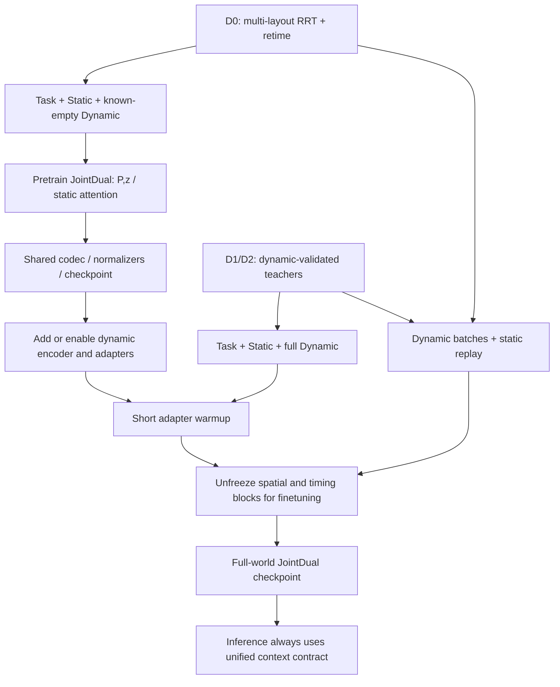
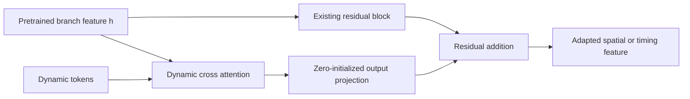
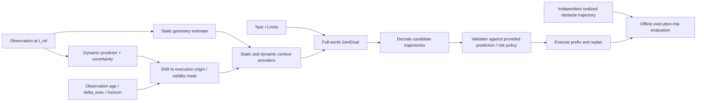
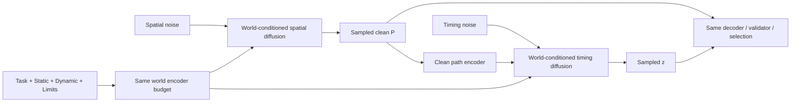

# JointDual 的静态与动态 Context、跨环境训练和版本设计

日期：2026-10-10。范围：同一单臂机器人上的空间与时间共同生成；JointDual 的 dual 指空间/时间分支。本文件是新增模型与数据契约的设计，图中新增 world encoder、JointDual backbone、adapter 和 trainer 尚未实现。

关联文档与入口：[JointDual 实施方案](JOINTDUAL_SPACETIME_IMPLEMENTATION_PLAN.md)、[Warehouse 动态轨迹生成器](../scripts/spacetime_data/generate_warehouse_spacetime.py)、[现有 TimingDiffusion](../scripts/train/TIMING_DIFFUSION.md)。既有 MPD/ROS 接口继续使用原契约；将来的新模型采用独立 loader、配置和 checkpoint。

## 1. 直接回答：两类环境是否都要作为 context？

**如果目标是让模型根据当前世界直接生成轨迹，并推广到新静态布局和新动态运动，建议静态几何与动态预测都进入 context。** 两者可以经过不同 encoder，但生成空间和 timing 的两个分支都应能访问它们。

**预训练/后训练解决数据利用和训练顺序，context 解决模型能获得什么信息；两者可同时使用。** 不是把静态信息只在预训练时提供，动态信息只在后训练时提供，最终模型就自动具备两者。最终训练与推理契约应一致，阶段之间主要改变数据来源、采样比例和可训练模块。

| 使用目标 | 静态 context | 动态 context | 可合理声称的能力 |
| --- | --- | --- | --- |
| 固定 warehouse 布局，无动态障碍 | 可省，布局固定在数据/配置里 | 已知为空 | 该布局上的轨迹先验 |
| 固定布局，有不同动态障碍 | 可固定；建议预留静态 encoder 接口 | 需要未来运动信息，或由外部引导提供 | 同布局内适应动态世界 |
| 新静态布局，无动态障碍 | 建议提供几何 | 已知为空 | 多布局的条件空间与运动学 timing 生成 |
| 新静态布局及动态运动 | 建议提供几何 | 建议提供预测、时间与有效期 | world-conditioned JointDual |
| 只学通用运动先验，在线优化负责世界适配 | 网络可不读；碰撞引导必须读 | 网络可不读；引导/优化必须读 | 可迁移的先验加在线求解系统 |
| 多机器人、不同夹爪/负载 | 几何仍需要 | 动态预测仍需要 | 还需机器人几何与限制条件，不能仅靠 scene context 实现 |

固定几何不必每步重新编码：静态 tokens 可以按 geometry hash 缓存，供两分支重复读取。**省去重复计算不等于省去几何信息。** 同样，forecast 在一个冻结请求内只需编码一次；预测、执行时间偏移或几何改变后，相关缓存失效。

### 1.1 为什么只给起终点不够？

记任务条件为 `a`，静态几何为 `S`，动态预测为 `D`，空间/timing 标签为 `P,z`。目标分布是：

\[
p(P,z\mid a,S,D).
\]

相同起终点在两个布局里可能分别要求从货架左侧、右侧绕行；相同空间路径在两条动态预测里可能分别要求抢先或等待。模型只见 `a` 时，学到的是对隐藏世界的混合：

\[
p(P,z\mid a)=\int p(P,z\mid a,S,D)\,p(S,D\mid a)\,dS\,dD.
\]

它可以产生通用候选，但不能仅根据相同输入辨认本次对应哪个世界。增加数据、换 diffusion 为 flow matching 或使用更大 backbone，都不会补回缺失的请求信息。这是本设计的条件信息分析，不是某个训练实验的结论。

`scene_id` 可以帮助已知场景的模型路由，却不能描述未见货架布局。轨迹长度、目标位置等偶然与布局相关的字段也不能代替几何。

### 1.2 没有 world context 仍然可以跨环境吗？

可以让**整个系统**通过在线碰撞距离引导、轨迹优化、筛选与 planner fallback 适配新场景。模型此时负责先验，世界信息在另一个环节进入。MPD 原论文明确使用轨迹先验和代价梯度进行 denoising 规划，为这种路线提供了依据；它不保证本项目任意新布局的先验都有足够支持。[MPD 原论文](https://arxiv.org/abs/2412.19948)。

这种方案适合已经有强先验、动态数据不足、可接受较多在线计算的情况。报告时需包括引导、筛选、优化和 fallback 的总耗时，不能只报告网络前向时间。

结构化几何条件也是已有研究路线。CAMPD 将障碍参数逐实例编码并通过 attention 条件化 U-Net；SceneDiffuser 将场景条件、优化和规划结合。这支持本文件采用几何 tokens 的选择，但并不证明本项目 JointDual 的动态泛化效果。[CAMPD 作者项目页](https://meco-group.github.io/campd/)、[SceneDiffuser 论文](https://openaccess.thecvf.com/content/CVPR2023/html/Huang_Diffusion-Based_Generation_Optimization_and_Planning_in_3D_Scenes_CVPR_2023_paper.html)。

## 2. 本仓库当前状态：不要把配置名当作环境编码

| 本地能力 | 实际信息通路 | 对本设计的含义 |
| --- | --- | --- |
| `ContextModelEEPoseGoal` | 编码目标位置与旋转 | 没有静态/动态 world encoder |
| 现有 `TemporalUnet` 的 attention 模式 | 把 `[B,d]` context 改成单个 `[B,1,d]` token | 不能直接当作支持任意物体/时间 token 的实现 |
| Standalone TimingDiffusion | clean `P` 经 path encoder，再条件化 timing MLP | `--env` 是数据选择和实验身份，不是障碍地图输入 |
| RRT+retime/nearwait 数据 | 空间路径与运动学时序 | 不能默认认为 nearwait 就是为某个动态世界生成的安全等待 |
| `warehouse_spacetime_joint_v1` | 保存完整动态 forecast、raw q-t、P/c/tau-r、执行参考 | 可用于动态共同网络；目前尚无对应 JointDual loader/trainer |
| 新 Warehouse generator 的静态环境 | 固定 `EnvWarehouse`，代码/资产 hash 写入配置 | 动态运动多样，静态布局仍然只有一个；没有每样本通用静态 primitive 数组 |

核对位置：[context_models.py](../mpd/models/diffusion_models/context_models.py)、[models.py](../mpd/models/diffusion_models/models.py)、[TimingDiffusion 说明](../scripts/train/TIMING_DIFFUSION.md)、[生成入口](../scripts/spacetime_data/generate_warehouse_spacetime.py)。

**现有生成器加上新网络就能开始固定 warehouse 的动态实验；要证明跨静态环境，还需新增静态布局数据与几何导出。** 单一静态布局即使输入真实几何，模型仍可能忽略这组恒定 tokens。

## 3. 统一 Context 契约

### 3.1 三种时间不要混用

- `k`：diffusion 去噪步，DDPM 训练时两分支使用同一步，噪声独立采样。
- `s`：空间 spline 的 phase，不是物理时间。
- `t`：从计划执行起点开始的秒数；动态 forecast 与 decoder 都使用它。

若 snapshot 参考时刻为 `t_ref`，执行起点为 `t_exec=t_ref+delta_exec`，碰撞检查为：

\[
d\bigl(q(s;P),S,D(t_{exec}+t(s;z))\bigr)>m.
\]

网络使用相对执行起点的 forecast 时间，不直接学习 Unix 时间。当前离线 teacher 已采用 `execution_start=0`、冻结 oracle forecast，规划求解耗时不推进世界；第一轮训练就保持这个契约。在线延迟预测、重规划和预测误差另做版本。

### 3.2 推荐字段

| 分组 | 输入 | 首版设置与说明 |
| --- | --- | --- |
| Task | `q_start/q_goal`、`goal_type`、边界 mask | 先 joint goal、rest-to-rest；pose goal 不能免费读取 teacher IK |
| Constraints | 关节限位、速度/加速度限制、margin、`T_max` | 固定机器人可作为固定配置；数值变化时必须进入 context 与 decoder |
| Static | primitive type、位置、姿态、尺寸、静态 mask | 固定到 robot base frame；用完整尺寸而非仅中心 |
| Dynamic | type、尺寸、forecast positions/orientations、相对时间 | 物体内部先做时间编码，再做物体集合编码 |
| Timing validity | `delta_exec`、observation age、预测有效期 | 不能用过期预测或隐式外推；oracle 首版显式标记确定性预测 |
| Uncertainty | 预测协方差/膨胀及其 mask | 确定性 oracle 与未知不确定性分开，不把缺失当精确零误差 |
| Availability | static/dynamic known、object mask、time-valid mask | 已知无障碍、未知、padding、训练 condition dropout 是不同状态 |

建议 tensor 契约：

```text
task                         [B,F_task]
static_features              [B,N_s,F_s]
static_mask                  [B,N_s]
dynamic_shape_size           [B,N_d,F_shape]
dynamic_pose                 [B,N_d,K,F_pose]
forecast_relative_time       [B,K] 或 [B,N_d,K]
dynamic_object_mask          [B,N_d]
dynamic_time_valid_mask      [B,N_d,K]
world_availability           [B,F_availability]
```

`N_s/N_d/K` 均支持 padding，不写死为 warehouse 的物体数量。物体顺序随机化，共享同类 encoder；物体内部时间顺序必须保留。若预测包含匹配好的物体轨迹，物体身份只用于串起时间序列，不将 ID 数值当物理特征。

当前动态数据的 sphere/轴对齐 box/z-capsule 没有变化朝向：adapter 按对应契约补 identity orientation，并标记“固定朝向”；不能臆造随时间旋转的标签。mesh/感知点云路线以后新增表示版本。

### 3.3 哪些字段不能作为默认输入？

默认只给推理时可获取的 `Task/S/D/Constraints`。以下保留为训练标签、审计或分组元数据：

- `P*`、`z*`：生成目标；JointDual 去噪输入的是 `P_k/z_k`，不是 clean teacher path。
- teacher 规划来源、seed、scene/template/task/source ID、质量/成功状态：不送入主网络。
- 最优 crossing time、通过窗口、teacher 选择的绕行方向/等待模式：不能提前给出决策答案。
- 当前生成器的 `anchors/event_times`：锚点由参考路径设计，默认不直接送给模型；仅由公开 forecast 编码世界。
- 原参考空间路径：可供 teacher 的搜索 proposal，JointDual 推理请求不默认携带它。

动态 `linear/shuttle/...` 是生成来源标签。网络读取实际预测曲线；不依赖生成模板名称。用户显式指定“最晚到达时间”属于合法偏好，teacher 求出的最早到达时间则不是。

### 3.4 已知无动态世界与动态信息缺失

| 状态 | 编码 | 训练/推理含义 |
| --- | --- | --- |
| 真实静态任务，已知无移动物体 | `dynamic_known=1`，object mask 全空，合法 null token | 可以使用静态安全轨迹标签 |
| 世界中有移动物体但预测未知 | `dynamic_known=0` | 不能当作上述静态任务；需要保守策略或 fallback |
| batch padding | mask=0，availability 不改变 | 不参与 attention/loss |
| 为条件消融/CFG 主动丢弃 D | 专门 condition-drop 标记 | 表示条件边缘化的训练分支，不保证动态安全 |

Attention 必须处理全部物体被 mask 的情况，例如给合法的 null token，避免 all-masked softmax 产生 NaN。首版不依赖大权重 CFG；它不能替代碰撞验收，也可能改变时序和多样性。

## 4. 六个具体版本和一个 Factorized 对照

以下统一输出 `P_free,z`。以当前 joint goal、P29 五阶 spline、起终前三个点分别相同的 rest-to-rest 约束为例，空间自由点为 `23×7`；网络 padding 与 mask 不改变 canonical codec。`z` 为六维，优先实验 tau-r，保留 c 对照。

tau-r 解码中的 `T_min(P,r)` 随空间/形状改变，不能沿用 teacher 保存的常数。所有版本最终执行完整静态、自碰撞、动态及运动学验收；context 本身不构成安全保证。

| 版本 | 对应原计划 | 场景 | 主要用途 |
| --- | --- | --- | --- |
| V0 Prior + Guidance | JD-KIN 的通用先验路线 | 多环境，但世界主要交给在线引导 | 低动态数据成本的基线 |
| V1 Fixed-Static Dynamic | 固定场景 JD-WORLD | 固定 warehouse，动态运动变化 | 当前数据可最快支持 |
| V2 Static-Context | 多布局 JD-KIN / static-conditioned | 静态布局变化，无动态物体 | 训练几何迁移能力 |
| V3 Full-World JointDual | 完整 JD-WORLD | 静态布局与动态运动都变化 | 跨环境主目标 |
| V4 Staged Full-World | V3 的分阶段训练版本 | 与 V3 同推理契约 | 利用便宜静态数据和少量动态 teacher |
| V5 Predicted-World | V3/V4 的预测误差版本 | 感知、延迟、滚动预测 | 后续真实运行实验 |
| F-WORLD Factorized | world-conditioned factorized 对照 | 与 V3/V4 同场景 | 判断共同去噪是否值得 |

### 4.1 V0：通用先验 + 在线世界引导

适用：有大量 RRT+retime，可接受在线优化；暂不训练 world encoder。可以混合多个环境的轨迹学习运动先验，但它没有按本次几何选择路径的直接能力。



优点是便宜数据可复用，世界表示不用立即训练。风险是新布局可能远离先验支持，优化需要较多迭代；动态冲突常涉及离散绕行/等待决策，局部梯度不一定能找到合适模式。

图中 guidance 对当前 clean estimate 求代价，再影响后续更新/后处理；高噪声阶段不把任意 spline 的离散 corridor 当稳定条件。

### 4.2 V1：固定静态环境 + 动态 Context

适用：先回答“JointDual 是否能在 warehouse 中根据移动障碍联合改变路径和时间”。静态 geometry 固定，通过数据学入权重，验收器仍使用实际静态环境。该版不能称作跨静态环境模型。



必须让动态 tokens 到达空间分支。只把 D 给 timing，空间先验容易一直复现原静态路径；遇到无可行 retime 的冲突时不能主动学会绕行。共享特征交互可以传递信息，但首版建议直接让两个分支读取 D。

### 4.3 V2：多静态环境 + 静态 Context

适用：动态 teacher 数量不足时，先建立跨静态布局的空间生成与运动学 timing 基础。



Timing 的运动学最小时间主要由 P 和限制决定；静态 context 对 timing 的额外直接收益可能小于对空间的收益。保留其读取通道便于迁移到 V3，通过消融决定是否减少该 attention，而不是事先断言两分支必须有相同收益。

### 4.4 V3：完整静态 + 动态 Context 的 JointDual

适用：跨布局且存在移动障碍，是主目标网络。静态与动态分开编码，保留各自物理含义，再通过多源 attention 融合。



推荐初始结构参数（实验起点，不是已经调好的最优值）：

- Token width `d=128`，4 attention heads；task/constraints 同时提供 FiLM 全局特征。
- 静态同类 primitive 共用 MLP；2 层 set encoder，保留物体 tokens。不能只平均池化后声称保留全部障碍关系。
- 动态每物体 2 层 temporal encoder，包含相对秒数、pose/shape/size、有效 mask；物体集合层保留多个时间片或 temporal latent tokens，避免只输出时间平均位置。
- 空间采用支持自由点长度及 mask 的独立 U-Net/残差序列网络；timing 用 width-256 残差 MLP，将六维 latent 投影成少量 tokens。
- 在 bottleneck 及一至两个对应分辨率插入双向交换：空间读取 timing feature，timing 读取当前空间 feature；不是只在最后拼接两个输出头。
- 两分支都读取 task/static/dynamic；各自标准化与输出 head 分开。
- 首版不默认启用 corridor、CFG、大规模 Transformer 或 Flow Matching；先证明世界信息与共同建模的收益。

Token 成本近似随 `N_s+N_d*K_token` 增长。可对长预测做时间压缩，但 encoder 的采样率要能覆盖最快障碍及窄通过窗口；**压缩网络输入不改变 teacher/验收器的完整预测与碰撞分辨率。** 首轮保留完整 20 ms forecast 存储，再消融编码采样率，不能先把所有运动简化成线速度。

可选后续增强：低噪声时，从 `P_hat,z_hat` 解码的机器人球位置与物理时间构造局部 world 查询。它与推理当前候选一致；不能训练时用 teacher `P*,z*` 采样距离，推理时却只剩 noisy 候选。几何反馈的成本与梯度实现应单独评估。

### 4.5 V4：统一接口的预训练 → 动态后训练

V4 推理网络与 V3 一致；差别在训练顺序。应从预训练开始建立 Task/Static/Dynamic 的全部槽位，静态任务的 D 为“已知空”，动态 encoder 可暂不训练。



一个可实现的 adapter 结构：



对**空间和 timing 两条分支**都插入 adapter。用零初始化输出投影让初始模型保持原函数；不要把 gate 和输出投影同时置零并导致整条支路无有效梯度。动态 encoder 若随机初始化，可先短暂冻结基础网络训练 adapter，再解冻。

永久冻结空间 backbone、只微调 timing，适合“已知空间路径必可 retime”的子任务；它不足以作为训练动态绕行的主要策略。动态后训练必须允许世界条件影响空间选择，更新对应空间模块。

若已有 checkpoint 只含 clean-P conditioned timing，可以迁移 timing/path encoder 的部分权重，但不是直接得到 JointDual：共同去噪时 path 是 noisy/predicted 的，输入分布、自由点映射和上下文接口都变了。需要重建适配并训练，不能将旧六维 timing checkpoint 视为全模型。

### 4.6 V5：预测世界、执行偏移和滚动运行

适用：Oracle-world 的模型与 codec 先通过后，评估有误差的感知/预测与在线执行。



Teacher 应在提供给模型的同一预测及膨胀假设下求解，再用独立真实轨迹复检/评价。若 teacher 使用未给模型的精确未来，那是 privileged-teacher 实验，需要单列，不能混进同信息量主对照。

当前生成器是 rest-to-rest。图中的连续滚动 prefix 运行还需要非零 `dq_start/ddq_start` 的边界 codec 与数据；V5 当前不能直接落地为已有能力。首次预测误差实验可以先保持 rest-to-rest 单次执行，以隔离 world prediction 问题。

### 4.7 F-WORLD：必须保留的 Factorized 对照

Factorized 本身可以表示 `p(P|a,S,D) p(z|P,a,S,D)`，因此需要与 JointDual 同信息量比较。



与仅给动态 timing 的旧 factorized 比较，会把“新增世界信息”与“共同去噪”混在一起。F-WORLD 空间分支也读 D，最终候选数、collision check 分辨率、后处理、fallback 预算与 JointDual 对齐。

## 5. 数据如何分给预训练和后训练？

### 5.1 按任务能力分层，不按 planner 名称硬切

| 数据层 | 生成与验收 | Context | 可以教会的主要内容 |
| --- | --- | --- | --- |
| D0 Static-KIN | 多静态布局 RRT；拟合后 retime；补静态/自碰撞与限制复检 | Task + S + 已知空 D | 静态绕行、多空间路径、P/z 运动学耦合 |
| D1 Dynamic-Retime | 在真实 D 下对固定 P 求时序/nearwait，多初值并完整动态验收 | Task + S + D | 路径可保留时的抢先、减速、近似等待 |
| D2 Dynamic-Joint | 原版 ST-RRT* 或 Torch forest；P/z 拟合后完整复检 | Task + S + D | 动态影响空间选择及可变到达时间 |
| D3 Prediction-Risk | 同一预测输入下求解；保留独立真值和误差 | Task + S + 预测 D + uncertainty | 预测误差/有效期下的行为与风险评估 |

`D2` 当前有原版 OMPL CPU batch 和受 ST-pRRTC 启发的 Torch forest，两种来源分开记录，统一 codec 与验收后可混用。Torch forest 不冒充完整 ST-RRT*；规划算法的最优性不直接转移到拟合标签。

RRT+retime 的优势是便宜、多样、可以提供运动学基础。原本未读动态世界的 nearwait 只是一种时序 proposal：把它配上随机 D 后，只有通过动态复检的组合才能成为 D1。不能直接把既有行复制到多个不同 D 上作为安全监督。

D1 不会主动创造新的 P，数据仅来自成功 retime 时，容易偏向简单世界。D2 应包含“静态路径直接 retime 失败，但空间改变后可行”的任务，并区分失败在搜索、codec、运动学还是动态验收。

### 5.2 推荐训练阶段

| 阶段 | 网络与数据 | 推荐操作 | 阶段退出条件 |
| --- | --- | --- | --- |
| A：codec/loader 小试 | D0/D2，c 与 tau-r | 统一边界、phase、timing、正常化、world adapter；先不加复杂辅助 loss | 同一 decoder 的 raw→fit→kinematic→world 漏斗稳定 |
| B：多布局静态预训练 | V2 结构/全部 context 槽位，D0 | 训练空间、timing、static encoder；D 明确为空 | 未见静态布局优于 task-only 对照 |
| C：动态 warmup | V4，D1+D2 | 短暂冻结基础层，训练新动态 encoder/adapter；随后解冻空间和 timing | 不忽略 D，简单 counterfactual 能改变轨迹或时序 |
| D：动态后训练 | V4 full-world，混合 D0/D1/D2 | 小学习率更新基础层，静态 replay，难例与多解均衡 | 相同动态数据预算下优于 scratch/mixed 基线 |
| E：预测误差实验 | V5，D3 + replay | 明确模型/teacher 信息一致性，误差与 age 分桶 | 真值执行风险与 latency 达到目标 |

若当前只需要固定 warehouse，先用 V1，阶段 B 可以是单布局，但应将结论限制为该布局。若最终目标是跨环境，建议从 B 就随机化静态布局，避免后期主要学习如何解除固定布局偏置。

阶段 D 可从 `D2:D1:D0=60:20:20` 的**batch 配额**开始；这只是消融起点，不是经验最优比例。按独立 task/world family 采样，避免同 P 的大量 retime 变体占据大多数 batch。根据未见场景性能与遗忘调整比例，不能由数据行数决定实际任务权重。

### 5.3 不同 context 是否意味着不同网络？

不必。同一个全契约模型可以处理 `S/D` 的有效状态：

```text
静态预训练：a, S, dynamic_known=1, D=empty -> P*, z*
动态后训练：a, S, dynamic_known=1, D=forecast -> P*, z*
预测实验：  a, S, dynamic_known=1, D=prediction, uncertainty -> P*, z*
```

如果先学无 world 的 V0，再添加 S/D encoder，也可以迁移；但这需要新参数、输入适配及充分后训练。其收益与从一开始用 V2 的差异需要实测。没有理由默认“先隐藏静态几何能得到更通用的空间 backbone”。

保留不同 checkpoint：`static_pretrain`、`dynamic_finetune`、`prediction_finetune`，记录 context schema、robot hash、P/z codec、normalizer 和训练来源。未来提供全条件请求时，不能静默装载只支持 Task 的旧 checkpoint。

### 5.4 Label、normalizer 和 loss 保持一致

预训练与后训练均以同一种 `P_free,z` 为标签，先固定 spline degree/control points、边界、phase gauge、时间原点、horizon 和 timing codec。现有 retime 与新动态 teacher 的 phase 定义未必完全相同，不能仅凭都是 P29/c8 就假定可直接合并。

建议新训练 adapter 统一为动态生成器使用的保时混合 phase，或对各来源显式重拟合到同一 gauge；禁止逐行采用不同 gauge 却不记录。c 与 tau-r 使用不同 checkpoint/normalizer，tau-r 无效行不得当六维正确目标。

P/z 分别标准化；normalizer 只用训练集。预训练后若重估 normalizer，必须同步转换输入/输出层或重建模型，并说明比较条件。优先保持固定 normalizer，记录后训练数据的范围偏移，避免悄悄改变权重的数值语义。

首版同一步 `k`，独立高斯噪声，按分支维数取均值：

\[
L=\lambda_P\operatorname{mean}\|\epsilon_P-\hat\epsilon_P\|^2
 +\lambda_z\operatorname{mean}\|\epsilon_z-\hat\epsilon_z\|^2.
\]

可先设两者权重均为 1，监控梯度尺度。静态/动态距离与运动学辅助项只对预测 clean `P_hat,z_hat` 计算，优先在低噪声阶段小权重加入。不要对高噪声 P 直接计算可信 corridor 或复用 teacher `T_min`。不可行/超时记录用于失败诊断；planner 超时不等于任务无解，失败样本不能混进正轨迹 imitation loss。

## 6. 分阶段训练收益是否高？

**当前建议是值得优先实验，但尚无本仓库证据可以承诺成功率或数据成本提高多少。** 其潜在收益主要来自便宜静态数据对昂贵动态数据的替代，而不是“预训练”这个名字。

已有 SODP 研究采用广覆盖数据预训练与任务相关 RL 微调，在其控制任务上取得结果；本项目是几何规划加监督 teacher、P/z codec，训练目标不同，不能直接移用收益数字。[SODP / ICML 2025](https://proceedings.mlr.press/v267/fan25a.html)。

| 具体情况 | 更合适的起点 | 预期收益与风险（工程判断） |
| --- | --- | --- |
| D0 很多，D2 生成贵，机器人/codec 相同 | V4 预训练→后训练+replay | 较值得验证，可能减少动态标注量和初期训练不稳定 |
| 已有同域高质量 D2，数量充足 | V3 scratch 与混合训练同时比较 | 复杂阶段管理可能不划算；静态标签过多反而稀释动态决策 |
| D0 只有一个布局，目标是完全新静态场景 | 补多布局 D0/V2 | 单布局预训练可能带来可用运动学 prior，也可能造成绕行偏置；不能据此称为跨环境 |
| D0 与 D2 phase/horizon/robot 不一致 | 先统一契约 | 未统一时迁移可能负收益，甚至学到相互矛盾的时序 |
| 动态任务几乎都能固定 P retime | F-WORLD / D1 | 完整 JointDual 的空间交互收益可能小，较轻模型更合适 |
| 动态任务经常要求空间绕行 | V3/V4 + D2 + 空间解冻 | 只后训练 timing 不够；D2 质量与多路径覆盖更关键 |
| 只在目标 warehouse 上后训练 | 固定环境部署可以 | 可能遗忘其他布局；跨环境目标需多布局动态数据和 replay |
| 新场景数据极少、在线预算较宽 | V0 + guidance/fallback | 更快形成系统基线，但在线求解成本与失败风险要单列 |

后训练先使用监督 denoising loss，不默认增加 RL/偏好优化。只有轨迹质量排序、约束代价与在线反馈契约稳定后，再讨论 reward 或 preference 阶段。

## 7. 跨环境数据必须新增什么？

### 7.1 静态随机化与几何存储

1. **布局族**：保留原 warehouse，增加货架位置/朝向/层高/间距、桌面位置/高度、静态箱体组合；保持与机器人 base frame 一致。
2. **物理任务有效性**：随机布局后重新检查起终点、参考路径、自碰撞；旧路径失效时重新规划。对静态 geometry 的 augmentation 不能只换 context 而不重新验收 label。
3. **几何资产**：每 world 导出 primitive pose/size/type 或可重建的 SDF/mesh reference，几何 hash 与 collision evaluator 一致；一个字符串 `EnvWarehouse` 不足以描述参数化布局。
4. **搜索世界一致性**：所有后端与拟合复检使用同一静态资产；动态物体与静态物体仍按当前用户要求允许穿模，不改变规定运动。
5. **请求任务**：同一布局里覆盖不同起终、不同姿态区域与路径模式；同一起终也跨多个布局生成，减少网络从目标位置猜布局的捷径。

第一版建议 primitive 表示，便于从模拟几何直接导出与复检。点云/SDF encoder 是面向感知和复杂 mesh 的后续版本，不能只用更复杂 encoder 补偿单布局训练数据。

### 7.2 动态世界多样性与难度

当前十种运动模式是可用起点。还需系统变化物体数量、尺寸、速度、运动方向、停留时长、同时/先后交互、事件间隔与 forecast horizon。保留无动态、动态与机器人无冲突、固定路径可 retime、必须更换路径等分桶。

当前 world 锚点来自参考路径，便于在执行期间产生工作区事件，但也会形成“障碍围绕这条来源路径设计”的偏置。新增独立采样的障碍曲线与独立任务配对，再筛选工作区访问条件；在测试里保留此分布。锚点/事件不作为网络输入。

“障碍进入工作区”不保证它影响最优路径或时序。统计参考轨迹冲突率、可 retime 率、需要绕行率和多窗口比例，避免只生成大量容易忽略 D 的样本。

同一 task/world 尽量保留多条复检有效的 P/z 与多 seed teacher，去重后按 family 采样。目前生成器虽可保留多个 raw 改进解，但每个 attempt 只写一个成功拟合的 P/z，**还不是同世界多解的联合训练集**；此项需要下一步扩展。

### 7.3 Split 必须能测到真正的新环境

| 测试集 | 独立保留的维度 | 验证内容 |
| --- | --- | --- |
| ID-task | 起终/task family | 同分布新任务 |
| Static-layout OOD | 完整静态 geometry/layout family | 新静态布局 |
| Dynamic-parameter OOD | 速度、尺寸、数量、时刻范围 | 已知模式下的新参数 |
| Dynamic-pattern OOD | 完整运动模式/组合 | 新运动模式 |
| Joint OOD | 静态布局与动态参数/模式同时改变 | 主目标的泛化 |
| Predicted-world | 噪声、age、截断/有效期、执行偏移 | 预测误差与在线契约 |

划分前先确定 geometry/task/world family，正反路径、同源 retime、同世界多 teacher/多模式都不能跨 split。跨数据源使用复合 identity（robot/geometry/task/source family 等），不能仅用局部 row number 去合并或拆分 family。

现有 generator 的 source-family hash split 防止同源正反泄漏，但不保证静态布局 OOD，也不能直接替代上述测试集。预训练阶段也不能读后训练测试中保留的 geometry/world family；“只在预训练见过测试布局”仍然不是零样本新布局测试。

## 8. 如何验证收益，避免把 context、网络、训练阶段混在一起？

### 8.1 最小模型对照

在相同数据/codec、候选数与验收规则下：

| 对照 | 模型读到的世界 | 要回答的问题 |
| --- | --- | --- |
| V0 + guidance | 网络无 S/D，外部检查与引导有 | 强先验加在线优化是否已经足够？ |
| Task-only | 无 S/D，最终验收器有 | 隐藏环境信息的代价 |
| S-only | S | 动态预测的增益 |
| D-only / V1 | D，静态固定或隐藏 | 静态几何的增益及单布局偏置 |
| S+D / V3 | S/D 同时给两分支 | 全 world context 的增益 |
| S+D / F-WORLD | 与 V3 同信息量 | 共同去噪相对 factorized 的增益 |

删除某类 context 的模型分别训练；另外对 full model 做条件敏感性实验。不要只在推理时清空从未被清空的 tokens，就把分布外损坏当作训练消融结果。

**Counterfactual 检查**：保持起终和采样 seed 不变，分别改变静态障碍位置/动态穿越时刻，重新采样。需要同时看到输出改变、对应世界验收通过和决策合理；单看轨迹数值改变不能证明模型理解世界。对无需改变解的扰动允许保持相同结果。

### 8.2 最小训练顺序对照

| 实验 | 训练方式 | 控制变量 |
| --- | --- | --- |
| T0 | 仅 D2，从零训练 | 动态数据预算参照 |
| T1 | D0/D1/D2 从零混合训练 | 与 T2 相同 unique data、总更新量、近似 FLOPs |
| T2 | D0 预训练→D1/D2 后训练+replay | 与 T1 比较训练顺序，不增加独有数据 |
| T3 | D0 预训练→D2 后训练，无 replay | 测静态/跨布局遗忘 |
| T4 | 固定空间 backbone，只训动态/timing adapter | 检验空间解冻与绕行的重要性 |

另做 D2 独立 family 数量的学习曲线，例如 N/2N/4N，每档多个训练 seed。分别报告：同 D2 标签预算的收益、同总训练算力的收益，以及 teacher 生成+训练的总成本。不能让 T2 多训练一倍，却只归因于预训练策略。

### 8.3 主要指标

- 拟合/解码有效率、静态/自/动态碰撞有效率、关节/速度/加速度违规率。
- 最终执行成功率、首次合格候选率；按 Static OOD、Dynamic OOD、Joint OOD、绕行/等待难度分桶。
- 到达时长、相对 teacher 时长/路径代价、最小 clearance、多样性；不宣称拟合后的 teacher 是全局最优。
- encoder、采样、decode、guidance、验收、fallback、总 latency；候选数与总计算预算对应。
- D2 每个最终合格去重 family 的生成成本、codec 接受率与训练所需 family 数。
- 后训练前后静态布局性能，测遗忘；预测版本以独立真实轨迹评价碰撞/风险。

对于多解分布，单条 teacher 的 P/z MSE 或 diffusion validation loss 不能替代规划成功率与模式覆盖。失败样本的 teacher 超时与 codec 拒绝分别报告。

## 9. 推荐实施顺序与决策点

1. **先固定新 JointDual dataset/context adapter。** 从现有 warehouse shards 读取 Task/D/P/z，构建真实静态 geometry 的固定 tokens，保留 mask/known-empty 契约；不修改旧 timing loader。
2. **先做 V1 与 F-WORLD 小试。** 验证动态 context 有效、codec 支持等待/绕行，报告同世界公平对照；不宣称跨静态环境。
3. **增加多布局 D0 和静态几何导出，做 V2。** 必须通过 held-out layout 与 static counterfactual，确认模型确实读 S。
4. **在相同多布局 world 上扩 D1/D2，比较 V3/V4。** adapter warmup 后解冻空间/timing；主对照包含 scratch、mixed、staged+replay。
5. **仅在数据成本或成功率确有收益时扩大 V4。** 若大部分动态任务仍由同一 P 安全 retime，保留较轻 F-WORLD；若绕行任务收益明显，再投入共同网络。
6. **最后增加 V5。** 预测有效期/误差与连续拼接边界分开验收；继续保持在线接口版本隔离。

**本仓库的默认研究路线：统一 S/D context 契约 + 多静态布局预训练 + 动态 teacher 后训练 + 静态 replay。** 固定 warehouse 的 V1 是验证共同生成的较快起点；V3/V4 的跨环境结论必须来自多布局数据和真正独立的世界测试。
