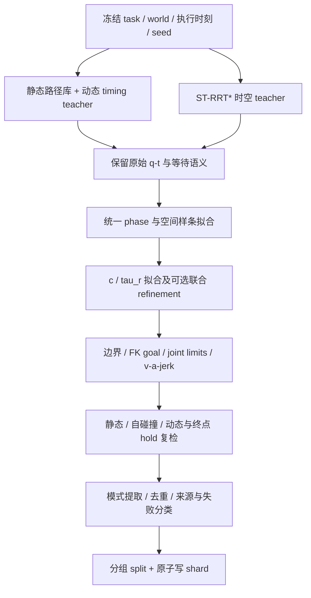

# JointDual 空间与时间共同网络：实施方案

日期：2026-10-08。状态：设计与实施计划，本文没有实现新的模型、数据生成器或运行入口。

2026-10-09 补充：核对了仓库已有的 Torch/CUDA multi-query RRT 和 Marvin 数据流水线，增加本地 GPU spacetime 扩展路线及其与 OMPL/pRRTC 的比较，见 7.4 节。已有基础比单纯的 GPU 碰撞批处理完整，不能忽略。

适用范围：单臂 Panda/FR3 的 Space-Time MPD。JointDual 指空间分支与时间分支共同去噪，不指双臂。保持现有 MPD、factorized、ST-RRT* benchmark 和 ROS 接口兼容；新增训练与离线数据功能应放在独立模块。

本文将既有设计收敛到可实施的选择，补齐条件、标签、teacher、数据验收、batch 与实验口径。基础设计见 [JointDual / TimeCorridor / Flow Matching 设计](SINGLE_ARM_SPACETIME_TIMECORRIDOR_JOINTDUAL_FLOWMATCHING_DESIGN.md)，历史数据计划见 [Timing 训练与数据工程](Space-Time%20MPD%20Timing%20训练与数据工程实施方案.md)。若命名冲突，以本文的 `JD-KIN`、`JD-WORLD` 为准，避免旧文档中 J1 同时指同步采样和动态条件阶段。

## 1. 建议先确定的结论

| 问题 | 本次建议 | 原因与限制 |
| --- | --- | --- |
| 现有设想是否完备 | 网络主干方向成立，尚未达到直接大规模训练的程度 | 缺世界条件契约、pose goal 处理、动态 teacher、codec 接受率、数据隔离和公平对照 |
| 共同网络怎么做 | 空间 backbone + timing backbone，共享 task/world encoder，双向特征交互 | 保留各分支的尺度、normalizer 和 loss；每一步同时预测与更新 |
| 是否先换 Flow Matching | 第一版沿用 DDPM epsilon prediction | 先验证共同建模的收益，再单独比较生成方法 |
| timing 用什么 | 以 `tau_r` 为首选、`c` 为 codec 与模型对照；先通过动态样本拟合门槛 | 两者目前都是六维；`tau_r` 解耦总时长和形状，但不保证能表达多次等待 |
| context 与 label | task/world/约束是输入；`P*, z*` 是目标；mode 是可选辅助标签 | teacher 求解出的窗口、IK、路径或未来决策不能直接冒充推理条件 |
| corridor 是否必需 | 首版关闭；保留离线 teacher、诊断和低噪声引导接口 | 无路径时没有唯一 phase-time corridor；当前消融不足以支持默认增加成本 |
| retime + nearwait 是否够 | 足以做运动学预训练和动态 teacher 的 proposal，不足以单独学会动态绕行 | 当前生成过程不看动态世界，随机 nearwait 也不等于避障等待 |
| ST-RRT* 是否接入方便 | 本地算法和 benchmark 已接通；离线 teacher 适配难度中等 | 还缺通用未来世界、原始解导出、统一样条拟合与复检 |
| ST-pRRTC 是否优先 | 作为后续 teacher 加速候选，不作为当前里程碑依赖 | 已确认论文，但本次未确认可运行官方动态代码；静态 pRRTC 不能直接替代 |
| batch 怎么做 | 保留 OMPL 参照，同时优先复用本地 Torch multi-query RRT 做 GPU spacetime 原型 | 当前 OMPL 不是 GPU batch planner，但仓库已具备 GPU 树操作与任务流水线；无需先从外部 pRRTC 开始 |

**建议路线：数据 codec 小试 → JD-KIN 冒烟 → world-conditioned factorized 对照 → JD-WORLD → 可选 corridor → 可选 ST-pRRTC。** 数据集以同一任务、同一动态世界下的多条空间路径和多种安全时序为核心。

## 2. 本地已有什么，缺什么

### 2.1 已有能力与边界

| 已有文件 | 可以复用 | 不能据此认为已经具备 |
| --- | --- | --- |
| [数据生成说明](../scripts/spacetime_data/README.md)、[生成器](../scripts/spacetime_data/generate_spacetime_dataset.py) | Warehouse 路径、空间样条拟合、TOPPRA、时长缩放、局部减速、nearwait、原子 shard 写入 | 动态世界条件、多路径动态决策标签 |
| [TOPPRA retiming](../mpd/parametric_trajectory/toppra_retiming.py) | 在拟合后的空间样条上检查速度/加速度和时长，生成时序变体 | 动态碰撞可行性；默认也不是 jerk 约束 teacher |
| [数据 schema](../mpd/datasets/spacetime_schema.py)、[timing loader](../mpd/datasets/spacetime_timing_dataset.py) | `P/c`、来源、质量、train-only normalizer、六维 timing target | 完整 world prediction 输入、JointDual loader |
| [timing 训练说明](../scripts/train/TIMING_DIFFUSION.md) | 固定 clean path 编码器、timing MLP、`c` / `tau_r` checkpoint | noisy path 训练适配；`--env` 不是动态世界 context |
| [ST-RRT* engine](../scripts/runtime/strrt_engine.py)、[collision](../scripts/runtime/strrt_collision.py) | OMPL 时空搜索、同机器人球模型、静态/动态碰撞采样、后处理、benchmark 计时 | 任意预测轨迹 evaluator、原生 GPU 多世界 batch、标准 `P,z` teacher 数据 |
| [time corridor](../mpd/inference/time_corridor.py) | 固定路径 phase-time 占据、窗口搜索、batch exact 和 timing refinement | 无路径条件下的通用 corridor；空间与时间联合学习网络 |
| [GPU RRT](../scripts/generate_data/gpu_batch_rrt.py)、[Marvin GPU backend](../scripts/generate_data/marvin_gpu_planning_backend.py) | Torch 批量采样、最近邻、扩展、插入与连接；多独立 query 的树、GPU 碰撞和批量审计 | 动态世界/时间方向、任意多世界碰撞、ST-RRT* 的到达时间优化逻辑 |

特别注意：当前 retime 生成器没有建立碰撞世界，`static_clearance_min` 可以是 NaN。`accepted=True` 的已有样本主要意味着通过该生成器的运动学/时长验收，**不等于完整的静态、自碰撞和动态安全样本**。进入动态训练前需要补这些检查。

本地现有 ST-RRT* 的 world evaluator 以 snapshot 中的位置和线速度外推，支持相应形状与膨胀，不等于知道任意真实未来曲线。已有 benchmark 接入是优势，但不能把它自动当作所有动态数据的 oracle。

### 2.2 共同网络要证明的内容

Factorized 也可以表示联合分布：

\[
p(P,z\mid x)=p(P\mid x)\,p(z\mid P,x).
\]

JointDual 的研究问题是：**让动态世界与时序特征反向影响空间生成，能否在相同数据、计算预算和验收规则下产生更好的空间与时间组合？** 不能仅凭网络同时输出 `P,z` 就宣称解决了这个问题。

必须补齐的设计包括：

1. 实际推理可用的 world prediction，以及时间原点。
2. joint goal 与 pose goal 的不同边界和条件，避免 teacher IK 泄漏。
3. 从原始 teacher 到共同 decoder 的可表达性验证。
4. 同世界多路径、多时序的动态训练样本，而非只有随机减速。
5. noisy path 特征适配、两分支同步采样、loss 尺度控制。
6. 数据分组、负例含义、mode 去重和对照实验。

## 3. 输出表示与边界条件

### 3.1 网络真正学习的对象

空间为 `q(s;P)`，`s∈[0,1]`。时间为 `t(s;z)`，`t(0)=0`、`dt/ds>0`，最终执行曲线是 `q(s(t))`。

```text
P_full : [B, H_P, 7]      canonical 空间控制点，当前数据常用 H_P=29
P_free : [B, H_free, 7]   施加对应边界约束后真正需要生成的自由参数
z      : [B, 6]          c 或 tau_r，checkpoint 必须记录是哪一种
```

不能默认 `H_free` 等于旧 MPD backbone 的长度。以 29 个控制点、起终位置给定且起终速度/加速度为零为例，常见约束会留下 23 个自由点；pose goal 的终点位置仍待生成，长度又不同。旧 U-Net 的长度约束见 [控制点调整逻辑](../mpd/datasets/trajectories_dataset_bspline.py)。

实施时先固定 boundary codec 和自由参数映射，再选择支持该长度的 backbone。若 padding 到 24/32，必须记录有效长度，屏蔽 padding 的 loss 和 attention，所有物理运算只使用还原后的 canonical 控制点。不能悄悄改变 H_P 后继续使用旧 normalizer/checkpoint。

### 3.2 timing codec

`c` 使用现有 softplus timing spline 的六维独立参数与完整八维控制点映射；不另造相近但不兼容的 decoder。

`tau_r` 使用 [normalized timing](../mpd/parametric_trajectory/normalized_timing.py)：

\[
z=(\tau,r_0,\ldots,r_4),\quad u(s)=\frac{dt}{ds}=T\pi(s;r),\quad\int_0^1\pi(s;r)ds=1,
\]
\[
T=T_{\min}(P,r)+(T_{\max}-T_{\min}(P,r))\sigma(\tau).
\]

`T_min` 依赖 P 和 r，不是可在路径改变后继续使用的常数。只在预测 clean 的 `P_hat,z_hat` 上计算物理量；`T_min>=T_max` 时判为不可解码候选，不能靠 clamp 把它伪装成可行。

对 `u=dt/ds`，物理导数为：

\[
\dot q=\frac{q_s}{u},\qquad
\ddot q=\frac{q_{ss}}{u^2}-\frac{q_su_s}{u^3}.
\]

可见动态限制是空间与时间共同决定的。有限采样得到的 `T_min`、极值与碰撞检查应记录分辨率和裕量，不能称为连续时间安全证明。

### 3.3 exact wait 与 nearwait

对固定、非退化空间路径，当前有限维、严格正 timing density 适合表达减速/近似等待，不能普遍表达任意相位的精确静止 dwell。空间样条若包含常值区间也可能产生停留，但现有 codec 没有独立 dwell 段的表达契约，不能依赖这一偶然表示。

因此 teacher 中 `q_i≈q_{i+1}` 且 `Δt>0` 的片段必须保留并标注。禁止删除重复 q 点后继续沿用旧时间，或用几何弧长压缩掉等待时间。先测试 nearwait 拟合能否保留安全等待效果；若失败比例高，再讨论显式 dwell/分段轨迹或更高维 timing，而非先扩大训练量。

建议 codec 小试同时统计 `c`、`tau_r` 的接受率，尤其按等待次数、持续时间、窗口数量分桶。六维表征不足时，JointDual 网络扩大也不会自动解决。

### 3.4 边界与目标类型

第一轮小试使用 rest-to-rest，先把 JointDual 联合生成验证清楚。拼接到运动中的非零速度/加速度是后续独立阶段，因为：

\[
q_s(0)=u(0)\dot q_0,\qquad
q_{ss}(0)=u(0)^2\ddot q_0+\dot q_0u_s(0).
\]

空间端点导数不能独立设为零，然后声称满足运动到运动边界。

目标分两种明确处理：

| 请求 | context | 空间终点 | 注意 |
| --- | --- | --- | --- |
| 明确 joint goal | 给定 `q_goal` | 用边界映射硬约束到该值 | 适合最初的 codec/训练小试 |
| pose goal | 给定目标位置/姿态、容差与 `goal_type` | 保留可生成的终点关节配置，以 FK/IK 可行性验收 | teacher 求出的 `q_goal*` 是标签/元数据，不是免费输入 |

当前 todrawer 的 pose 请求不能为了省事变成“把 teacher 的 IK 给网络”。若采用先选 IK 的设计，该 IK 选择必须是显式推理阶段，计入耗时，并让对照方法获得同样的候选信息。

## 4. Context、target 与辅助 label 的具体设置

### 4.1 时间原点

定义 snapshot/reference 时刻 `t_ref`，计划执行起点 `t_exec=t_ref+Δ`。碰撞查询统一为：

\[
\operatorname{collision}(q(s),W(t_{\mathrm{exec}}+t(s))).
\]

模型中的 forecast token 时间使用相对 `t_exec` 的秒数。`Δ`、观测 age、预测剩余有效期是输入；绝对 Unix 时间保存在回放元数据，不直接作为特征。起点不是 wall-clock now 的隐式别名。

训练时采样覆盖执行偏移和预测过期边界；测试时使用真实可用预测。数据生成不根据当前待测模型的 inference mean 任意移动障碍，以免数据随模型改变。

### 4.2 输入与标签表

| 字段 | 角色 / 推荐形状 | 设置规则 |
| --- | --- | --- |
| `q_start`、可选 `dq_start/ddq_start` | task context `[B,7]` | 初版非零导数 mask 关闭；后续显式开启 |
| `goal_type` 与给定的 joint/pose goal | task context、类型 mask | pose 用连续姿态表示；坐标系固定到 robot base |
| joint limits、机器人/夹爪/负载设置 | constraint context 或固定配置 hash | 单机器人固定时无需重复 token；变化时必须显式条件化 |
| 静态环境 primitive/局部 SDF | world context + mask | 固定 drawer 可先固定编码；跨场景数据必须携带几何，不能只用 scene_id |
| 动态物体 shape、size、forecast pose | world tokens `[B,M,K,F]` | 物体 padding mask 和时间有效 mask 分开；不要仅用障碍中心而忽略尺寸/朝向 |
| forecast 相对时间、置信度/协方差、膨胀 | world context | K 个时间点或等价连续 evaluator；缺失与零值不同 |
| `Δ`、observation_age、valid_horizon、T_max | temporal context | 秒单位，独立归一化；不外推超出声明有效期 |
| 可选用户偏好 | context | 例如给定的时长上限/风险权重；必须在推理时确实可指定 |
| `P*`、`z*` | 主 target | 统一 codec 后的空间与时间，不用原始 planner 折线直接充当标签 |
| event order / nearwait / mode | 可选辅助 target + mask | 从复检后的轨迹提取；首版不要求人工模式分类 |
| teacher 原始 `q(t)`、IK 解、corridor/windows | teacher/audit 数据 | 默认不输入主网络；用于拟合、诊断与消融 |
| task/world/template/seed/source IDs | 分组与审计元数据 | 不作为可记忆场景或 teacher 偏好的网络特征 |
| clearance、fit error、teacher status | 质量标签 | 训练过滤/权重或独立评估；不能作为推理时未知的输入 |

“context label”需要拆开理解：context 是给网络的已知条件；label 是希望它学习的结果。将最优 crossing time、通过窗口或 teacher 选择的 mode 当作 context，会把决策答案提前交给网络。

### 4.3 world encoder

第一版采用 primitive + forecast tokens，避免为单一 drawer 场景先建设复杂的视觉网络：

1. 每物体编码 shape/size、相对时间、位置、旋转连续表示、可选速度及不确定性。
2. 物体内时间 encoder，再用 set attention 聚合物体；保持物体顺序置换一致性。
3. 保留物体级/时间级 token 供两分支 cross attention，不只平均池化成一个向量。
4. 所有几何使用统一 base frame；所有预测通过统一 `WorldPrediction.evaluate(relative_t)` 接口查询。
5. 训练中加入物体顺序随机化、token dropout/缺失 mask；不把物体 ID 大小当物理特征。

无动态物体通过全空 mask 表示，不能用“零坐标大球”占位。scene ID 只用于分组；固定 scene 可在 manifest 指定静态资源 hash。

### 4.4 oracle 与预测条件必须区分

建议第一轮做 **Oracle-world**：teacher 和网络都获得同一条已知的未来轨迹，用来验证共同建模是否有效。第二轮做 **Predicted-world**：teacher 在提供给网络的同一预测/膨胀假设下求解，同时保存独立真实轨迹做复检，评估模型误差下的执行风险。

若 teacher 使用未提供给网络的精确未来，它的标签包含隐信息；这可作为 privileged-teacher 实验，但不能与同信息量的主实验混在一起。预测外推、误差模型与不确定性膨胀也必须被版本化。

### 4.5 mode 标签

首版 `mode` 仅作辅助诊断，采用几何/时序特征聚类或规则，不直接使用 `TimingSource` 当动态模式：

- 事件顺序：相对相关障碍的 `pass_before / pass_after / no_interaction / ambiguous`，每事件独立 mask。
- 等待特征：连续低速区间的位置、时长、最小速度、次数；阈值和单位固定。
- 空间分支：同一 task/world 下对重采样路径距离聚类，不轻易称为严格拓扑类别。
- 事件交互多次或同时发生时保留序列/多标签，避免把所有复杂行为压为一个整数。

`fast_anchor/local_slowdown/near_wait` 是生成来源，不自动等于“抢先/让行/等待”语义。先完成动态复检，再用同一规则提取 label。

建议首版只启用主目标 `P*,z*`，mode loss 权重为 0，额外保存等待诊断：令 `v_rel(t)=max_j |dq_j(t)|/dq_max_j`，初始阈值取 `v_rel<=0.02` 且连续至少 0.25 s，排除纯起终 rest 边界片段；阈值放入版本化配置。这个标签表示低速区间，只有与障碍交互相关时才可解释成让行等待。事件顺序没有稳定的交互区域定义时置 `ambiguous`/mask=0，不强行用轨迹总时长分类。以后加入辅助 loss 前，先人工检查一小批标签。

若未来引入离散 mode latent，推理时应由 `p(m|x)` 预测或枚举模式并计入预算，再生成 `p(P,z|x,m)`。不能在测试时读取 ground-truth mode。多解任务不要把唯一 teacher mode 当分类真值；需要可接受集合或软标签。

## 5. Corridor 在 JointDual 中的位置

### 5.1 没有空间轨迹时，离散 corridor 的含义

现有 corridor 是某条路径 `P` 上的安全集合：

\[
C_P=\{(s,t):d(q(s;P),W(t_{\mathrm{exec}}+t))>m\}.
\]

在 JointDual 的初始高噪声阶段没有可信 P，`s` 也没有固定的空间含义。沿 noisy P 计算离散 corridor，得到的是这条不可信曲线的窗口，不是目标联合分布的固有条件。

路径无关的 workspace-time occupancy / object forecast 仍有意义，但这应作为 world representation；对于机械臂，末端无碰撞也不能替代整臂占据检查。不能把一张 workspace-time 图直接称作现有 phase-time corridor。

### 5.2 现有消融支持什么结论

已归档的 [factorized corridor study](FACTORIZED_CORRIDOR_BRANCH_STUDY.md) 在两份冻结请求、每配置三次运行中显示：

| 冻结请求 | baseline 中位耗时 / valid | 所有扩展组合 | 备选分支救回 |
| --- | --- | --- | --- |
| simultaneous_multi | 1.074 s / 8 | 1.625 s / 8 | 0 |
| mixed_motion_multi | 1.037 s / 15 | 1.384 s / 15 | 0 |

其中一份请求 timing 分支从 86 增至 335，未带来更多有效窗口序列；两份 DP 到六维 timing 的拟合平均绝对误差约 2.68 s、2.41 s。研究提示可能存在 codec 表达、候选路径质量和额外搜索成本问题；两份请求不能证明 corridor 对所有动态任务都无用，也不能证明 JointDual 中必然有收益。

### 5.3 推荐三种用途

1. **离线 teacher / 诊断，优先保留。** 对已有静态可行 P 求可达窗口，提供等待位置、窗口序列和 timing 初值，再拟合和连续曲线复检。离线不受在线 latency 同样约束。
2. **低噪声可选 guidance，后做。** 根据当前 `P_hat` 和 world 重算，只在路径稳定阶段启用；P/world/执行偏移变化就使缓存失效。离散窗口选择不宜直接当光滑梯度，连续碰撞距离仍是最终目标。
3. **训练辅助任务，需独立消融。** 若用 teacher `P*` corridor 作标签，输入仍应是当前 noisy/predicted path 与 world；首选对 detach 的 `P_hat` 在线生成一致的辅助标签。不得训练时读取 `C(P*)` 条件，推理时突然换成 `C(P_hat)` 而不评估偏差。

首版主模型不依赖 corridor。后续只比较 `world only`、`world + low-noise distance guidance`、`world + low-noise corridor`，各自报告成本和验收结果。先有无 corridor 的强基线，再决定是否增加 corridor token。

## 6. 数据：保留 retime/nearwait，补充动态决策

### 6.1 三层数据

| 层 | 内容 | 主要用途 | 能支持的结论 |
| --- | --- | --- | --- |
| D0-KIN | 同 P 的 TOPPRA、缩放、局部减速、nearwait | codec、运动学预训练、JD-KIN | 学会 P 与 timing 的物理关联 |
| D1-TIME | 固定静态可行 P，针对给定 W 求多个动态可行 timing | world-conditioned factorized 与 JD-WORLD 初训 | 固定路径的动态时间选择 |
| D2-JOINT | 同 task/W 下存在不同 P 与不同 timing 的有效解 | JD-WORLD 核心训练和评价 | 动态世界是否影响空间选择，以及空间/时间交换策略 |

仅用 D0，即使 joint loss 收敛，也不能声称网络学会动态避障。仅用 D1，空间多样性来自旧路径库，未必包含为了动态障碍而绕行的路径。D2 必须有可观察的动态几何决策。

### 6.2 当前 retime + nearwait 的改进方法

无需立即丢弃现有生成器。将它作为大吞吐 proposal 来源：

1. 在统一静态与自碰撞模型下验证 P；有问题的 fit 路径先修复或拒绝。
2. 对同一 P 采样多个 world 与执行偏移，覆盖 before/after、长等待、多事件等情形。
3. 先批量试验 fast/scale/local/nearwait，按 world 检查整个 `q(t)`；保留多样的安全样本。
4. 对失败或单一 mode 的任务，以障碍交互相位为中心生成 nearwait 初值，再优化 timing。随机 bump 与 event-conditioned bump 分开记录来源。
5. 可选 corridor/DP 提议多个窗口时间表，拟合到同一六维 codec；最终接受仍依据拟合后的安全轨迹。
6. 采样 hard case：较窄时间窗、两次事件、等待后穿越、固定路径 timing 预算内未找到解而另一空间路径可行。

`tau_r` 的 y/时长扩展在 D0 可以检查运动学后复用；在 D1/D2 中**每个新 T 都必须重新查动态碰撞**。放慢动作可能撞上后一个障碍，不能把拉长时长当作保持动态可行的增强。

反转空间路径也不能直接复用动态标签：需要交换边界、重建 world 时间关系并重新规划/复检。

### 6.3 D2 的 teacher 组合

采用两条互补路线：

**路线 A：多空间候选 + world-aware timing。** 同任务从静态 RRT-Connect/MPD 采样多条静态可行路径，对每条运行 D1 teacher；保留不同路径和时序。速度快、容易 batch，但空间库可能漏掉必要绕行。

**路线 B：ST-RRT* 直接在 q-t 中规划。** 对路线 A 覆盖不足的任务及部分随机任务运行多 seed/多预算搜索，保留原始时间和空间决策，再统一拟合。用于补充绕行与时间耦合，不应只对 A 失败的任务采样，否则 teacher 来源与难度完全相关。

同 task/W 不只保存最短一条。按空间距离、event order、等待特征和时长分桶去重，保留少量高质量解；重复 seed 产生的几乎同轨迹不能算新增模式。

**GPU 扩展路线：** 在仓库已有 `GpuMultiQueryRRTConnect` 上增加时空节点和动态检查，产生与路线 B 相同契约的原始 q-t 解。首版按 `(task, world, seed, goal, arrival_time)` 展开独立 query，随后再考虑共享前向树与目标时间森林。该实现应命名为独立的 GPU ST-RRT-Connect teacher，未复现优化逻辑前不能标成 ST-RRT*。具体改造见 7.4 节。

ST-RRT* 的最早到达目标本身会偏向快解。需要多 seed、不同求解预算及显式的到达时间区间任务来补充安全慢解；“求解时间更多”不自动等于多模态标签。相关参数只有在本地绑定确实支持时才使用，不在计划中假定未知 API。

### 6.4 小试与扩量

以下数字是建议的工程起点，不是已经完成的结果或吞吐保证：

- codec 小试：约 200 个 task/world family，每个尝试 2–4 条空间候选、若干 timing；至少包含单次等待、多次等待、必须绕行和无动态场景。
- 独立保留至少 50 个 world/task family 做小试验收，不能与训练变体混用。
- ST-RRT* 采用短/中/长求解预算分桶，例如 1/5/20 s；记录超时，不预设必须使用某一档。
- 先统计 raw success → spline fit → kinematic valid → dynamic valid → deduplicated sample 的漏斗。
- 漏斗稳定后扩到 N、2N、4N 独立 family，报告学习曲线。有效 family 数比复制 timing 变体后的行数更重要。

如果 ST-RRT* raw success 高而 codec 接受率低，先修 decoder/fit；若多数失败在静态路径有效性，先修路径候选。只有规划搜索确实占据合格样本生成的主要成本时，优先投入 GPU planner。

## 7. Teacher 对比与接入工作量

### 7.1 ST-RRT*

ST-RRT* 针对已知动态障碍轨迹进行时空搜索并优化到达时间；其理论规划问题不直接包含本文样条的加速度/jerk 和拟合约束，不能把原始解的性质转移到后处理结果。[原论文](https://arxiv.org/abs/2203.02176)、[OMPL STRRTstar 接口](https://ompl.kavrakilab.org/classompl_1_1geometric_1_1STRRTstar.html)。

本机 2026-10-08 重新检查：指定仓库内 `deps/pybullet_ompl/ompl/py-bindings` 后，`mpd-splines-public` 可导入 `SpaceTimeStateSpace`、`STRRTstar`。**不是**不配置路径就能保证使用正确的 conda OMPL。已有接入见 [ST-RRT* benchmark 文档](STRRTSTAR_TODRAWER_BENCHMARK_INTEGRATION.md)。

离线接入建议新建 teacher adapter，复用经过验证的逻辑，而不改现有在线请求结构：

1. 输入 joint/pose task、冻结的 world prediction、`t_exec`、horizon、robot bundle 和 seed。
2. 将未来世界 evaluator 从 constant-velocity snapshot 扩展为可查询 dense/spline forecast。若复用 collision core，需要新增独立适配层并保持旧默认行为。
3. 保存原始 `q_i,t_i`、求解耗时、搜索配置、目标类型与 IK 来源；在在线 shortcut/smoothing 之前导出。
4. 离线不使用在线 handoff deadline，也不因 planner 计算消耗了几秒就移动冻结 world；求解预算和轨迹执行时间是两个量。
5. 将解转为统一 `P,z`，所有平滑、缩放后都重新查动态世界。已有在线 quintic 段输出不能直接当 canonical B-spline 数据。
6. 起点、终点与 terminal hold 策略和数据任务一致。现有 engine 会检查至剩余 horizon 的终点 hold；teacher 必须显式选择“到达即结束”或“到达后保持”，不能暗中使用不同目标。

现有 engine 只支持 `EnvOpenDrawerShelf`。最先做相同静态 drawer 下的离线 teacher，随后通过独立 world adapter 扩场景；不将 runtime 变成通用数据工厂。

### 7.2 ST-pRRTC（用户提到的 stprrtc）

这里按 **ST-pRRTC: Parallel Space-Time RRT-C with Adaptive Goal-Time Forests** 理解。论文于 2026-09-24 提交，针对已知障碍轨迹和未指定到达时刻，使用 GPU 上的共享前向树与多目标时间后向树。论文区分有理论保证的 interval-root formulation 与不具备同等保证的 practical root recycling。[论文](https://arxiv.org/abs/2609.30533)。

截至 2026-10-08，本次检查论文入口和 [作者公开页面](https://duozhangrobotics.github.io/) 未确认可运行的官方动态代码、版本和 Python/batch API。本地检查的 OMPL geometric 绑定没有 ST-pRRTC 项。此结论仅表示当前没有验证过可直接接入的实现，不表示外部一定不存在代码。

已公开的 [CoMMALab/pRRTC](https://github.com/CoMMALab/pRRTC) 是另一套静态 GPU RRT-Connect，实现支持 Panda 等机器人，使用生成的 FK/碰撞 kernel，离散 granularity 与编译 batch size 有约束。它提供 GPU 并行搜索基础，但不能通过改 planner 名称就得到 ST-pRRTC。

**工程判断：** 已有 ST-RRT* 更适合立即做 teacher 原型；ST-pRRTC 的潜在 GPU 吞吐有吸引力，但接入成本需要拿到动态实现后才能估算。若只能从静态 pRRTC 改写，涉及有向时间边、时变碰撞、目标时间森林和资源管理，应当视为新的 planner 工程。

取得实现后的验收清单：

- 锁定官方 commit、许可、CUDA/编译器与机器人 FK/collision 来源。
- 对齐本项目 7 关节顺序、base/tool frame、夹爪、碰撞球和自碰撞 pair mask。
- 确认 dynamic obstacle 曲线、旋转、膨胀、预测有效期与执行偏移能表达。
- 保留等待/循环、原始时间、可变到达时刻；验证速度语义及后处理后的加速度/jerk。
- 明确一个 query 的 GPU 并行是否支持多个独立 world/query；没有该接口时不能称作原生 task batch。
- 用与 ST-RRT* 相同的 teacher-to-codec 流水线、相同 world 和最终验收比较。

### 7.3 选择表

| teacher | 补 timing | 补动态空间绕行 | 当前接入 | batch 路线 |
| --- | --- | --- | --- | --- |
| 现有 retime/nearwait | 运动学 proposal；加 world 验收后可补 | 不会主动改 P | 最低，但需动态筛选 | GPU 张量化，优先 |
| fixed-path 优化 / corridor | 可以，多窗口受 codec 限制 | 不会主动改 P | 已有模块，可离线适配 | 同 P 多初值、多 P 分块 |
| OMPL ST-RRT* | 可以，原始时间需保留 | 可以 | 算法已有，离线与 codec 适配中等 | CPU 进程池 + GPU 后处理 |
| 本地 Torch RRT 的 spacetime 扩展 | 需新增时间采样/等待/到达时刻 | 可以，待实现验证 | GPU multi-query 树与流水线已有，建议先原型 | 原生 query × edge × collision-state batch |
| ST-pRRTC | 目标是时空搜索 | 可以，仍须统一 codec 复检 | 动态实现未确认，当前无法称为方便接入 | GPU 搜索并行；多 query 能力待核实 |

建议采用混合数据，记录每个来源。既比较固定数据上的模型，又比较各 teacher 每秒产出的最终合格且去重样本；不要把 planner 原始 success/sec 当训练数据吞吐。

### 7.4 仓库已有 GPU RRT 能推广到 spacetime 吗？

#### 已并行到哪里

[gpu_batch_rrt.py](../scripts/generate_data/gpu_batch_rrt.py) 有两级实现：

- `GpuBatchRRTConnect`：一条 query 内同时采样和扩展多条候选边，分块 `torch.cdist` 最近邻，批量 steer、边插值和碰撞检查。单 query 的 parent 数组仍在 CPU。
- `GpuMultiQueryRRTConnect` / `_BatchedTree`：树状态、parent、count 放在 GPU，形状为 `[query,node,dof]`；按 `[query,edge,dof]` 查询最近邻、扩展、插入并连接两树。已完成 query 的碰撞采样会被 mask/compact；不只是多个 CPU planner。

生产数据入口还具备跨 shard active window、任务分桶、持久 CUDA actor、批量 shortcut/raw/spline Torch audit、独立 CPU endpoint/PyBullet actor、partial spool 与 telemetry，见 [Marvin GPU planner 比较](MARVIN_WAREHOUSE_GPU_PLANNER_COMPARISON.md)。当前配置的 query 上限为 dual/left/right=12/16/16，edges/query=24；任务窗口为 80。参数扫描报告中的 endpoint actor 数等参数属于当时运行配置，不等于当前 YAML 默认值。

但它还不是完整 GPU 常驻 kernel：Python 控制每轮迭代，存在 `.item()` / CPU 计数同步和逐 query RNG/path trace；最近邻是分块 brute force；已完成 query 的 NN/采样不全被移出 dense batch。`plan_batch` 内没有新 query 动态补位，补位发生在外围流水线的 batch 调度。并且当前碰撞接口只有 `collision_fn(q)`，Marvin backend 使用共享静态场景，不携带每个 query 的动态 world。

#### 需要新增的算法，而非只增加一维

1. **状态/元数据：** 单独保存节点 t、query 的 world_id、t_exec、horizon 和 goal/root time，机器人 FK 仍只吃 q。
2. **定向最近邻与扩展：** 在 `t_b>t_a` 且直线插值满足 `t_b-t_a >= max_j |q_bj-q_aj|/dq_max_j` 的集合中选 parent；反向树按相反增长方向处理。不能直接对拼接后的 q/t 做无量纲欧氏 cdist，随后仅检查终点。
3. **时间采样：** 根据起点/目标的运动时间下界筛选目标时间与状态时间；高拒绝率时增加条件采样，而不是靠大 batch 淹没无效点。
4. **时空边：** 同一插值 alpha 同时插值 q 和 t，采样数同时受关节步长与时间步长限制。纯等待 `Δq=0,Δt>0` 仍需沿时间采样，不能按零空间长度直接接受。反向 prefix 与最终正向轨迹分别验证。
5. **碰撞契约：** 改为独立新接口 `collision(q,t,query_id)`。现有 `_edge_prefix_batch` 已生成 query_index，可在 compact 后保留并传给 world evaluator；每个采样点匹配自己的预测和时间原点。
6. **目标/等待：** 首版固定多个 arrival-time proposal，将其展开为独立 query；验证后加入慢速/等待 proposal，再做共享前向树/目标时间森林，最后才做 recycling。
7. **后处理：** 现有几何 shortcut 必须改成保留端点时刻并检查完整时空边。Marvin 的弧长重采样会去掉重复 q，不可直接用于动态等待；样条拟合也必须保留 t 并查动态世界。
8. **调度与输出：** 新任务 key 要包含 world 和解槽位。现有 Marvin 每 task 只采纳一条的策略不能原样用于多模式 JointDual 数据；原有按模式分桶/有界队列/spool 思路可以复用，Marvin/Pika 专用代码不硬迁移。

先实现固定 Panda、固定 drawer、确定性 forecast、rest-to-rest 的独立 teacher backend。所有新功能 opt-in，不修改旧 Marvin planner 或在线 ROS 接口。

#### ST-RRT-Connect 与完整 ST-RRT* 的工作量不同

目前 Torch planner 找到首个连接后返回，没有 ST-RRT* 的目标时间优化机制。本地 OMPL `STRRTstar.h/.cpp` 还包含 conditional sampling、goal-tree rewiring、start/goal pruning 和到达时间界更新。移植这些并保持语义需额外设计 GPU 数据结构，不能由“batch RRT 已有”推导成“GPU ST-RRT* 已有”。

可以借用 [ST-pRRTC 的共享前向树、目标时间森林和 root recycling](https://arxiv.org/html/2609.30533v1)，构建实用 teacher；变更后的实现不继承原论文理论保证。训练数据需要多模式时，也不应只保留最早到达根。

#### 工作量比较

以下为工程量级估计，不是工期承诺；假定一名熟悉仓库的开发者，固定 Panda/drawer、已知未来、速度约束时空边。包含该路线专项回归与 profiling，不含各路线共用的完整 P/z codec 工程、网络训练、ROS 接入及多机器人扩展。

| 路线 | 粗估投入 | 复用与新增 | 适用目标 |
| --- | --- | --- | --- |
| 现有 OMPL ST-RRT* 外层任务并行 | 1–3 人日 | 复用 solver，增加任务/seed/world 隔离、原始 q-t 导出 | 最快获得参照数据，主要提高总吞吐 |
| 本地 Torch RRT → 固定到达时间 spacetime 原型 | 3–5 人日 | 复用 GPU 树与 query batch，新增定向时间边与动态碰撞 | 先验证搜索质量和吞吐是否有价值 |
| 本地 Torch → 可用 GPU spacetime teacher | 累计约 8–15 人日 | 加多到达时刻/等待、多 world、动态 shortcut、数据管线和验收 | 当前建议优先的 GPU 路线 |
| 基于外部 pRRTC → 可用 spacetime teacher | 约 15–30 人日 | 新增相同的时间算法，另需 CUDA 环境/模型对齐、binding、query 状态隔离和数据接口 | 有明确 kernel 性能瓶颈后的优化路线 |
| 本地 Torch → 保持完整 ST-RRT* 优化语义 | 约 15–30+ 人日 | 除时空搜索外，移植 rewiring/pruning/conditional sampling 等 | 确实需要 ST-RRT* 算法等价性时另立任务 |

Panda 已有上游支持会降低 pRRTC 的机器人接入成本；若换 Marvin/Pika，几何与 codegen 工作还会增加。若只测单 query、球障碍的小 demo，两条 GPU 路线都能更早跑通，但不能据此认为数据 teacher 已经可用。

#### 效果预期与实测边界

归档的 Marvin 静态实验提供方向性证据：早期固定端点 30 对的 RRT 均值由 2.052 s 降到 0.599 s，约 3.43x；同一早期方案完整生成却由 15.82 s/条退化到 28.05 s/条。后续跨 shard 100 条参数扫描为约 3.45–3.60 s/条，但没有同配置 CPU 配对，不能把它除以前述 CPU 数字宣称严格加速比。以上来源见 [已有测试报告](MARVIN_WAREHOUSE_GPU_PLANNER_COMPARISON.md)。

这些是 Marvin 静态实验，不能当作 Panda 动态规划性能。对于 spacetime，Torch 路线在多 query、较大边碰撞 batch、足够任务供给时有提高吞吐的条件；窄窗口的时间采样拒绝、长等待的采样量、树增长的 NN 成本及 codec 拒绝都可能吃掉收益。Panda 球数更少也可能使 kernel launch/sync 比重上升。

外部 pRRTC 的融合 CUDA kernel 有减少 launch/同步开销的潜力，但动态改造后的单 query 延迟与多 world 吞吐都需实测。它不自动改善路径质量，也不能保证消除 timing codec 的瓶颈。优先用 Torch 原型验证相同 task/world 的 raw success、首次解时间、到达时间、动态复检率、P/z 接受率和最终 unique samples/sec，再决定是否下沉 CUDA。

## 8. Teacher 到训练样本的统一流水线



### 8.1 phase 与拟合

同一 `q(t)` 可有多个 P/z 分解，必须固定 phase 规则，避免网络学习任意重参数化的噪声：

1. 普通运动段可用累计关节 chord 的平滑、严格单调 phase；记录算法和参数。
2. 小试建议明确采用混合 phase：`s_i=(1-eta)*ell_i/ell_N+eta*(t_i-t_0)/T`，其中 ell 是按关节范围归一化后的累计 chord，先取 `eta=0.05`，另测 0.01/0.1 的拟合敏感性。它为 dwell 分配非零 phase，但不保证有限控制点能表达该 dwell；完全静止的退化路径单独处理。保留原始时间、片段和 eta，不能仅用零 chord 删除时间。
3. 固定 knot vector、degree、H_P、boundary codec；拟合空间后按相同 phase 拟合 `t(s)`。
4. 用拟合后的路径重新计算 timing 的物理可行域；必要时联合 refinement，但保存 raw 与 fitted 两套结果。
5. 若拟合改变了事件顺序或需要的等待位置，重新标注；无法安全表达则拒绝。

### 8.2 验收顺序与失败记录

每一条正训练样本应全部通过：

- finite、单调时间、时长有效、完整 forecast 覆盖。
- 初始边界与 joint/pose goal 容差；不把 IK 解误差漏出验收。
- 关节位置、速度、加速度；jerk 若作为执行门槛则统一检查并记录限值。
- 静态、自碰撞、完整机器人与动态障碍的最小距离及安全裕量。
- 可选终点 hold；等待/事件顺序不因拟合失真。
- 最终独立加密复检。采样应随机器人/障碍相对运动与曲率加密，检查器分辨率必须显式记录。

失败分为 `teacher_timeout / no_raw_solution / spatial_fit / timing_fit / codec_capacity / boundary / limits / static / self / dynamic / horizon / goal / duplicate`。超时只表示预算内未找到解，不能标成数学上不可行。

负样本存入独立表，可用于 feasibility/ranking 辅助任务；不对碰撞轨迹做正向 imitation。固定路径 teacher 超时也不能证明不存在另一 P 的联合解。

## 9. 数据契约与 split

### 9.1 新增动态 schema，兼容读取旧数据

当前 schema 常量是 `spacetime_mpd_v1`；目录名中的 `-v2` 或 tau_r 扩展不代表已经有动态 world schema。新增动态数据要有新的明确版本，例如 **拟议** `spacetime_joint_world_v1`，不能静默改变原字段语义。

推荐 HDF5 + manifest：样本保存 task/world 索引，冻结世界单独去重保存，loader 根据索引组合。下面是拟议逻辑契约，不是已存在的字段/API：

```yaml
schema: spacetime_joint_world_v1
robot_bundle_hash: ...
spatial_codec: {degree: ..., knots_hash: ..., H_P: 29, boundary_version: ...}
timing_codec: {representation: tau_r, version: ..., T_max_s: 14.0}
world_evaluator: {version: ..., frame: fr3_link0, forecast_type: oracle_spline}
quality_policy: {version: ..., collision_margin_m: ..., validation_config_hash: ...}
samples:
  task_id: ...
  world_id: ...
  family_id: ...
  goal_type: joint_or_pose
  execution_offset_s: ...
  P: ...
  z: ...
  source: {spatial: ..., timing: ..., planner_commit: ..., seed: ...}
  auxiliary: {event_order: ..., event_mask: ..., wait_features: ...}
  quality: {fit_errors: ..., clearances: ..., v_ratio: ..., a_ratio: ..., accepted: true}
worlds:
  static_geometry_ref: ...
  reference_time: ...
  forecast_times_s: ...
  object_shape_pose_size: ...
  object_mask: ...
  forecast_valid_mask: ...
  uncertainty: ...
```

14 s 是现有配置的起点，必须记录而非硬编码为所有数据的有效预测长度。raw trajectory、失败表与 teacher cost 可放 sidecar，正训练表保持简洁。

来源 enum 如需增加 STRRT，采用新增值或独立 teacher metadata，保持旧数值稳定。旧 loader 不应误读动态数据；新 loader 对字段缺失、版本/robot hash 不一致应 fail fast。

### 9.2 防止数据泄漏与样本偏置

- 同 task/world 的所有 teacher seed、timing 变体、path repair、同源正反路径、拟合派生样本在同一 split。
- world perturbation、轨迹模板变体与 warehouse 路径建立 ancestry/family，不按最终行随机划分。
- 保留两个明确测试集：固定静态布局内的 task/世界 family 泛化；独立 layout/template 的 OOD 泛化。
- 不把“所有样本共用一个静态 drawer”当连通条件，否则整个数据集只能进同一 split；共享固定环境本身是实验范围，派生样本的 ancestry 才是泄漏关系。
- normalizer 只用 train，checkpoint 保存其 hash、单位、codec、边界类型和 world encoder 配置。
- sampler 先采 task/world family，再采 path/mode/variant，避免某条路径的数百个变体主导训练。
- rare mode 可以重采样，但保留原始频率；报告均匀场景结果与真实分布结果。
- test 不用于 inference mean 校准、teacher 参数选择、mode 阈值或 codec 选择。

## 10. JointDual 网络与训练

### 10.1 最小共同网络

```text
task encoder -------------------------------+
static / dynamic world encoder -------------+--> spatial & timing blocks

P_k -> spatial TemporalUnet / Transformer --> eps_P
         ^                        |
         | timing-to-space        | ordered spatial-to-time tokens
         | FiLM / cross attention v
z_k -> timing residual MLP / tokens --------> eps_z

两支都输入自身与对方的 noise level / log-SNR。
```

双向 adapter 用零初始化或小尺度 gate，先保留各 backbone 行为。空间到时间使用有顺序的 token；仅全局平均池化可能抹掉“何处等待”。时间到空间应能影响不同 phase 的特征，不能只有末层拼接。

现有 timing path encoder 是在 clean P 上训练的。第一版的 cross-branch encoder 应在 noisy P 条件下训练，或使用与训练一致的 predicted-clean/self-conditioning；不能冻结旧 encoder 并假设高噪声 P 仍在其分布内。self-conditioning 必须使用模型自己的预测且控制梯度，不使用 clean teacher 替代。

首轮配置起点：timing 分支沿用 width=256、6 个 residual block；world token 维度 128、4 个 attention head，预测均匀采样 K=32 点并包含执行起点和 horizon 末端，物体按 M=8 分桶而非截断超出数量的物体。先沿用 100-step cosine DDPM 以复用 timing 训练经验；K=32 是网络输入采样，不是最终碰撞检查分辨率。空间 backbone 的宽度和长度适配依据实际 checkpoint 决定，不能承诺直接加载所有旧权重。这些是待调参的起点，不是已有 JointDual 默认配置。

### 10.2 loss 与噪声

分别标准化 P 与 z，独立采样高斯噪声；首版两支共享 timestep，但使用各自 alpha/sigma 与完整 noise embedding：

\[
\mathcal L=\operatorname{mean}\|\epsilon_P-\hat\epsilon_P\|^2
+\lambda_z\operatorname{mean}\|\epsilon_z-\hat\epsilon_z\|^2.
\]

mean 按各分支有效元素计算，不把 7×H_free 的空间 sum 与 6 维 timing sum 直接相加。先检查 `lambda_z∈{0.5,1,2}`，记录 loss 与双向 adapter 梯度，再锁定配置。

物理与动态碰撞辅助损失在低噪声的 `P_hat,z_hat` 上后加；分别记录 goal、limits、collision 与可解码比例，不从第一步就让碰撞梯度压过去噪。`T_min` 的 max/边界导数需梯度检查，不在 noisy P 上强行套用运动学公式。

世界 dropout 可做 CFG 消融，但同时移除两支的相同 world 信息；安全关键约束不作为随机 dropout 的“无条件”字段。模式辅助头和 feasibility head 都在主生成器稳定后再加。

### 10.3 sampler

每一步从同一个旧状态 `(P_k,z_k)` 同时计算两支预测，再同时更新。先更新空间、用新空间更新 timing 是另一种 alternating sampler，需要独立命名和消融。

采样器先不加 corridor：生成候选 → 解码/边界投影 → 物理和动态复检 → 排序/拒绝。后续 guidance 也不代替最终验收。所有候选都失败时返回 failure，不输出未经检查的“最佳”轨迹。

### 10.4 训练顺序

1. **JD-KIN**：D0，task 条件，联合生成；小规模过拟合与物理关联检查。
2. **F-WORLD**：现有 factorized 架构加同一 world encoder，使用同一 D1/D2 数据，建立必需对照。
3. **JD-WORLD**：D1/D2 为主，少量 D0 回放以保持运动学覆盖；batch 按 dataset_type 处理 world 缺失 mask。
4. **Pose-compatible JD-WORLD**：按真实请求训练与验收 pose goal，不能用 joint-conditioned 小试直接替代 todrawer。
5. **可选扩展**：低噪声 guidance/corridor、显式 mode、异步噪声、Flow Matching、motion-to-motion。一次改变一个核心因素。

## 11. Batch 化与性能实施

### 11.1 三种不同的并行

| 层次 | 本项目可采用的方式 | 要避免的误解 |
| --- | --- | --- |
| 一条路径的多时间/多碰撞点 | FK、SDF、timing decode 张量化 | 不是多个独立 planner query |
| 多条任务的离线数据生成 | CPU process pool，GPU 集中后处理 | OMPL worker 并行不等于 GPU 树搜索 |
| 本地 Torch multi-query 树搜索 | 多 query × 多候选边 × 多边采样点 | 已有静态实现；spacetime 的方向/时间/world 契约仍待增加 |
| 单个 GPU planner 内部扩展 | ST-pRRTC/pRRTC 的并行设计 | 单 query kernel batch 不自动是多 world batch |

### 11.2 推荐流水线

CPU 负责加载、teacher 搜索与 manifest；GPU 服务集中运行空间 FK、时序变体、动态距离、fit/refinement。队列有界，使用固定 static geometry cache，按 world/shape/horizon 分桶，物体和预测点用 mask。

上述 CPU 搜索方案保留作 OMPL 基线。GPU teacher 原型优先使用 7.4 节的本地 Torch 树，复用持久 GPU actor/跨 task 流水线结构，不必先集成外部 pRRTC。新 spacetime backend 与旧 Marvin backend 独立，按实际 profiling 决定搜索与后处理是否共用同一 GPU actor。

当前 TOPPRA、SciPy 空间/时间拟合和 NumPy normalized timing 并非全部可直接在 GPU batch 运行。第一版先让 CPU worker 并行这部分，GPU 批量做 FK/碰撞筛选；随后将固定 basis 的 least-squares、timing decode 与物理检查迁到 torch，并以现有 CPU decoder 为数值对照。不要为了声称“全 batch”先改写全部求解器。

对 ST-RRT* 采用 `spawn` 多进程，每进程持有独立 OMPL 与 collision world，避免在多线程中共享 solver 或全局 RNG。现有 engine 在构造时设 OMPL seed，因此应记录 worker seed 和确定性 job 分配；若要求单任务与调度无关的 seed，使用独立任务进程或经过验证的 seed reset 生命周期，不能随意在已使用 RNG 后重复 setSeed。

不要每个样本启动 IsaacLab/ROS。冻结场景参数应直接喂给一致的几何 evaluator，少量 IsaacLab 回放用于几何/坐标系与执行一致性检查。

### 11.3 GPU 内存与分块

phase-time 全量碰撞若显式形成 `[B,S,K,L,M]` float32 距离，`B=32,S=64,K=128,L=56,M=8` 仅该张量就约 **448 MiB**，还没算三维坐标、autograd 和候选分支。不能把理论向量化当成无限 batch。

先以 B=8/16 做 profiling，对路径/phase/time/物体分块，流式保留最小距离和有效 mask。D1 同 P 多 z 可缓存 q/q_s/q_ss；JointDual 每次改变 P 后应失效，不能沿用 factorized 固定路径缓存。最终复检可独立采用更小 batch。

训练 batch 与 teacher batch 各自调优；用 AMP 的网络推理不意味着物理极值/碰撞裕量也应全部半精度。质量门槛附近需稳定精度。

### 11.4 需要记录的成本

每条 task 的 teacher CPU 时间、GPU 时间、wall time、fit/refine、复检、IO；同时报告 raw success/sec、accepted/sec、unique family/sec、peak memory。GPU timing 同步并分开 warmup。

ST-pRRTC 若引入，既报告 kernel/search-only，也报告含 scene upload、结果回收、codec 和复检的 end-to-end。论文计时、当前在线 planner inference 和离线 teacher 吞吐不是同一指标。

## 12. 评估与消融

### 12.1 必需对照

| 编号 | 方法 | 目的 |
| --- | --- | --- |
| B0 | 现有 phase5_joint | 历史基线，明确它不是 JointDual 训练网络 |
| B1 | factorized，不带 world，D0 | 检查当前 prior 与时序优化能力 |
| B2 | F-WORLD，使用同 D1/D2 和 world encoder | 分离“加动态数据/条件”与“双向共同网络”的收益 |
| J0 | JD-KIN | 验证联合运动学，不宣称动态决策 |
| J1 | JD-WORLD，关闭双向交互或单向交互 | 验证交互方向的贡献，尽量匹配参数量 |
| J2 | JD-WORLD，双向交互，无 corridor | 主方法 |
| J3 | J2 + 低噪声距离 / corridor，分别测 | 判断额外引导的收益与成本 |

固定同一 split、目标信息、robot/world 模型、候选数、denoise 步数、指导迭代与验收策略。另给相同 wall-time budget 对照；不要只比较各自最有利的配置。

### 12.2 离线指标

- teacher 漏斗与 codec 接受率，按 mode/等待次数/来源/难度分桶。
- 全候选物理/静态/自碰撞/动态有效率、每 task 至少一条有效解的比例。
- `success@K`、有效模式覆盖、路径/时序多样性；去重后统计。
- 时长、路径长度、最小 clearance、速度/加速度/jerk 比例；质量比较使用共同成功集合，并同时报告全体失败率。
- 固定同 P 换 W、固定同 W 换执行 offset 的反事实响应；检查网络是否真用 world，而非复制平均时序。
- dynamic-world token 打乱/删除实验，测条件敏感性，不仅看训练 MSE。
- 条件复杂度与 N/2N/4N 数据学习曲线，多训练 seed，按 task/world family 统计置信区间。

### 12.3 todrawer 在线指标与 timing protocol

沿用现有 benchmark 报告字段，至少包含：goal success、首次 planner result 成功、最终 dynamic-valid 候选、brake、开始运动时刻、到达时长、路径长度、inference mean/p50/p95、world-start 到 first-plan、重规划次数及失败原因。规划可行不等于执行到 goal。

`absolute_world_time` 作为真实时间成本的主口径，`motion_aligned` 作为按标定 inference mean 调整障碍交互时机的辅助口径；两者分别报告。motion_aligned 沿用现有规则，以独立 calibration split 得到并冻结各方法 mean，不用测试结果反复移动 crossing time。

即使 scene seed 相同，method-specific motion_aligned 可能改变具体 crossing time；因此同 seed 不自动表示物理世界时间完全相同。另做冻结同 task/world/执行时刻的离线配对，分清规划质量与在线计算延迟。

新模型达到独立离线验收后再增加单独 benchmark mode/checkpoint 配置。现有 modes、report 字段与 ROS 请求/响应契约保留；不在训练阶段改它们。

## 13. 分步实施与 commit 划分

下面所有“新增文件”都是规划路径，当前尚不存在；不能据此直接运行命令。每一步独立提交，只包含该步修改；已有用户工作不混入提交。

| 步骤 | 工作 / 拟议文件 | 必须交付的验收证据 | 建议 commit |
| --- | --- | --- | --- |
| 1 | 独立 `mpd/joint_training/contracts.py`、`world_prediction.py`；定义时间、目标、mask、codec identity；保留旧 schema | 同一 q-t 对绝对/相对时间查询一致；pose/joint goal 无泄漏；几何 frame/hash 校验 | `feat(joint-data): define task world and codec contracts` |
| 2 | `scripts/spacetime_data/audit_joint_codec.py`；抽取现有 retime 和 ST-RRT* 原始 q-t 小试，比较 c/tau_r | fit/运动学/碰撞漏斗，等待与多窗口分桶，raw/fitted 可视化；选定 codec 或明确改表示 | `feat(joint-data): audit dynamic teacher codec acceptance` |
| 3 | 离线 `dynamic_timing_teacher.py`，复用 TOPPRA/nearwait/refinement，可选 corridor | D1 同 P 同 W 多时序；时长增强后重新查动态碰撞；batch 与 scalar 结果一致 | `feat(joint-data): generate world conditioned timing samples` |
| 4 | 独立 `strrt_teacher.py` 与统一 `teacher_fit.py`，输出 D2；不修改在线 ROS adapter | 拐点/等待保留；同 world 多路径；每次 smoothing/scaling 后复检；新预测与 constant-velocity adapter 一致性 | `feat(joint-data): add offline STRRT teacher and joint fitting` |
| 5 | 新动态 shard writer、`joint_dataset.py`、group split 和训练统计 | ancestry 不跨 split；normalizer train-only；原子恢复无重复；schema/version/mask 完整 | `feat(joint-data): add versioned world shards and grouped loader` |
| 6 | `dual_denoiser.py`、独立 trainer/sampler/config；JD-KIN，然后 F-WORLD 与 JD-WORLD；包含 pose-compatible 边界 | 小 batch 过拟合；两方向梯度；同步更新；关闭 adapter 可回到对照；无隐含 teacher 输入 | `feat(joint): train dual branch spacetime denoiser` |
| 7 | 独立离线 evaluator、数据量/交互/corridor 消融与 profile | 固定 world 的配对结果、mode/难度分桶、多 seed、同预算比较；决定是否引入 corridor | `feat(joint): evaluate world conditioning and coupling ablations` |
| 8 | 经离线验收后的新 benchmark mode/config；复用现有运行协议，不改变默认接口 | 原模式回归；joint goal 与 pose goal；absolute/motion_aligned；完整 report 字段和 frozen calibration | `feat(benchmark): add opt-in JointDual planner mode` |
| 可选 9 | 确认 ST-pRRTC 动态实现后，在独立 teacher backend 中接入 | 同 world/model 验收、codec 后吞吐、多 query 能力与端到端成本 | `feat(joint-data): add optional ST-pRRTC teacher backend` |
| GPU teacher 支线，步骤 1–2 后可开展 | 独立 Torch spacetime planner/world adapter，复用已有 multi-query 树思路；固定 arrival proposal → 多时刻/等待 → forest/recycling | 与 OMPL 冻结世界配对；时间定向、等待、多 world compact 索引、动态 shortcut；检查最终合格吞吐 | `feat(joint-data): add opt-in torch spacetime teacher` |

测试集中在真正风险：时间原点、mask/goal 泄漏、拟合后动态安全、batch 等价、split 隔离、旧模式兼容。文档变更本身只需链接与格式检查；不为文件名或常量写镜像测试。

## 14. 继续或调整的判据

以下为建议门槛，实施时先将数值写入冻结的 experiment config，不作为已达到的结果：

1. **先过 codec。** 常规单事件/近等待样本拟合后的安全保留率建议达到 90% 左右；困难多等待单独报告。若低于门槛或某关键模式近乎全丢，先解决表示/拟合，不扩量掩盖问题。
2. **先证明 world 有用。** F-WORLD/JD-WORLD 对冻结 world 的动态有效率、条件反事实响应应超过无 world 模型；否则检查信息、teacher 与训练，而非立即上 corridor。
3. **再证明双向交互有用。** J2 对相同数据的 B2/单向模型在同预算下有稳定收益；若只有 latency 增加，保留简单模型并继续诊断。
4. **corridor 看净收益。** 以有效 task/mode 增益和额外端到端时间一起决定，不凭离散窗口数增加判成功。
5. **GPU teacher 看合格吞吐。** 只有 ST-RRT* 搜索是主要瓶颈、且拟合后接受率够高时，ST-pRRTC 的集成才优先于改善现有 batch retime/validation。
6. **在线结果独立验收。** 离线有效率不能替代 goal、brake、运动启动和相对障碍时机。motion-to-motion 在专门边界 codec 验收前不纳入首版能力声明。

当前最值得先做的具体工作是步骤 1–2：冻结条件/时间契约，用现有 retime 和 ST-RRT* 各抽一批样本，测出六维 timing 对动态等待和绕行后时序的真实接受率。它会决定后面应优先投入网络、teacher 搜索还是轨迹表示。
