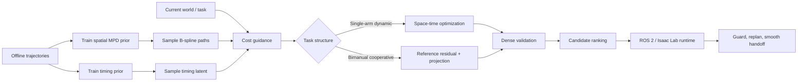
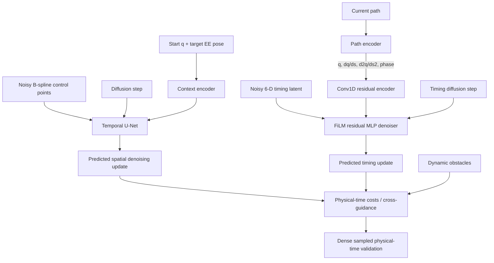
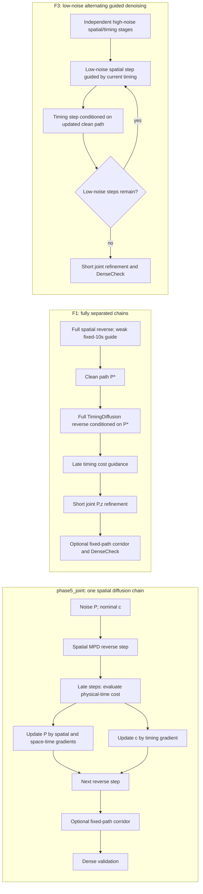
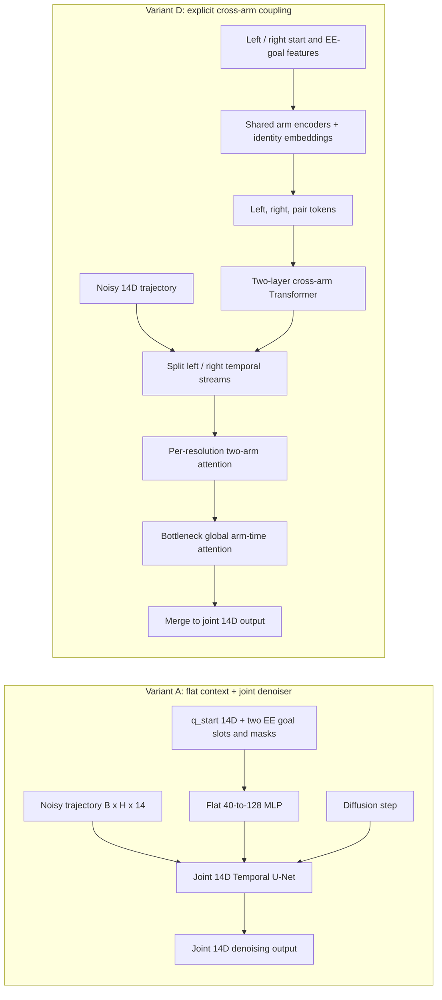
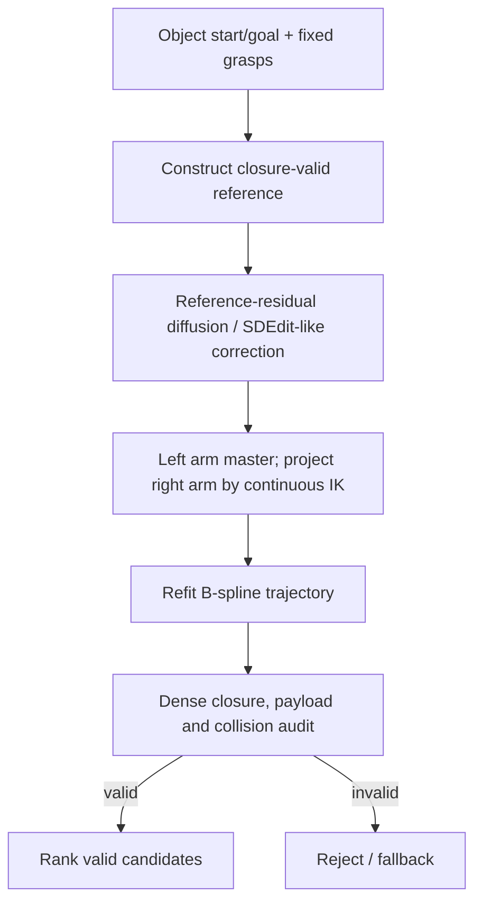
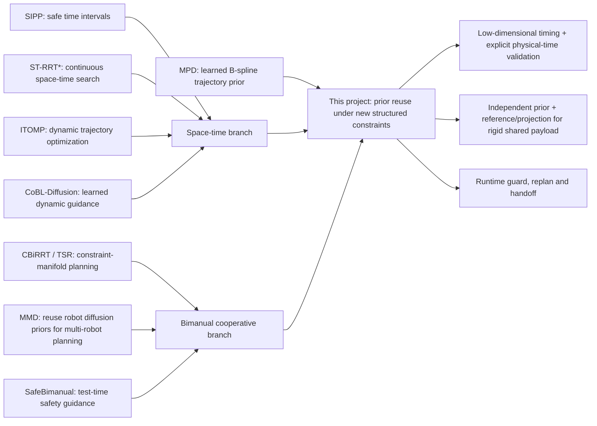
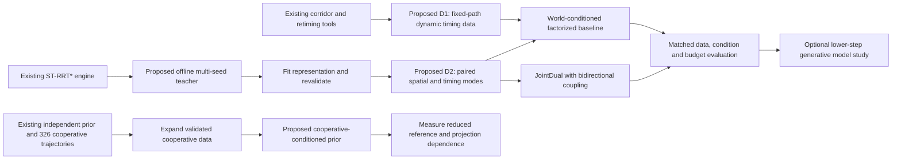

# MPD 项目正式汇报初稿

> 审计日期：2026-09-30
>
> 用途：与导师正式汇报项目完成情况，并据此制作 PPT。
>
> 证据口径：分别标注“实现完成”“已测范围”“尚待验证”；实现完成但评估不充分，不等于功能未实现。设计方案与训练设想标为 Proposed。本文是英文 PPT 的内容依据，第 13 节可直接交给 GPT 继续制作。

## 1. 建议的项目定位

### 汇报标题

**Extending Motion Planning Diffusion to Structured Space–Time and Bimanual Constraints**  
中文可用：**面向时空与双臂结构约束的扩散运动规划扩展**

### 一句话主线

本项目研究的是：**在尽量保留预训练运动扩散先验的前提下，如何在推理阶段引入新的结构化约束，并把方法推进到可验证、可运行的机械臂规划系统。**

这里的两类结构化约束是：

1. 单臂动态场景中的**空间—物理时间耦合**：同一条几何路径，经过障碍区域的时刻不同，碰撞结果也不同；
2. 双臂刚性协作中的**跨机械臂闭链耦合**：两条单臂轨迹必须在整个运动过程中同时满足共同负载、相对抓取位姿与碰撞约束。

这条叙事比“做了若干独立功能”更适合作为正式汇报主线。单臂动态规划和双臂协作不是两个无关项目，而是同一个问题的两种实例：**原有 learned prior 不包含新约束时，如何通过表示、引导、投影、验证和运行时机制完成适配。**

这里复用的是各任务已有的空间 prior：单臂沿用 Panda 空间模型；双臂先训练 14-DoF independent prior，再将该 prior 用于 cooperative 推理。不能画成“同一个单臂 checkpoint 直接变成双臂模型”。两条任务线共享研究问题与部分工具，不是同一个联合训练系统。

### 不应使用的主张

- 不把 corridor 写成已经带来成功率提升：实现与计算优化已完成，现有 30 组在线配对没有一致增益；计划矩阵尚未补齐，不能写成仍有进程正在运行。
- 不把 F1/F2/F3 称为 JointDual：它们仍是空间扩散模型与 timing diffusion 的因子化组合。
- 不说已经完成 Flow Matching：仓库里没有对应训练器、网络和正式实验。
- 不说当前 cooperative planner 学会了闭链协作分布：现有正式 benchmark 使用 independent prior，并依赖 reference-residual 与 projection。
- 不把当前结果扩展成动力学、力控或柔顺操作结论：目前验证主要是几何与运动学层面。
- 不把 Isaac Lab、fake-hardware 或 replay 结果表述为真实硬件实验。

## 2. 当前仓库状态审计

| 模块 | 当前状态 | 可在主汇报中如何表述 | 主要证据 |
|---|---|---|---|
| 原始 MPD 复现与扩展 | 已完成 | 以 B-spline 控制点为低维轨迹变量，结合扩散先验、可微代价引导与最终验证 | 原 MPD 代码路径及 [MPD 论文](https://arxiv.org/abs/2412.19948) |
| 引导梯度加速 | 已完成并有正式 ablation | 用 active-set / link-sparse pruning 降低无效碰撞梯度计算；在 7 个场景中保持判定一致 | `GRADIENT_PRUNING_B0_B7_MULTI_SCENE_RESULTS_20260807.md` |
| 单臂显式时序 | 已完成并有系统 benchmark | 将空间路径与物理时序分离；支持显式时序优化及动态障碍代价 | `space_time_guidance.py`、120-environment benchmark |
| Learned timing（F1/F2/F3） | 已完成并有系统 benchmark | 6 维 timing latent 的 diffusion prior；三种空间—时序组合采样方式 | `mpd/timing_training/`、factorized benchmark |
| Factorized 推理优化 | 已实现；有冻结请求分阶段测试 | timing-only 梯度、固定路径空间量缓存、路径编码缓存；当前三个 mode 默认均全开 | `FACTORIZED_TIMING_OPTIMIZATION_REPORT.md`、`factorized_sampler.py` |
| Time corridor | **已实现；已有 30 组部分在线配对** | 已完成 safe interval、可达分支、corridor cost、fixed-path refinement、`batch_exact` 与 K-best/DP 可选项；当前有限测试未显示稳定的覆盖或成功率增益 | `time_corridor.py`、`TIMECORRIDOR_SPEED_FIRST_IMPLEMENTATION_REPORT.md`、`FACTORIZED_CORRIDOR_BRANCH_STUDY.md` |
| 14-DoF 独立双臂 MPD | 已完成并有 benchmark | 构建 19.94 万条 independent 双臂轨迹，比较 A–D 四类跨臂建模结构 | 数据 summary、region benchmark、网络变体说明 |
| 双臂刚性协作推理 | 已完成并有 ablation/benchmark | 使用闭链 reference、reference-residual 扩散修正、非对称投影与 dense audit，将 independent prior 适配到 cooperative task | cooperative ablation 与 9-checkpoint benchmark |
| Cooperative 数据 | 已有小规模数据，尚未形成正式 learned cooperative prior | 已生成 100 contexts、326 trajectories；未找到用该 Warehouse cooperative 数据训练并验证的 checkpoint | cooperative `generation_summary.json` |
| ROS 2 / Isaac Lab 运行时 | 主要软件链路已实现 | resident worker、world update、候选选择、碰撞 guard、重规划与平滑 handoff；作为系统工程完成项展示 | `physical_ai_runtime` 中三个 planner adapter；不宣称真机验证 |
| ST-RRT* 在线对照 | 已实现；30 场景中有 28 组完整配对 | 非学习式 space-time baseline；goal reach、动态交互与时延分别报告 | `scripts/runtime/strrt_engine.py`、`todrawer-strrt-motion-aligned/report/` |
| JointDual | 设计阶段 | 作为 future work；需要双向空间—时间交互的联合网络、训练目标和采样器 | `SINGLE_ARM_SPACETIME_TIMECORRIDOR_JOINTDUAL_FLOWMATCHING_DESIGN.md` |
| Flow Matching | 设计阶段 | 在数据和条件对照稳定后，按瓶颈决定是否研究 timing 或 joint 的少步生成 | 同上 |

补充说明：corridor 推荐的显式测试配置是 `batch_exact`、chunk 64；B2/B3 后端和 C1/C2 分支功能已经实现，但对应报告未证明可推广收益，不能写成待实现。最终候选由 DenseCheck 与运行时检查筛选；有限采样、预测模型和 guard 并不构成真实连续时间的安全保证。30 组 corridor 与 28 组 ST-RRT* 配对均为已记录结果，不把尚未补齐的矩阵描述为当前运行中的进程。

### 2.1 全文统一的完成口径

| 容易混淆的说法 | 全文采用的口径 |
|---|---|
| `joint` / `phase5_joint` / JointDual | 前两者是同一现有优化模式的 benchmark/实现名称；JointDual 是未来空间与 timing 双分支联合模型，Dual 不指双臂 |
| F1/F2/F3 与 `c`/`τr` | 前者是采样安排，后者是 timing 表示；同一种安排可以配两种 checkpoint |
| 已有 corridor vs 未来 conditioned timing | 已有推理时 safe intervals、分支搜索与 refinement；未来新增把世界/窗口信息写入数据和网络条件 |
| 配置数量 vs 完成数量 | 主实验有 136 组完整配对；corridor 实际 30 组；ST-RRT* 实际 28 组完整配对，均不把计划总数当完成总数 |
| Goal vs 安全/动态成功 | Goal 只说明到达；`valid_dynamic_success` 还要求 crossing 前明显运动且没有 brake；它仍不等同于物理接触检测 |
| Dense check vs 连续安全证明 | 按实际配置离散加密检查与阈值验收；不声称认证的连续时间无碰撞或真实硬件安全 |
| 已有 ST-RRT* vs 未来 teacher dataset | 在线引擎与对照已完成；批量离线 teacher、多模态筛选、样条再编码数据集和 JointDual 训练尚待新增 |
| Cooperative 成功 vs prior 的净增益 | 当前支持整套 reference-residual + projection 流程；相对 reference+projection 无 diffusion 对照的增益尚未隔离 |

## 3. 英文 PPT 的统一结构（18 页，约 20–25 分钟）

叙事顺序是 **Question → Implemented adaptation → Evidence and limits → New learning problem**。先说明已有先验缺少哪些任务结构，再展示两条任务线的适配与实验，最后让 future work 回答实验留下的问题。正文不按文件、开发日期或 phase 编号顺序讲。

| 页 | 建议英文标题 | 唯一要传达的观点 / 主视觉 | 依据 |
|---:|---|---|---|
| 1 | Extending Motion Planning Diffusion to Structured Constraints | 单臂动态与双臂刚性协作，两张真实任务图 | 第 1 节 |
| 2 | How far can we reuse a learned motion prior? | 同一研究问题对应“何时通过”与“如何保持闭链” | 4.1–4.3 |
| 3 | Our starting point: a spatial diffusion prior | MPD、时空搜索、约束规划各贡献什么；标明本项目新增部分 | 5.1、6.2 |
| 4 | Make timing explicit while retaining the spatial prior | `P + z → q(t)`；区分 joint optimization 与 factorized diffusion | 4.4、5.2–5.3 |
| 5 | Evaluate completion, timing, and execution separately | 世界启动→首个 result→接受/交接→运动→goal；定义三个成功指标 | 7.2、12.1 |
| 6 | Learned timing exposes a completion–duration trade-off | 136 配对主实验；goal rate、成功样本 duration、inference 三个小图 | 7.2 主表 |
| 7 | ST-RRT* reaches goals, but often after the crossing | 28 配对的 goal 与有效动态成功；25 共同成功场景质量对照 | 7.2 ST-RRT* |
| 8 | Time corridors add structure; gains remain limited | phase–time 示意 + 30 配对 on/off；已实现与评估结论各一句 | 4.5、7.2–7.3 |
| 9 | Reduce guidance cost before increasing model complexity | B0/B3 正式多场景加速；factorized 缓存作为单请求补充 | 7.1、7.1.1 |
| 10 | Build an independent 14-DoF prior for bimanual motion | 数据、A/D 架构简图、19/21 region 结果及任务集边界 | 5.4、7.4 |
| 11 | Rigid cooperation requires explicit closure correction | reference→residual→projection→dense audit | 4.6、5.5 |
| 12 | Reference and projection work together in this pipeline | 完整 2×2 ablation；合并难度为 0/120 vs 102/120，附分层 | 7.5 |
| 13 | Several checkpoints reach 81.7%, with different costs | 全部 9 checkpoint 成功率；A/D 与 B/C 都可见 | 7.6 |
| 14 | Runtime feasibility extends beyond the planner output | 单臂 runtime；分清模型、worker、handoff、执行时钟 | 2、10、12.1 |
| 15 | What is established, and what remains unproven? | Evidence / Interpretation / Missing control 三列，不重复实验全表 | 7.8、8 |
| 16 | Proposed: learn joint decisions from validated teachers | ST-RRT* + corridor teacher→编码重验→D1/D2→JointDual | 9.1–9.3 |
| 17 | Test learned structure under matched conditions | 新数据、world 条件、双向耦合分别消融；cooperative 学习路线 | 9.3–9.4 |
| 18 | Reuse works; learning the missing structure is next | 三条已证实结论与一条明确 proposed 下一步 | 11 |

转场示例：第 6→7 页 “How does this compare with a non-learning space-time planner?”；第 8→9 页 “Before adding model capacity, we can remove avoidable computation.”；第 9→10 页 “Timing is one missing structure; rigid closure is another.”；第 15→16 页 “The next step is to learn the decisions that are currently supplied by search and correction.”

15 分钟版本保留第 1–8、11–13、15–18 页中的核心内容，将第 3 页相关工作并入第 2 页，将第 9、10、14 页放附录，合并第 16–17 页。不要通过缩小字体在一页塞入全部表格。每页可直接使用的英文内容与 GPT 交付要求见第 13 节。

## 4. Motivation 与问题表述

### 4.1 建议的 motivation 叙事

1. **MPD 的优势**：学习到的轨迹先验能够快速提出平滑、任务相关的候选，并通过代价引导适应测试时约束。
2. **现有边界**：原始先验主要描述空间轨迹；实际部署还需要处理物理时间、动态障碍、双臂互相影响及刚性负载闭链。
3. **简单扩维的困难**：把所有变量直接拼成一个大向量会增加数据与训练成本，而且新约束未必存在于原始训练分布。
4. **本项目假设**：保留已有空间运动知识，把新增结构编码成低维 timing latent、推理期代价、显式投影和严格验证，可以更经济地扩展规划能力。
5. **研究问题**：这种“prior reuse + structured correction”的方式能走多远？在哪些约束下足够，在哪些约束下必须把新结构重新写入训练数据与模型？

最后一句自然引出结果：单臂实验显示 completion–duration trade-off；双臂协作中，reference 与 projection 在已测流程内共同起作用。它们提示当前适配的依赖和失败模式，尚不能证明所有推理期方法存在同一能力上限。

### 4.2 本项目可以解决、以及预期解决的问题

贡献定位是：**在所选 MPD 基础与机器人任务上，实现并评估“空间 prior + 显式时序”及“independent 双臂 prior + 闭链修正”两条适配流程。** 相关工作提供生成、时空搜索、约束规划与安全引导的不同工具；本项目通过匹配任务、条件和验收过程研究这些工具的组合，不以“其他方法都无法覆盖”代替文献与实验证据。

| 问题 | 现有方法留下的缺口 | 本项目当前能够解决什么 | 预期进一步解决什么 |
|---|---|---|---|
| 静态空间 prior 无法判断“何时经过” | 原始 MPD 主要生成几何路径；仅沿路径做固定速度执行，无法利用等待、加速或减速避开运动障碍 | 保留空间 MPD，通过低维 timing latent 和 physical-time cost，为每个候选联合决定路径与执行时序 | 用 corridor-conditioned timing 和 JointDual 学习 early/late passing 等多模态，并在 timing 无解时反向修改空间路径 |
| 传统时空搜索不利用任务运动先验 | SIPP / ST-RRT* 能处理动态可达性，但不直接利用预训练机械臂轨迹分布；连续高维机械臂搜索仍可能昂贵 | 由 learned prior 提供少量高质量空间候选，再优化物理时序；已实现 time corridor 约束固定路径的到达时刻 | 继续验证 corridor 在真正多时间模态任务中的覆盖收益，并把 corridor condition 输入 timing model |
| 纯局部轨迹优化依赖初值 | ITOMP、GPU trajectory optimization 等方法很强，但结果可能受 seed、局部极小值和候选覆盖影响 | 扩散 prior 提供多样候选，cost guidance、批量验证与 ranking 负责测试时约束 | 形成固定候选预算下，与 sampling / optimization baseline 的完整成功率—延迟对照 |
| Independent 双臂轨迹不满足刚性协作 | 一般多机器人协调主要处理互相碰撞；两臂共同搬运还要求全过程保持相对抓取位姿并验证 payload | 在固定抓取假设下，以 closure-valid reference、residual correction、closed-chain projection 和 dense audit 适配 independent prior | 将 cooperative 数据写入生成 prior，提高直接产生 closure-consistent 候选的比例，减少强 reference 与高频 projection 依赖 |
| 离线可行轨迹不等于可部署规划 | 许多论文以离线 success 为终点，未覆盖动态 world age、deadline、handoff 和执行中 guard | 已实现 resident inference、候选验证、world update、replan、平滑 handoff 与 braking 软件链路 | 补充 warm-latency、replan-to-handoff 和真实硬件鲁棒性实验 |

因此，本项目的核心价值不是提出一个可以替代所有规划器的单一模型，而是给出一条**从已有 learned prior 到新约束任务的渐进式适配路径**：先用低维结构变量、引导和投影获得可用系统，再根据消融暴露出的瓶颈，把 timing corridor 或 cooperative structure 纳入数据与模型。

可在 Motivation 页用一句话概括：

> We study how learned spatial motion priors can be reused when a task additionally requires physical-time decisions or rigid bimanual closure. Our focus is the adaptation and validation of these priors under the two constraint settings.

这是项目研究范围，不是“此前无人解决该能力组合”的 novelty 证明。相关工作按输入、任务与约束对齐比较，不因论文未采用本项目接口就宣称其方法不能完成任务。

### 4.3 统一问题

用 B-spline 控制点 $P$ 表示几何路径：

\[
q(s)=B(s)P,\qquad s\in[0,1].
\]

预训练扩散模型给出条件轨迹先验 $p_\theta(P\mid b)$，其中 $b$ 是起终点/任务条件，避免与 timing 控制点 $c$ 混淆。推理目标可概念性地写成：

\[
\min_{P,z}\;-\log p_\theta(P\mid b)+\lambda J(P,z;\mathcal W)
\quad\text{s.t.}\quad g(P,z;\mathcal W)\le 0,\;h(P,z)=0,
\]

其中 $z$ 是新增的低维结构变量，$\mathcal W$ 是规划时的世界状态；单臂动态任务中 $z$ 表示时序，双臂任务中 $h=0$ 表示闭链约束，并不必然需要额外 $z$。这是用于解释 prior 与约束关系的概念目标；当前 guided denoising 并不显式精确求解此 MAP 问题，DenseCheck 也不证明全局最优。

### 4.4 单臂 space–time formulation

保持几何路径 $q(s)$，另用单调 timing law 把路径相位映射到物理时间。

#### `c` 表示：直接参数化正 timing density

完整 timing spline 使用 8 个控制点：

\[
g(s;c)=B_t(s)c,\qquad
u(s;c)=\frac{dt}{ds}=u_{\min}+\operatorname{softplus}(g(s;c)),
\]

\[
t(s;c)=\int_0^s u(\xi;c)d\xi.
\]

端点约束为 $c_1=c_0$、$c_6=c_7$，使 $u_s(0)=u_s(1)=0$。TimingDiffusion 实际学习的六维向量是

\[
z_c=[c_0,c_2,c_3,c_4,c_5,c_7],
\]

解码后恢复为 $[c_0,c_0,c_2,c_3,c_4,c_5,c_7,c_7]$。`phase5_joint` 则直接维护完整 $c$，并在优化时冻结首尾各两个控制点。

#### `tau_r` 表示：分离总时长和相对 timing shape

令五维 $r$ 经过 gauge-fixed spline 得到归一化正密度

\[
\pi(s;r)=\epsilon+(1-\epsilon)
\frac{\exp(B_t(s)\tilde r)}{\int_0^1\exp(B_t(\xi)\tilde r)d\xi},
\quad
\tilde r=[0,0,r_1,r_2,r_3,r_4,r_5,r_5].
\]

根据路径和该 shape 计算满足采样速度/加速度限制的下界 $T_{\min}(P,r)$：

\[
T_v=\max_{s,j}\frac{|q_{s,j}|}{\pi\,\dot q_j^{\max}},\qquad
T_a=\sqrt{\max_{s,j}
\frac{|q_{ss,j}/\pi^2-q_{s,j}\pi_s/\pi^3|}{\ddot q_j^{\max}}},
\]

\[
T_{\min}=\max(T_{floor},\kappa T_v,\kappa T_a).
\]

六维 latent 为 $z_{\tau r}=[\tau,r_1,\ldots,r_5]$，其中

\[
y=\sigma(\tau),\qquad
T=T_{\min}+y(T_{\max}-T_{\min}),
\]

\[
u(s)=T\pi(s;r),\qquad t(s)=T\int_0^s\pi(\xi;r)d\xi.
\]

因此 `tau_r` 把“总时长选择”和“沿路径在哪里减速”分开；`c` 更直接，但整体尺度与局部 shape 耦合在同一组控制点中。

上述可行时长区间要求 $T_{\min}\le T_{\max}$；下界来自采样点与运动学限制，仍需最终验证。$s$ 是路径相位，diffusion step 是噪声迭代步，两者均不是物理秒数。若世界快照时刻为 $t_W$、执行开始为 $t_E$，动态查询应使用 $\Delta+t(s)$，其中 $\Delta=t_E-t_W$；推理延迟、bridge/hold 与到达时刻必须使用一致时钟。

#### 联合物理代价

两种表示最终都解码成相同的 $t(s)$，并使用：

\[
J_{ST}=w_{dyn}J_{dynamic}(q(s),t(s))
+w_vJ_{velocity}+w_aJ_{acceleration}
+w_TT+w_sJ_{timing\ smoothness}.
\]

核心不是只找 collision-free path，而是同时选择**从哪里走**和**何时经过那里**。当前 timing network 只以 path 为条件，没有直接看到 dynamic world 或 corridor，因此相同路径在不同障碍时序下可能得到相同 timing prior；这是后续 corridor-conditioned timing 的主要动机。

#### Timing model 的训练数据从哪里来

训练数据从 Warehouse HDF5 的静态可行 `sol_path` 开始：先拟合空间 B-spline $P[29,7]$，再用 TOPP-RA 和 Panda 运动限制生成可行 retiming；将其拟合为 runtime `c[8]`，并生成 `fast_anchor`、1.5/2.0/2.5 倍全局减速、`local_slowdown` 和 `near_wait` 变体。每条记录重新检查 joint position、velocity、acceleration 和 14 s horizon。

`tau_r` 数据再从这些 $c$ 曲线拟合五维 shape $r$，计算 $T_{\min}(P,r)$，并对 eligible shape 展开

\[
y\in\{0.01,0.05,0.15,0.35,0.60\},\qquad \tau=\operatorname{logit}(y).
\]

同一 base path、反向路径和所有 timing variants 放在同一 train/validation/test split，避免路径泄漏。当前数据提供的是**运动学可行的多 timing teacher**，没有把当前 dynamic world 或 corridor 作为模型条件，这也解释了 learned timing 在动态测试中的局限。

### 4.5 Time corridor cost 与本项目实现

对固定空间路径 $P$，在采样 phase $s_i$ 上选择一个可达安全时间区间 $[l_i,u_i]$。若当前 timing 的到达时刻为 $t_i=t(s_i)$，corridor penalty 为

\[
J_{corr}=\frac{1}{M}\sum_{i=1}^{M}
\left[\operatorname{ReLU}(l_i-t_i)^2+
\operatorname{ReLU}(t_i-u_i)^2\right],
\]

并优化 $J_{total}=J_{ST}+\lambda_{corr}J_{corr}$。

本项目中的实现流程是：

1. 固定 $P$，默认取 32 个 phase points，并以 0.2 s 网格查询动态世界中所有 collision spheres 的 signed distance；
2. 结合碰撞 margin 得到每个 phase 的 safe intervals，并由关节速度限制给出相邻 phase 的最小时间步数；
3. 用动态规划连接可达 intervals，默认搜索贴近当前 timing、偏早和偏晚三种分支；K-best 与 DP 初始化作为可选实验项；
4. 对 `phase5_joint` 的物理 $c$ 或 F1 checkpoint 的标准化六维 latent 做 fixed-path Adam refinement；默认 $\lambda_{corr}=0.1$、20 steps、learning rate 0.04；
5. 按原精确物理代价选择结果，最后仍执行原 DenseCheck，不把离散 corridor 可达当作连续安全证明。

实现、`batch_exact` 加速与相关测试已经完成，在线已有第 7.2 节的 30 组配对。K-best 在所测冻结请求中增加了分支数，但没有救回额外候选。因此当前结论是“提供显式时间窗口结构，当前已测范围没有一致任务增益”。本文的 Corridor A cost 与 speed-first 计划的 Stage C（DP 初始化/K-best）是两个命名维度；二者都已实现，不把 Stage C 再列为未来开发。

### 4.6 双臂 cooperative formulation

双臂状态为 $q=[q_L,q_R]\in\mathbb R^{14}$。固定抓取下，共同物体要求左右末端之间的相对变换在整条轨迹上保持一致：

\[
h(q_L(s),q_R(s))=
\operatorname{Log}\!\left(
T_L(q_L(s))^{-1}T_R(q_R(s))T_{LR}^{*-1}
\right)=0.
\]

同时满足关节限制、自碰撞、环境碰撞和 payload 碰撞。当前做法不是训练一个真正的 closed-chain prior，而是：

- 先构造 closure-valid reference；
- independent bimanual diffusion prior 在 reference 附近生成 residual；
- 以左臂为 master，对右臂做连续 IK projection；
- 对投影轨迹重新拟合，并进行 dense closure / payload / collision audit。

投影是数值修正，不应表述为连续流形上的理论保证。

## 5. 建议放入 PPT 的图

以下 Mermaid 图可直接作为绘图草稿，正式 PPT 建议重新绘制成统一配色的矢量图。

### 5.1 项目总流程图



图中 `Train timing prior` 只适用于 factorized timing 方法；cooperative 正式结果仍使用 independent spatial prior。

该图是方法族的概念总览。单臂在线 benchmark 支持 ROS 2/Isaac Lab 时序结论，双臂 region/cooperative 表支持离线请求与 replay 的结论；不能据此推断每个双臂模型都已跑过相同在线 runtime 矩阵。

### 5.2 单臂模型结构图



需要在图旁明确写：空间 MPD 默认 context 不含 scene geometry；动态世界主要通过 inference-time cost 进入。timing denoiser 目前也没有 corridor/world condition。

### 5.3 单臂 `phase5_joint`、F1 与 F3 推理流程图



准确口径：`phase5_joint` 没有 TimingDiffusion，它在 spatial diffusion 的 guide 内优化 $c$；F1/F3 才加载独立的 path-conditioned timing checkpoint。F3 是 alternating guided denoising，不称为严格 Gibbs sampler。

F2 是分阶段交替：在路径固定时运行 timing 子链，再更新空间路径，随后重建依赖路径的缓存。F1、F2、F3 是采样策略，均可用 `c` 或 `τr` 表示；checkpoint 名称与采样策略分别报告。

### 5.4 双臂 Variant A 与 D 模型结构图



两者使用相同的 14-DoF 轨迹、扩散过程和 loss。A 的 context 与轨迹都较早扁平融合，约 4.57M parameters；D 保留左右臂与 pair token，并在多个时间分辨率显式交换信息，约 6.86M parameters。D 不是参数量匹配消融，因此结果页仍应同时报告延迟和模型规模。

### 5.5 Cooperative 推理算法流程图



此图应该紧接 cooperative ablation，因为结果直接说明 `RR` 与 `PR` 两个模块都不是可选装饰。

### 5.6 Time-corridor 图应画什么

画一个二维 $s$–$t$ 平面：横轴 path phase，纵轴 physical time。

- 障碍物造成的 forbidden regions 用红色表示；
- 每个 phase 的 safe intervals 用白色纵向区间表示；
- interval 之间的可达连接构成分支图；
- 当前 timing curve 是从左下到右上的单调曲线；
- corridor cost 把曲线拉回选中的可达分支；图旁可放第 4.5 节的 hinge-squared interval penalty。

右上角标注：**Implemented. Thirty paired online runs show no consistent task gain.** 不把 safe intervals、离散 DP 连通或图中的连续曲线当作连续无碰撞证明。

## 6. Related work：主幻灯片放哪些论文

### 6.1 主图的组织方式



### 6.2 建议正文保留的论文

| 方向 | 论文 | 与本工作的关系 | 放置位置 |
|---|---|---|---|
| 基础方法 | [Motion Planning Diffusion](https://arxiv.org/abs/2412.19948) | 低维 B-spline 轨迹扩散先验与推理期 cost guidance；本项目的直接基础 | Baseline 页 |
| 时间区间 | [SIPP](https://www.cs.cmu.edu/~maxim/files/sipp_icra11.pdf) | safe interval 的经典离散抽象；启发 time corridor，但本项目作用于连续机械臂路径的 phase–time 表示 | Related work / corridor 页 |
| 连续时空搜索 | [ST-RRT*](https://arxiv.org/abs/2203.02176) | 在连续 state-time 中处理动态障碍与未知到达时间；是非学习式动态规划基线代表 | Related work 页 |
| 动态轨迹优化 | [ITOMP](https://ojs.aaai.org/index.php/ICAPS/article/view/13513) | 动态环境中的增量优化与执行耦合；对比本项目“learned proposal + guidance/runtime” | Related work 页 |
| 学习式动态规划 | [CoBL-Diffusion](https://arxiv.org/abs/2406.05309) | 用 barrier/Lyapunov guidance 处理动态多智能体约束；相关但任务不是高维机械臂操作 | Related work 页，注明任务差异 |
| 约束流形规划 | [CBiRRT / Task Space Regions](https://publications.ri.cmu.edu/task-space-regions-a-framework-for-pose-constrained-manipulation-planning) | 经典 pose-constrained / manifold planning；解释 projection/reference 的来源与差异 | Cooperative 页 |
| 多机器人 prior 复用 | [MMD](https://arxiv.org/abs/2410.03072) | 用单机器人 diffusion priors 协调多机器人碰撞；不直接处理刚性 shared-object equality | Cooperative related work |
| 双臂测试时安全适配 | [SafeBimanual](https://arxiv.org/abs/2508.18268) | 对预训练双臂 diffusion policy 施加测试时安全代价；与“保留 prior、推理期修正”最接近 | Cooperative related work |

### 6.3 相关方法的任务设定与本项目的评估范围

| 方法类别 | 主要问题与机制 | 与本项目设定的区别 | 本项目评估的部分 |
|---|---|---|---|
| MPD | 学习 B-spline 轨迹 prior，并在推理期加入 differentiable cost | 原始设定没有独立的物理时间决策，也没有 rigid bimanual closure | timing latent、physical-time costs、双臂 reference/projection 和 runtime validation |
| SIPP / ST-RRT* | safe intervals 或连续 state-time search，能够绕开动态障碍 | 不提供由操作任务数据学习的机械臂运动 prior；SIPP 的经典保证基于其离散图设定，不能直接移植为本项目连续高维系统的保证 | 用 learned spatial proposals 缩小搜索范围，并用 continuous phase-time corridor 表达固定路径的安全时序 |
| ITOMP / cuRobo 类优化器 | 高效局部轨迹优化、碰撞和运动约束处理 | 依赖初始解或多 seed，且没有直接回答如何复用已有 diffusion prior 增加任务相关候选覆盖 | generative candidates + guided correction + dense candidate selection；但仍需补直接 baseline 对照 |
| CoBL-Diffusion 等 learned dynamic planning | 将动态安全条件加入 diffusion guidance | 主要实验问题和状态维度与高自由度机械臂操作不同，也没有采用“可复用空间 prior + 独立低维 timing model”的设计 | 针对机械臂 B-spline path 与物理时序的因子化建模和验证 |
| CBiRRT / TSR | 在约束流形上搜索 pose-constrained manipulation path | 不学习任务轨迹分布，每次规划仍主要依靠采样、投影和连接 | 使用 learned bimanual prior 提供候选；同时保留 reference/projection 处理强等式约束 |
| MMD | 复用单机器人 diffusion priors，解决多机器人之间的碰撞协调 | collision coordination 不等同于两臂刚性抓持同一负载；没有直接施加全过程 shared-object equality | 显式 closure constraint、payload collision 与闭链 dense audit |
| SafeBimanual / APEX | 双臂生成或测试时安全适配 | 与本项目的固定双抓取、刚性 shared payload、全过程闭链和 independent-prior reuse 设定不同 | 针对该闭链设定验证 reference-residual 与 projection 的必要性，并规划用 cooperative 数据减少依赖 |

这张表说明本项目的任务与方法选择，不证明其他方法无法完成相同任务。ST-RRT* 已有直接在线对照；仍缺更大且时序严格匹配的统计、trajectory-optimization 对照，以及 cooperative prior 净增益的隔离实验。SafeBimanual 本身也处理双臂安全与物体关系，不能以“其他工作完全不处理协作约束”作区别。

### 6.4 建议只放附录或 future-work 页的论文

- [cuRobo](https://arxiv.org/abs/2310.17274) / [cuRoboV2](https://arxiv.org/abs/2603.05493)：作为 GPU 优化与高自由度规划参考；除非补做直接 benchmark，否则不要在正文造成“已比较”的印象。
- [APEX](https://arxiv.org/abs/2404.02284)：双臂 latent diffusion，可用于补充 learned dual-arm planning 背景；其问题设置与本项目的 rigid shared payload 不完全相同。
- [G2DP](https://arxiv.org/abs/2606.26017)：可微时空 cost volume 对 corridor 表示有启发，但任务是自动驾驶，适合 future-work 页。
- [FlowMP](https://arxiv.org/abs/2503.06135) 与 [SafeFlow](https://arxiv.org/abs/2504.08661)：只在 Flow Matching future-work 中引用，不应写成当前方法组成。

相关工作页的重点应是“问题轴与方法轴”，不是论文数量。正文 7 篇左右已经足够。

## 7. 可以正式展示的实验结果

### 7.1 引导梯度加速：完整多场景 ablation

实验覆盖 7 个场景、8 个变体、3 次 timing repeats，共 168/168 次 CUDA runs。相对未裁剪基线 B0，推荐展示 B3（link-sparse）：

| 指标 | B0 | B3 | B3 相对结果 |
|---|---:|---:|---:|
| Guidance time | 0.4646 s | 0.2794 s | 1.668× speedup |
| Inference speedup | — | — | 1.561× |
| Total speedup（含 dense validation） | — | — | 1.341× |
| Valid / collision decisions | 7 个场景基线 | 与 B0 一致 | 无变化 |

表述边界：该实验支持“在这些场景中减少引导计算且不改变最终判定”，不支持对所有任务的普遍无损保证。重复实验使用相同 seed，适合做性能稳定性统计，不是独立规划成功率估计。

统计细节：时间列是 7 场景各自 3 次运行中位数的算术平均；speedup 是逐场景比值的几何平均，因此不能直接用两列平均时间相除替代所报 speedup。此处 Total 是包含 dense validation 的离线计算，不是完整机器人任务的端到端耗时。

#### 7.1.1 Factorized 推理优化：已完成的工程证据

三项优化均已实现，当前 F1/F2/F3 默认均开启；不再放入 future work。关闭 corridor 的同一困难冻结请求中，`c` 模型每组 3 次的完整离线请求中位数如下。这里展示的是报告中的累计开关测试，全开列与当前默认组合一致。

| 策略 | 三项全关 | 三项全开 | 同请求状态/有效候选 |
|---|---:|---:|---|
| F1-c | 1.140 s | 0.711 s | success；8 个保持不变 |
| F2-c | 1.802 s | 1.186 s | success；10 个保持不变 |
| F3-c | 0.831 s | 0.685 s | success；10 个保持不变 |

结论是“减少重复求导、FK/空间量计算和条件编码在该输入上降低计算耗时”，不是跨场景成功率提升。`τr` 的额外两次交叉验证使用历史筛选组合，不作为现行全开默认的完整验证。该消融与 7.2 主实验属于不同数据源，不能把它的时间替换进主表。来源：`docs/FACTORIZED_TIMING_OPTIMIZATION_REPORT.md`。

### 7.2 单臂动态：120 个冻结环境 benchmark 与补充对照

主实验配置为 120 个固定环境（12 categories × 10），每种模式 3 repeats，日志共发现 1257 runs；下表所有指标均来自 136 个配置完整的 paired groups（`motion_aligned`）。执行时间和关节空间 L2 路径长度（rad）只在到达 goal 的 runs 上取均值，不能把较短执行时间单独解释为整体更优。`Mean inference` 先对每个 run 的成功规划 result 取 `inference_total_sec` 均值，再对 runs 等权平均；不含 IPC/写盘，也不是从世界启动到首个 plan 完成的延迟。

| 方法 | Goal reached | 成功轨迹执行时长 | Path length（L2, rad） | Mean inference |
|---|---:|---:|---:|---:|
| phase4 | 130/136（95.6%） | 12.131 s | 4.976 | 0.255 s |
| phase4_aligned | 133/136（97.8%） | 10.952 s | 4.693 | 0.454 s |
| joint | 132/136（97.1%） | **10.681 s** | 5.201 | 0.372 s |
| F1-c | 94/136（69.1%） | 5.703 s | 4.348 | 1.041 s |
| F2-c | 92/136（67.6%） | **5.576 s** | 4.364 | 1.799 s |
| F3-c | 92/136（67.6%） | 5.810 s | 4.342 | 0.752 s |
| F1-τr | 113/136（83.1%） | 9.165 s | 4.309 | 1.054 s |
| F2-τr | **114/136（83.8%）** | 9.220 s | **4.285** | 1.835 s |
| F3-τr | 110/136（80.9%） | **9.119 s** | 4.296 | 0.758 s |

来源：`scripts/isaaclab/logs/todrawer-factorized-c-tau-r-120x3x9-v2/report/summary.json`。Factorized 的 inference 已统一回退到此主实验，不再混用 `todrawer-median-source` 的 5 场景耗时。

主实验的结论：

- phase4、phase4_aligned、joint 的 goal reach 均为 95.6%–97.8%；joint 相对 phase4_aligned 的成功轨迹执行时间略短（10.681 vs 10.952 s），但 L2 路径更长（5.201 vs 4.693 rad），不存在“时间、长度都占优”的结论。
- learned `c` timing 的 goal reach 为 67.6%–69.1%，虽然成功样本执行时间仅 5.576–5.810 s、路径约 4.34 rad，但其成功率明显低于 joint 的 97.1%；`τr` 提升到 80.9%–83.8%，成功样本约 9.12–9.22 s、4.28–4.31 rad，仍有成功率—时间—长度权衡。
- 在相同主实验中，factorized 的平均成功规划 inference 为 0.752–1.835 s，高于 joint 的 0.372 s；F1/F2/F3 的速度不能只按成功轨迹执行时间判断。

**Corridor on/off（`todrawer-corridor-compare`，不并入主表）。** 该 `motion_aligned` suite 配置为 50 个冻结环境、每环境 2 repeats；现有报告只包含其中 30 个场景的第 0 次 repeat，即每 mode 30 runs、30 组完整配对，而非计划中的 100 组。表内执行时间和路径长度只取两种设置**都到达 goal** 的共同成功场景：joint 对 27 组、F1-c 对 13 组、F1-τr 对 17 组；成功率、有效动态成功、成功规划 inference 和首次 plan 时间取各 mode 的全部 30 组。`有效动态成功` 还要求 crossing 前机械臂已明显运动且全程没有 brake。各 mode 的 crossing-time 校准不同，因此配对的是冻结场景/seed，不是完全相同的障碍物时序。

| 模式 | Goal reached | 有效动态成功 | 双成功执行时长 | 双成功 path L2（rad） | Mean inference | 首个 plan 完成均值 |
|---|---:|---:|---:|---:|---:|---:|
| joint | 29/30 | 23/30 | 11.066 s | 5.220 | 0.657 s | 1.961 s |
| joint + corridor | 28/30 | 24/30 | 11.424 s | 5.221 | 0.654 s | 2.358 s |
| F1-c | 16/30 | 9/30 | 5.953 s | 4.526 | 1.145 s | 2.297 s |
| F1-c + corridor | 16/30 | 11/30 | 6.397 s | 4.527 | 1.159 s | 2.684 s |
| F1-τr | 20/30 | 15/30 | 8.889 s | 4.359 | 1.103 s | 2.242 s |
| F1-τr + corridor | 18/30 | 14/30 | 9.159 s | 4.367 | 1.099 s | 2.592 s |

三组 on/off 的 goal reach 分别为 29→28、16→16、20→18；有效动态成功为 23→24、9→11、15→14，没有一致的成功率增益。共同成功场景中的路径长度几乎不变（差值均不超过 0.008 rad），执行时间则均略增。成功规划 inference 均值差异仅为约 -0.004 至 +0.014 s，但首个 plan 完成均值晚约 0.35–0.40 s；这两个 time 指标口径不同。30 组只覆盖部分计划矩阵，尚不足以断言 corridor 普遍有效或无效。来源：`scripts/isaaclab/logs/todrawer-corridor-compare/report/summary.json`、`scripts/isaaclab/logs/todrawer-corridor-compare/report/runs.csv`。

**ST-RRT\* 对照（`todrawer-strrt-motion-aligned`，不并入 120 环境主表）：** suite 有 30 个场景、各 1 次；其中 28 组 joint 与 ST-RRT\* 都有 manifest。成功率等计数使用这 28 组；执行时间和路径长度仅使用双方**都到达 goal** 的 25 组，避免成功样本集合不同造成的均值偏差。成功规划 inference 与首个 plan 时间使用 28 组完整配对。

| 方法 | Goal reached | 有效动态成功 | 双成功执行时长 | 双成功 path L2（rad） | Mean inference | 首个 plan 完成均值 |
|---|---:|---:|---:|---:|---:|---:|
| joint | 28/28 | 23/28 | 11.004 s | 5.226 | 0.660 s | 1.971 s |
| ST-RRT\* | 25/28 | 3/28 | 11.242 s | 5.328 | 1.470 s | 2.310 s |

该对照的 goal reach 为 100% vs 89.3%，ST-RRT\* 少到达 3 次；在 25 个双方均到达的场景中，它的执行时间长 2.2%、L2 路径长 1.9%，方向上略逊于 joint，但差距不大。成功规划 inference 均值约为 joint 的 2.23 倍，首个 plan 平均晚 0.339 s。更大的差异是有效动态成功 23/28 vs 3/28：虽然 goal reach 接近，ST-RRT\* 往往在 crossing 后才开始明显运动，不能把 goal reach 等同于动态交互成功。2 个 ST-RRT\* 运行缺少 manifest，已从完整配对中排除；样本量和 mode-specific crossing 校准仍限制泛化结论。来源：`scripts/isaaclab/logs/todrawer-strrt-motion-aligned/report/summary.json`、`scripts/isaaclab/logs/todrawer-strrt-motion-aligned/report/runs.csv`。

主表是 corridor 之前的统一 baseline；报告时应分开展示上述三组数据，避免把不同协议、场景数、时间校准规则和成功判据混合排名。

### 7.3 Time corridor：已完成实现，已有部分效果评估

目前可报告两点：第一，`batch_exact` 已消除原串行实现的主要计算瓶颈；同一冻结请求的中位完整计算由约 19.875 s 降至 1.636 s，67 个有效候选保持不变。第二，当前有限 F1 冻结请求中，扩大到 K-best 分支没有增加最终有效候选，备选分支救回数为 0；7.2 的 30 组在线配对也没有显示 corridor on/off 的一致成功率或路径长度收益。

PPT 的结果句应为：**The implemented corridor adds explicit time-window structure, but the evaluated cases show no consistent task-level gain.** “原 cost/refinement 已覆盖多数可修复情况”只是待检验的解释；场景模式覆盖、六维拟合能力和在线延迟也可能影响结果。现有日志不能在这些原因之间作因果归因。

### 7.4 独立双臂：region benchmark

21 个 planning-evaluable requests；每个请求最多 4 batches × 32 candidates。推荐只展示代表性的 D checkpoint，避免把整张 checkpoint 表塞进正文：

| Model | Overall | In-distribution | Structured OOD | Strict random OOD | Mixed / shared workspace | Mean wall time |
|---|---:|---:|---:|---:|---:|---:|
| D-305k | 18/21 | 6/6 | 3/4 | 4/5 | 4/5 | 17.29 s |
| D-600k | **19/21** | 6/6 | 4/4 | 4/5 | 4/5 | **15.77 s** |
| D-665k | **19/21** | 6/6 | 4/4 | 4/5 | 4/5 | 17.71 s |

限制：任务集较小，wall time 含启动开销；有一个 endpoint sampling shortfall 未进入 planning-evaluable denominator。因此应称为 task-suite result，而不是广义 OOD 泛化证明。

分层列共覆盖 20 个请求，另有 1 个 `dataset_exact` 请求，三个 D checkpoint 均为 1/1，合计 21。相同日志中的 A-660k/A-835k 均 18/21，B-715k/B-955k 为 14/21、18/21，C-715k/C-835k 为 15/21、16/21；D 的最好值只比 A 多 1 个请求。表中 D 子集用于解释 region 分层，不是严格的架构优越性证明。

### 7.5 Cooperative 组件 ablation

| 生成方式 | Projection | Easy | Medium | Hard |
|---|---|---:|---:|---:|
| Direct project | Off | 0/30 | 0/60 | 0/30 |
| Direct project | On | 0/30 | 0/60 | 0/30 |
| Reference residual | Off | 0/30 | 0/60 | 0/30 |
| Reference residual | On | **28/30** | **52/60** | **22/30** |

结论应写成：

> Ablation showed that neither reference-residual correction nor closed-chain projection alone produced valid cooperative trajectories; successful planning required both mechanisms in the evaluated tasks.

中文讲法：在当前 prior、候选预算和任务集下，只有同时使用 reference-residual 与 projection 的组合得到成功结果；合计为 102/120，其他三种组合均 0/120。这是配置内的经验结论，不是任意算法都必须使用这两项的定理。现有 2×2 消融未包含“同一个 reference + projection、完全不使用 diffusion”的基线，因而不能单凭此表声称 diffusion prior 本身贡献了全部提升。

### 7.6 Cooperative 9-checkpoint benchmark

正式 v2 benchmark 已完成 1080/1080 runs，即 9 checkpoints × 120 tasks；所有模式均启用 reference-residual + projection。正文图应保留全部 checkpoint，避免只挑 A/D 后得出所有结构相当：

| Model | End-to-end success | Planning success* | Mean wall time | Mean valid candidates |
|---|---:|---:|---:|---:|
| A-660k | 98/120 = **81.7%** | 90.7% | **19.08 s** | 4.85 |
| A-835k | 98/120 = **81.7%** | 89.1% | 19.60 s | 5.07 |
| D-600k | 98/120 = **81.7%** | 89.1% | 20.28 s | 5.81 |
| D-665k | 95/120 = 79.2% | 86.4% | 20.44 s | **6.12** |
| D-305k | 96/120 = 80.0% | 86.5% | 19.34 s | 4.95 |
| C-715k | 85/120 = 70.8% | 78.7% | 16.98 s | 2.89 |
| C-835k | 72/120 = 60.0% | 67.9% | 16.36 s | 2.43 |
| B-955k | 66/120 = 55.0% | 59.5% | 16.15 s | 2.18 |
| B-715k | 62/120 = 51.7% | 57.4% | 15.80 s | 2.06 |

\* Planning success 排除了部分 reference construction / runtime fault；因此正文把 end-to-end success 作为主指标，planning success 只用于诊断。

合理结论是：所测 A/D checkpoint 的端到端成功率为 79.2%–81.7%，B/C 为 51.7%–70.8%；A 与 D 的最好结果相同，不能说 D 的显式 cross-arm attention 已证明更优，也不能说所有变体没有差异。训练步数、参数量和 checkpoint 选择并非严格控制的多 seed 架构消融。

更短 wall time 也可能来自较早失败，不能将 B/C 直接排名为更高效。D-665k 有更多平均有效候选（6.12），但成功任务数少于 D-600k；候选数与任务成功不是同一指标。Planning success 与 end-to-end success 的差说明参考构造/runtime 故障会影响总体结果；仅凭汇总不能量化每类故障的因果贡献。

### 7.7 不建议放入主结果页的内容

- 不把 corridor 的单个冻结请求或 30 组部分在线矩阵当作最终效果 benchmark；它们目前只支持实现、速度和初步趋势判断；
- 单个 GPU SDF microbenchmark：可放性能附录，不能替代 planner-level 结果；
- Panda 与 Marvin 的单次生成速度对比：更像容量测试，不是核心研究结论；
- 单个成功视频或 hand-picked trajectory：可作演示，但不能替代统计结果；
- 只有 unit test 通过的模块：测试证明实现一致性，不证明方法有效性。

### 7.8 跨实验能得出的结论，以及结论的边界

| 分析角度 | 当前证据支持什么 | 尚不支持什么 / 所需对照 |
|---|---|---|
| 任务完成与执行质量 | 主实验 joint 保持较高 goal reach；learned timing 在成功样本上更短，但完成率较低 | 不能把失败 runs 排除后的短时间当作总体更优；需要同场景共同成功质量、全体完成率与超时一起看 |
| 表示选择 | 同一 F 策略下，`τr` goal reach 高于 `c`，但成功执行时间更长 | 表示、训练标签和 checkpoint 共同变化，尚未隔离 representation 的纯因果效应 |
| 计算效率 | B3 多场景减少 guidance 时间；factorized 三项缓存/求导优化在冻结请求中减少计算 | 更低 kernel/inference 时间不保证更早交接、更早运动或更高 deadline 达标率 |
| 在线动态交互 | STRRT 对照显示 goal reach 与 crossing 前有效运动可明显分离 | `valid_dynamic_success` 是当前协议指标；mode-specific 时序、预测与启动差异妨碍泛化为算法内在优劣 |
| 路径质量 | 25 个共同成功的 STRRT/joint 场景中，joint 的 L2 长度约短 1.9% | 差异小且无置信区间，不写 statistically significant；joint-space L2 不等于末端距离、能耗或 jerk |
| Corridor 结构收益 | 已实现显式窗口与分支；30 配对中路径近似不变、成功数没有一致改善 | 尚不能归因于“走廊冗余”“模态不足”或“表示太小”；需不同窗口/绕行任务及拟合损失诊断 |
| 14-DoF 扩展 | D checkpoint 在 21-request region suite 中最多通过 19 个，说明该适配流程可运行 | 21 请求不足以证明广泛 OOD 泛化；该表也没有 A/D 同预算架构优越性证据 |
| 闭链适配 | 2×2 消融中 reference-residual+projection 联用达到 102/120 | 未比较 reference+projection 无 diffusion，不能说 prior 是成功的唯一原因 |
| 网络结构与候选 | Cooperative 的 A/D 当前优于所测 B/C；更多 valid candidates 不必然带来更多成功任务 | 未做参数匹配、训练步数匹配、多训练 seed，不能确定差异源于 attention 结构本身 |
| 数据与模型边界 | 326 条 cooperative 轨迹是已生成资产；当前 timing 标签是静态路径的运动学 retiming | 不能把它们称为已训练的 closed-chain prior 或已具备世界条件的动态决策 prior |
| 安全与部署 | 候选检查、闭链 audit、guard/handoff 链路形成可追踪的验收过程 | 加密检查、无 brake 和 replay 不能证明所有真实接触都已排除，也没有硬件/力矩/力控验证 |

这些实验共同支持的叙事是：**结构化推理修正让空间 prior 能用于新任务，但当前学习分布仍缺少动态决策或闭链结构。** 后半句是从训练输入、数据来源和消融依赖出发的研究动机；“新模型一定优于现有优化器”仍是待检验假设。

## 8. 已有方法的补充验证（不列为新的方法开发）

按正式汇报的重要性排序：

1. **Corridor 全量效果实验**：实现、后端速度测试及 30 组部分在线配对已完成；仍需补齐同环境/seed/candidate-budget、同 crossing-time 规则的矩阵，报告 goal reach、有效动态成功、deadline、inference latency 和窗口分支统计。K-best 只保留为诊断项，当前没有覆盖收益。
2. **已有 space–time 组件的归因**：固定场景、表示、checkpoint、候选/计算预算，比较 fixed timing、timing optimization、timing prior 与 prior+optimization。相关 mode 已存在，待做的是匹配对照；新 world-conditioned 模型另见第 9 节。
3. **扩展与非学习式方法的直接比较**：已有 28 组完整配对的 `motion_aligned` ST-RRT* 对照，goal reach 接近但有效动态成功差距明显；仍需更多 seeds、相同 crossing 时序与稳定性分析，才能把路径和动态避障差异作为可泛化主结论。
4. **统计不确定性**：补按环境/任务组重采样的 paired bootstrap interval，避免把同环境 repeats 当独立样本；共同成功质量使用固定交集，完整任务率保留失败。尤其关注 21-request region suite 和仅 25 场景的 STRRT 长度差。
5. **Cooperative prior 的净增益**：在相同 reference、projection、候选与时间预算下新增无 diffusion 的 reference/refinement 对照。Cooperative-data 训练是新方法，移至第 9 节，不与此处已有方法归因混写。
6. **Cooperative 难度分解**：分别记录 reference failure、diffusion candidate failure、projection failure、closure violation、payload/environment collision 和 runtime timeout，避免只报总成功率。
7. **实时性与部署**：给出 resident worker 下的 warm latency、world-update age、replan-to-handoff latency、guard intervention；若无真机，则明确 Isaac Lab / fake-hardware 范围。
8. **动力学与鲁棒性**：当前主要是运动学验证；若要声称可部署，后续需要速度/加速度/力矩约束、模型误差和障碍预测误差实验。

近期优先补统一时序下的 corridor/ST-RRT* 对照和 cooperative 无 diffusion 对照：前者澄清动态任务指标，后者隔离 prior 的贡献。已有实现继续作为起点，不再把“加入 corridor / 实现缓存 / 接入 STRRT / 实现 projection”列入下一阶段开发清单。

## 9. Future work 路线图

本节只写**新增数据与模型能力**。第 8 节负责已实现方法的补充评估。所有数据规模、训练配置和收益目标都是 Proposed，不代表已有数据集、checkpoint 或结果。



### 9.1 为什么用 ST-RRT* 做离线 teacher

在线基线与离线 teacher 有不同预算。现有在线 ST-RRT* 会遇到连续无解、后处理失败和较晚开始运动；这不妨碍研究它在冻结世界和更长离线预算下，能否提供不同空间绕行/先后通行方式。不能据在线 25 次 goal 就认定已拥有合格的 JointDual 数据。

ST-RRT* 搜索的是带速度约束和到达时间目标的 state–time path；其算法性质不自动覆盖本项目样条拟合、加速度限制和实际交接约束。将它用作 teacher 是本项目的拟议扩展，需转换和重验。[ST-RRT* 原论文](https://arxiv.org/abs/2203.02176)

本地可复用 `scripts/runtime/strrt_engine.py` 的搜索、带时间 waypoint 和 `_trajectory` 后处理，以及 `strrt_collision.py`、现有 timing codec/cost。待新增的是批量 teacher orchestration、模式保留、目标 codec 拟合验收、带 world 条件的数据 loader 与 JointDual 网络/训练器。现有 `spacetime_mpd_v1` 是起点，新增字段应带 schema 版本；不能将 ST-RRT* 来源冒充现有 RRT-Connect 枚举，也不能把 schema 注释中的 JointDual 当作已有实现。

### 9.2 ST-RRT* → 配对数据 → JointDual 的具体 pipeline

| 阶段 | 输入与操作 | 保存/验收内容 |
|---|---|---|
| 1. 冻结训练任务 | 固定机器人/静态场景/起终点，采样障碍方向、尺寸、速度、运动模型及 crossing；训练任务与当前 benchmark 测试集分开 | scene/robot hash、边界导数、seed、预测版本、horizon、world snapshot 和 execution offset |
| 2. 多预算、多 seed 搜索 | 同一世界运行多个 ST-RRT* seed，离线预算分档；保留空间绕行、早过/晚过等不同有效模式 | 原始 `(q_i,t_i)`、求解状态、预算、模式；time-out 只记“该预算未找到”，不标成数学不可行 |
| 3. 初步验收与平滑 | 使用现有运动学与全机器人碰撞模型，检查路径边、起点保持、终点保持和边界；平滑/retime 后再次验证 | raw 与 processed 轨迹都保留，记录 postprocess-invalid 原因；不能假定整体减速后仍避开同一动态障碍 |
| 4. 转成可训练表示 | 拟合空间控制点 `P` 与 `c`/`τr` timing；显式保存相位映射与时间戳，必要时联合优化拟合误差和物理约束 | basis/knots、`P,z,t(s)`、位置/到达时刻误差、窗口序列是否改变；不能只检查 latent MSE |
| 5. 拟合后最终验收 | 对解码后的 `q(t)` 使用目标 runtime 相同的关节限位、速度/加速度、静态/动态/自碰撞及预测时域检查 | 不通过者不进入正轨迹集；区分 teacher 无解、平滑损失、codec 表达损失与验证失败 |
| 6. 模式保留和 split | 同一 task/world 保留少量不同 `(spatial_mode,event_order,duration_bin)`；按 task/path/world 关联组拆分 | 同一路径及反向、timing variants 不跨 split；normalizer 只用 train；留出新布局/运动组合 OOD |
| 7. 训练与对照 | D0 保持基础运动学；D1 训练世界条件 timing；D2 同时训练 world-conditioned factorized 和 JointDual | 相同任务/标签、world encoder、候选与检查预算，区分数据、条件和耦合的收益 |
| 8. 在线评估与补数据 | 测试集固定；训练侧模型失败经高预算 teacher 修复后形成下一版训练数据 | teacher 可行率、拟合通过率、模式覆盖、有效候选率、任务率、首次接受/运动延迟；不向冻结测试集回灌训练 |

物理时钟统一为 $t_{query}=\Delta+t_{relative}$，$\Delta=t_{exec}-t_{snapshot}$。离线计算可以慢，但输出轨迹仍必须在声明的执行时间轴上有效；不能把“求解花了几秒”自动加到 teacher label 里，也不能在部署时忽略真实执行 offset。若离线用真实未来轨迹验证，单独存为 `oracle_future`；网络输入使用部署可得的预测，不能读取真实未来来制造测试优势。

**精确等待是转换时必须处理的边界。** 有限、严格正的 $dt/ds$ 可以表达 near-wait，但通常不能表达内部相位完全不变的有限时间 dwell。ST-RRT* 中存在 hold 的轨迹不能简单删除重复位置点再拟合，否则会丢失避障时序。第一版可只接收现有 codec 能重验通过的样本，并记录丢失率；如 dwell 是重要模式，再独立设计带验证的启动 hold 或分段 dwell codec，而不是降低安全 margin 让拟合通过。

建议先做小规模数据 pilot，例如约 200 个独立 task/world、每组目标 2–4 种有效模式，用 teacher 成功率、拟合后通过率和有效模式数决定是否扩量。这是建议规模，不能在 PPT 写成已采集数量。既保留 ST-RRT* teacher，也保留 corridor+高预算 refinement teacher，检查标签是否过度继承单一规划器偏好。

### 9.3 JointDual 的学习目标和分阶段验收

学习目标是动态条件联合分布

\[
p_\psi(P,z\mid b,\operatorname{Enc}(\mathcal W),\Delta),
\]

其中空间与 timing 分支分别加噪，双向 adapter 交换信息，在同一个旧状态 $(P_k,z_k)$ 上同步预测两分支更新。先复用空间 backbone 和 timing 权重作初始化，训练 world encoder/timing/adapters，再小学习率解冻空间 backbone。旧 timing 只见过 clean path，不能直接把 noisy path 输入后称为已训练 JointDual。

\[
L=\operatorname{mean}\|\epsilon_P-\hat\epsilon_P\|^2
+\lambda_z\operatorname{mean}\|\epsilon_z-\hat\epsilon_z\|^2
+\lambda_{phys}L_{phys}(\hat P_0,\hat z_0).
\]

两项分别按各自维度取均值；物理项从低噪声 clean estimate 计算。`τr` 的 $T_{min}(P,r)$ 依赖两分支，要保留正确导数或明确冻结近似。先使用任务、边界、world/event tokens；teacher 最终路径生成的 corridor 不能在测试时直接当作已知条件。若用预测 clean path 在线构建 corridor，训练也需覆盖其误差。

| 新增阶段 | 要证明的收益 | 公平对照 / 进入下一阶段的条件 |
|---|---|---|
| D1 + world-conditioned timing | 同一路径在不同世界下能选择不同可行通行时刻 | 同数据训练的 path-only timing；看未见世界的 unguided 可行率与模式响应，而非只看 training loss |
| D2 + JointDual | 需要换空间通道时，学习双向耦合改善可行性或以更少 refinement 达到同等结果 | 同 D2/world encoder/预算的 factorized；报告参数量、模型时间与完整请求时间，不把新增条件收益归给耦合 |
| Cooperative-conditioned prior | 提高原始 closure-consistent 候选比例，降低修正负担 | 同 reference/projection 的 independent prior，以及 reference+projection 无 diffusion |
| 可选 timing Flow Matching / 少步采样 | 在相同数据与验收规则下降低采样计算 | 只有网络采样已成为主要瓶颈时再做；不预设 FM 能改善数据覆盖或取消检查 |

JointDual 的 Dual 指空间与物理时序。Factorized 本来就可以分解联合分布 $p(P,z)=p(P)p(z\mid P)$；拟议贡献是学习和利用**双向条件更新**，不能说 factorized 没有联合分布。若主要问题仅是固定路径 timing 选择，D1 条件 timing 可能足够；只有 D2 中确有换路与让行耦合且匹配对照显示收益，才把 JointDual 提升为主方法。

### 9.4 Cooperative：让协作结构进入数据与先验

当前已有一版 Warehouse cooperative 数据：100 个 contexts、326 条轨迹，其中 65 个 context 达到每任务 4 条解的目标；相比 independent 数据的 199,424 条轨迹，规模和覆盖明显不足，且 35 个 contexts 未达到配额。

上述 independent 总数包含既有生成/反向增强记录，不能把轨迹条数当作独立场景数。新增学习条件应包括 object pose、双抓取变换和边界；先验证标签的 closure/payload audit，再做 mixed training。

建议路线：

1. 扩充 cooperative 数据，平衡 object pose、grasp transform、narrow passage、shared workspace 和失败边界样本；
2. 用 mixed curriculum 保留 independent reachability 能力，同时学习闭链协作分布；
3. 首先在现有 reference+projection 框架下比较 independent prior 与 cooperative prior；
4. 再做 reference noise / dropout，使模型逐步降低对精确 reference 的依赖；
5. 将 projection 从“每个候选必须依赖”改为轻量 correction 或最终 safety repair；
6. 保留 dense closure、payload collision 与最终加密验收，并报告阈值/采样分辨率，即使生成 prior 已经改善。

目标不应表述为“完全取消一切约束处理”，而应是：**减少强 reference 和高频 projection 的依赖，提高直接生成有效协作候选的比例，同时保留安全验证。**

## 10. 容易遗漏、但值得讲的已完成工作

1. **验证体系**：动态碰撞、闭链误差、payload 碰撞和 dense audit 是方法可信度的一部分，不只是辅助代码。
2. **数据工程**：14-DoF independent 数据生成、reverse augmentation、GPU RRT、分 shard 生成与恢复机制，是模型结果能够形成的前提。
3. **候选级而非单轨迹级规划**：方法依靠批量候选、验证和 ranking；汇报图中应体现，而不能只画一条 diffusion trajectory。
4. **运行时集成**：规划器输出还经过 stale-world 管理、guard、replan、quintic/constrained handoff 和 braking，说明工作目标不只是离线生成。
5. **负结果与边界**：learned timing 不总是优于优化；cooperative 中任何单独组件都失败；corridor 已完成实现但初步增益不明显。这些不是削弱工作，反而构成下一阶段问题定义。

## 11. 最后一页可直接使用的 takeaways

1. **Efficient inference is supported by controlled measurements.** Link-sparse guidance achieved a 1.341× total-computation speedup with unchanged decisions across seven tested scenes.
2. **Dynamic completion depends on timing and execution.** Learned timing exposed a completion–duration trade-off; reaching the goal did not necessarily imply motion before the obstacle crossing.
3. **Structured correction enables cooperative reuse in the tested pipeline.** Reference-residual sampling with projection achieved 102/120 in the component study; the best checkpoints reached 98/120 in the separate model benchmark.
4. **Proposed next step: learn the missing task structure.** Use validated dynamic teachers for world-conditioned timing and JointDual, and validated cooperative data to reduce correction dependence.

第 3 条是两个独立实验，不能把 102/120 与 98/120 当成同一模型退化趋势。结尾口头补一句：corridor 已实现但当前无一致任务增益；JointDual 和 cooperative-conditioned prior 都是研究计划。

## 12. 讲述口径与素材清单

### 12.1 建议统一术语

- `spatial path`：几何路径 $q(s)$，不要直接称为 timed trajectory；
- `timing law / physical-time parameterization`：$t(s)$ 或其 6 维 latent；
- `factorized timing diffusion`：F1/F2/F3 的总称；
- `JointDual`：只指未来双向交互的联合模型；
- `reference-residual correction`：避免说成 reference-free generation；
- `closed-chain projection`：说明为 numerical asymmetric projection；
- `end-to-end success`：包含 reference/runtime fault；优先于条件化 planning success。

| PPT 英文指标名 | 对应定义 | 不可替代成 |
|---|---|---|
| Goal reach rate | `goal_reached / declared runs`；说明是否完整配对子集 | Collision-free success 或有效动态成功 |
| Valid dynamic success | 到 goal + crossing 前明显运动 + 全程无 brake | 原用户“goal 前无 brake”的宽松版本；两者判据不同 |
| Mean successful-request inference | 每 run 成功 result 的 inference 均值，再对 runs 等权；不含 IPC/写盘 | 总任务时间、累计 replan 时间、全请求含失败的均值 |
| First-result latency from world start | 首个完成 result 减 world start，包含失败 result | First successful plan、被接受/开始执行时刻 |
| Execution duration | 生效执行轨迹的时长，条件化样本范围见各表 | World-start-to-goal 的总墙钟时间 |
| Joint-space path length (rad) | 生效轨迹关节增量的 L2 累加 | 末端路程、能耗、平滑性 |
| End-to-end task success | Cooperative 任务分母包含 reference/runtime 失败 | 排除这些失败的 planning success |
| Dense validation / guard rejection | 配置模型下加密检查或预测拒绝 | 真实物理碰撞计数、连续时间安全证明 |

所有 first-plan 表格在英文 PPT 中用 `First-result latency` 标签；正文中“首个 plan 完成”沿用日志俗称，不表示该结果成功。计时 benchmark、执行 benchmark 与 dataset 数量使用各自分母，不能统一重命名为 `accuracy`。

### 12.2 做 PPT 前建议导出的素材

- 1 个已有单臂动态成功案例；若没有同一路径 early/late 的真实记录，用明确标为 schematic 的示意图，不伪造已验证的多模态视频；
- 1 个 phase–time corridor 草图或可视化，标注 “Implemented; 30 paired runs, no consistent task gain”；
- 1 个 independent 双臂 mixed/shared-workspace 案例；
- 1 个 cooperative easy 与 1 个 hard 成功案例，叠加闭链误差曲线；
- gradient pruning 的 B0/B3 时间分解图；
- factorized 主实验的 goal-rate / successful-duration / inference 三幅小图；若用散点图，标注 duration 是各 mode 自己的成功子集，不称为严格 Pareto frontier；
- cooperative ablation 与 9-checkpoint benchmark 的简化柱状图；
- runtime 的 planning → validation → handoff → guard 时间线。

### 12.3 仓库内主要证据位置

- `docs/gpt-analyse.txt`
- `docs/GRADIENT_PRUNING_B0_B7_MULTI_SCENE_RESULTS_20260807.md`
- `docs/TIMECORRIDOR_SPEED_FIRST_IMPLEMENTATION_PLAN.md`
- `docs/TIMECORRIDOR_SPEED_FIRST_IMPLEMENTATION_REPORT.md`
- `docs/FACTORIZED_CORRIDOR_BRANCH_STUDY.md`
- `docs/FACTORIZED_TIMING_OPTIMIZATION_REPORT.md`
- `docs/SINGLE_ARM_SPACETIME_TIMECORRIDOR_JOINTDUAL_FLOWMATCHING_DESIGN.md`
- `scripts/isaaclab/logs/todrawer-factorized-c-tau-r-120x3x9-v2/report/report.md`
- `scripts/isaaclab/logs/todrawer-corridor-compare/report/summary.json` 与 `runs.csv`
- `scripts/isaaclab/logs/todrawer-strrt-motion-aligned/report/summary.json` 与 `runs.csv`
- `scripts/inference/logs/marvin-region-model-benchmark-4x32/summary.json`
- `logs/benchmarks/cooperative_priors_v1/summary.md`
- `logs/benchmarks/cooperative_models_reference_projection_v2/summary.md`
- `data_public/data_trajectories/EnvWarehouse-RobotMarvinBimanual-independent-v3-gpu-combined-reversed/generation_summary.json`
- `data_public/data_trajectories/EnvWarehouse-RobotMarvinBimanual-cooperative-v1/generation_summary.json`
- `scripts/train/MARVIN_BIMANUAL_NETWORK_VARIANTS.md`
- `mpd/timing_training/model.py`
- `mpd/inference/time_corridor.py`
- `scripts/runtime/strrt_engine.py`、`scripts/runtime/strrt_collision.py`
- `mpd/datasets/spacetime_schema.py`

### 12.4 PPT 证据索引与锁定规则

| Evidence ID | 本文位置 / 原始来源 | PPT 必须保留的限定 |
|---|---|---|
| E1 | 7.1；gradient-pruning 多场景报告 | 7 scenes × 8 variants × 3 timing repeats；speedup 为逐场景比值几何平均 |
| E2 | 7.2 主表；120-environment `summary.json` 的 `paired.by_mode` | 136 complete paired cells；所有 inference 都来自主实验；duration/length 是各 mode 的成功子集 |
| E3 | 7.2 corridor；`todrawer-corridor-compare/report/` | 30 complete paired cells；质量用各对共同成功交集 27/13/17；并非 50×2 全量 |
| E4 | 7.2 STRRT；`todrawer-strrt-motion-aligned/report/` | 30 attempted scenes，28 complete pairs，25 common-success cases；两个缺 manifest 的运行保留排除说明 |
| E5 | 7.4；region `summary.json` | 21 planning-evaluable requests；endpoint sampling shortfall 另计；离线 wall time |
| E6 | 7.5；`cooperative_priors_v1/summary.md` | 2×2 component study，每配置 120 tasks；只在当前流程内解释必要性 |
| E7 | 7.6；`cooperative_models_reference_projection_v2/summary.md` | 9 checkpoints ×120 tasks；A/B/C/D 全部可见；end-to-end 为主指标 |
| E8 | 7.1.1；factorized optimization report | 单个困难冻结请求、c 每组 3 次；不是多场景成功率实验 |
| E9 | 9.4；cooperative generation summary | 100 contexts / 326 trajectories / 65 contexts 满配额；尚无已验证 learned cooperative prior |

E3/E4 的“双方都成功”质量表由 `runs.csv` 按 `(scenario_id, repeat)` 配对，并筛选两边 `goal_reached=true` 得到；不能直接用 `summary.json` 中各 mode 自己的 `successful_*` 均值覆盖。每张图 notes 记录 Evidence ID、分母、筛选、单位和来源。没有原始分布就不画箱线图、误差棒或置信带。

## 13. 交给 GPT 继续制作英文 PPT 的具体要求

### 13.1 制作范围与设计约束

目标受众是熟悉 robotics/ML 的导师或课题组，汇报约 20–25 分钟。交付 18 页英文正文与约 5–7 页备份页。正文回答一个问题：**How far can structured inference adapt an existing motion prior, and what should be learned next?**

采用 16:9、浅色背景、可编辑的矢量流程图与原生图表。空间分支用蓝色、timing 用橙色、闭链修正用绿色；Proposed 路线用紫色虚线。颜色编码方法角色，`Measured / Implemented / Proposed` 用文字标注，不能只靠颜色区分。标题约 28–34 pt、正文约 20–24 pt、图表标签至少 16 pt；参考来源可放页脚/notes，但样本数和主要条件必须肉眼可读。

每页一个结论式标题、一个主视觉，正文最多三个短 bullet。完整数学推导、全部配置和代码名称放备份页；正文仅保留能解释方法的 $q(s)=B(s)P$、$t(s)$、闭链误差与必要的网络示意。页脚使用简短 source label，speaker notes 记录完整来源。PPT 全部标题、图例、坐标、注释和 notes 用英语；不将本中文工作文档整段翻译塞进幻灯片。

### 13.2 逐页英文内容与讲述动作

以下文案是可直接使用的草稿，图和 notes 仍需依指定来源制作。对于百分数同时保留整数分母，避免掩盖小样本。

**Slide 1 — Extending Motion Planning Diffusion to Structured Constraints**

On-slide: “Reusing spatial motion priors for dynamic timing and rigid bimanual cooperation.” 视觉用已有单臂与双臂任务截图；姓名、单位、日期使用提供的信息，缺失时留清晰占位。开场先说研究问题，不罗列所有 mode。

**Slide 2 — How far can we reuse a learned motion prior?**

On-slide: “Dynamic tasks require deciding when to pass.” / “Rigid cooperation requires maintaining relative pose.” / “We study representation, correction, and validation around learned priors.” 用两幅小示意引出两类约束。说明不同机器人使用各自 prior，统一的是适配思路。

**Slide 3 — Our starting point: a spatial diffusion prior**

On-slide: “MPD proposes task-conditioned B-spline paths.” / “Guidance incorporates additional costs at inference time.” / “This project adds explicit timing and closed-chain adaptation.” 主图为 inherited MPD→本项目两个扩展，旁边只留 MPD、ST-RRT*/SIPP、constraint planning 三条相关工作线；完整文献表放附录。[MPD](https://arxiv.org/abs/2412.19948)、[ST-RRT*](https://arxiv.org/abs/2203.02176)

**Slide 4 — Make timing explicit while retaining the spatial prior**

On-slide: “Geometry: q(s). Timing: t(s). Execution: q(t).” / “Joint optimization updates path and timing with physical costs.” / “Factorized diffusion uses a path-conditioned timing prior.” 两分支图标注 learned timing 尚无 world input；`c` 和 `τr` 都是 timing 表示。不要将现有 `joint` 画成 JointDual。

**Slide 5 — Evaluate completion, timing, and execution separately**

On-slide: “First result can be a failed plan.” / “Goal reach does not imply timely obstacle interaction.” / “Valid dynamic success also requires motion before crossing and no brake.” 画 schematic 时间线；没有对应原始事件的具体秒数不标。Notes 解释 successful-request inference 与 first-result latency 的不同统计范围。

**Slide 6 — Learned timing exposes a completion–duration trade-off**

On-slide: “Joint optimization: 132/136 goals reached.” / “Learned timing: shorter successful motions, fewer completed tasks.” / “τr reaches more goals than c in the tested configurations.” 使用 E2 的三组对齐小图：goal rate、成功执行 duration、mean inference，固定相同 mode 顺序。九种模式全部可见；caption: “136 complete paired cells; duration is conditional on each mode reaching the goal.”

**Slide 7 — ST-RRT* reaches goals, but often after the crossing**

On-slide: “Goal reach: 28/28 joint vs 25/28 ST-RRT*.” / “Valid dynamic success: 23/28 vs 3/28.” / “Matched successful paths differ only modestly.” 左侧两项计数对照，右侧用 E4 展示共同成功 n=25 的 path L2 5.226 vs 5.328 rad、execution 11.004 vs 11.242 s；inference 0.660 vs 1.470 s 注明 n=28。Notes 必须解释两个排除项及 mode-specific crossing；不写 universal superiority。

**Slide 8 — Time corridors add structure; gains remain limited**

On-slide: “Safe intervals provide explicit passing windows.” / “No consistent task gain in 30 paired online cells.” / “Successful-request inference is similar; the first result arrives later.” 左侧用标为 schematic 的 phase–time corridor；右侧显示 E3 三个 on/off goal 数，caption 标出首次 result 均值增加约 0.35–0.40 s。完整质量表放备份；不能将 tiny inference 差解释为 corridor refinement 零开销。

**Slide 9 — Reduce guidance cost before increasing model complexity**

On-slide: “Link-sparse guidance: 1.668× speedup.” / “Total computation: 1.341× speedup across seven scenes.” / “Final decisions matched the baseline in those tests.” 主视觉 E1 分解图；E8 放一个小侧栏并标 “one frozen request”，或移至备份页。不同实验的 speedup 不相乘，不能合成整个系统加速倍数。

**Slide 10 — Build an independent 14-DoF prior for bimanual motion**

On-slide: “Train on independent bimanual trajectories.” / “Compare flat and explicitly coupled architectures.” / “D-600k solved 19/21 requests in the region suite.” 左侧 A/D 简化结构，右侧小表列 E5 同源 A/B/C/D 的总体计数。Notes 说明 dataset-exact 1 个请求与采样失败边界，不以 21 个请求宣称广义 OOD 泛化。

**Slide 11 — Rigid cooperation requires explicit closure correction**

On-slide: “Construct a closure-valid reference.” / “Sample residual corrections with the independent prior.” / “Project and validate closure, payload, and collisions.” 按实际先后顺序画流程，用末端相对位姿图解释 closure。标注 “Implemented; numerical projection”，避免理论连续流形保证。

**Slide 12 — Reference and projection work together in this pipeline**

On-slide: “Reference-residual + projection: 102/120.” / “Other tested combinations: 0/120 each.” / “The prior’s net gain needs a no-diffusion control.” 主视觉 E6 的 2×2 heatmap，格内显示整数；旁注 easy 28/30、medium 52/60、hard 22/30。Notes 限定配置内结论，解释 reference+projection 无 diffusion 基线尚缺。

**Slide 13 — Several checkpoints reach 81.7%, with different costs**

On-slide: “A-660k, A-835k, and D-600k each reached 98/120.” / “The tested B/C checkpoints performed less well.” / “Architecture alone does not explain the full pipeline outcome.” E7 九 checkpoint 横向条形图，附 wall-time 数值而非误导性的跨时间轴折线。分母均为 120；planning success 放 notes。不同 checkpoint 训练步数和参数量未匹配。

**Slide 14 — Runtime feasibility extends beyond the planner output**

On-slide: “World snapshot → worker → validation → handoff → execution.” / “Guard interventions and replanning affect completion.” / “Reported online evidence comes from the single-arm setup.” 用已有单臂时间线或系统图；bimanual offline wall time 单列。标明 simulation/replay 范围，不能从动画生成硬件验证结论。

**Slide 15 — What is established, and what remains unproven?**

On-slide: “Established: faster guided computation and working structured adaptation.” / “Observed limits: timing trade-offs, late starts, and correction dependence.” / “Missing controls: matched world timing and the no-diffusion cooperative baseline.” 三列表只各放两项，依据 E1–E8 与第 7.8 节；这里将实验事实转成研究问题，不再复制结果总表。

**Slide 16 — Proposed: learn joint decisions from validated teachers**

On-slide: “Offline ST-RRT* and corridor teachers provide diverse decisions.” / “Fit path and timing representations, then revalidate.” / “Train JointDual on paired spatial and temporal modes.” 主图为第 9.2 节 pipeline 的简化 6 框版。Existing engine 用实线、所有新增数据/训练用紫色虚线并标 Proposed；在拟合→数据之间画一个失败拒绝出口。Notes 解释动态时间轴及 exact dwell 的表达限制。

**Slide 17 — Test learned structure under matched conditions**

On-slide: “Separate the effects of new data, world conditioning, and coupling.” / “Compare factorized and JointDual with matched inputs and budgets.” / “Learn cooperative structure while measuring correction dependence.” 左侧 D1/D2 与同数据对照矩阵，右侧 cooperative 数据→prior→降低 projection 依赖。FM 只放备份页，避免主线同时引入太多未经验证方向。

**Slide 18 — Reuse works; learning the missing structure is next**

正文使用第 11 节的前三条已测结论各一句，再用一条 Proposed 下一步收束。最后口头句可用：“Our next test is whether validated teacher data can reduce the amount of search and correction required at inference time.” 不把假设写成已取得的提升。

### 13.3 备份页、素材和检查要求

备份页建议：A1 `c/τr` 编码与物理时间导数；A2 F1/F2/F3 采样与当前三项缓存；A3 主实验九模式原表及统计分母；A4 corridor/STRRT 的共同成功筛选与指标定义；A5 region/cooperative 全表与失败分母；A6 JointDual loss、条件与 D0/D1/D2 字段；A7 相关工作与原始链接。缺乏数值的失败分解只列待分析项，不凭经验分配百分比。

交给无法访问仓库的 GPT 时，至少附上本 MD；它可以按表中的已核对数字制图。如果要求重新统计共同成功场景，还需提供 E3/E4 的 `runs.csv` 和对应 `summary.json`。任务截图/视频另附，未提供时使用标为 schematic 的方法示意或 `ASSET NEEDED` 占位；不要把示意机器人轨迹当真实实验。

每页 speaker notes 用 80–120 个英文词，包含本页结论、关键依据/限定，以及通向下一页的一句话。数据页 notes 增加 Evidence ID、文件来源、单位、分母、成功子集筛选；这些注记不受正文的字数限制。提出新比例时由原始分子/分母计算，不改变已锁定的样本范围。

最终检查包括：每个数字能追溯到 E1–E9；正文/notes/图例的 mean 与 median 一致；E2/E3/E4 分开；所有 proposed 箭头和结果区分；没有 unsupported error bars、连续安全保证或真机主张；失败和排除项可查；英文读起来像研究汇报而非中文逐句直译。若生成 PPTX，渲染所有页检查溢出、裁切、字体、图例和公式，不仅检查文件能打开。

### 13.4 可直接复制给 GPT 的英文任务说明

```text
Create an English research presentation from the attached
PROJECT_FORMAL_PRESENTATION_DRAFT.md. Treat the reviewed document and its
evidence tables as the source of truth. The audience is a robotics/ML advisor
and research group. Target 20–25 minutes, 18 main slides, and 5–7 backup slides.

Follow this narrative:
1. A spatial motion prior lacks some task-specific structure.
2. We implemented two adaptations: physical-time planning and rigid bimanual
   cooperation, with distinct priors and evaluation settings.
3. Present the evidence, trade-offs, and attribution limits.
4. Propose validated teacher data and learned structure as the next step.

Use Sections 3 and 13.2 for slide order and English messages. Use Section 7
for numerical results, Section 12 for metric definitions and evidence IDs,
and Section 9 only for proposed work. Do not request permission to draft the
storyboard or slide content. Work with supplied evidence; record missing
assets explicitly instead of inventing them.

Keep these experimental sources fixed:
- Factorized inference: the 120-environment main benchmark, 136 complete
  paired cells. Do not substitute todrawer-median-source timings.
- Corridor: todrawer-corridor-compare, 30 complete paired cells. Quality
  metrics use the common-success subsets of 27, 13, and 17 for the three pairs.
- ST-RRT*: todrawer-strrt-motion-aligned, 28 complete pairs from 30 attempted
  scenes. Quality metrics use 25 cases where both methods reached the goal.
- Cooperative component ablation and checkpoint evaluation are separate
  studies. Include all nine checkpoint outcomes, not only A and D.

Do not conflate goal reach, valid dynamic success, successful-request
inference, first-result latency, execution duration, and total wall time.
First result may be a failed plan. Preserve every denominator and exclusion.
No confidence intervals or significance claims without supporting analysis.
Joint-space path length is not end-effector distance, energy, or smoothness.

Distinguish existing joint/phase5_joint optimization, factorized F1/F2/F3,
and proposed JointDual. JointDual means spatial–timing branches, not two arms.
Corridor, its optional DP/K-best components, factorized caches, ST-RRT*
integration, and cooperative projection are already implemented. Do not
list their initial implementation as future work.

Explain the proposed ST-RRT* teacher pipeline concretely: freeze task/world
and execution offset; run diverse offline searches; smooth and fit P,z;
revalidate the decoded trajectory; retain distinct valid modes; split by
task/path/world groups; train a world-conditioned factorized control and
JointDual with matched data and budgets. Address exact waits, time-axis
consistency, representation failures, and leakage from teacher corridors.
Do not claim that this dataset or JointDual checkpoint already exists.

Use 16:9 slides, editable diagrams and charts, consistent method colors,
one takeaway headline and one primary visual per slide. Keep at most three
short on-slide bullets. All displayed text and speaker notes must be English.
Use the reviewed paper links for related work; distinguish inherited methods
from project contributions. Do not fabricate novel-method or hardware claims.

Deliver a complete storyboard, slide-ready text, and 80–120 word speaker
notes per slide with transitions. Add evidence IDs, source paths, filters,
units, and sample counts to data-slide notes. If presentation-generation
tools are available, also deliver an editable PPTX and a rendered PDF or
slide preview, inspect every slide, and fix layout issues before delivery.
If only text output is available, provide the full slide package and state
that no PPTX was generated. Include a concise asset manifest and any genuinely
unresolved evidence questions; do not replace the deliverable with questions.
```
