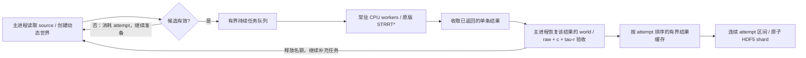

# Warehouse STRRT* 持续任务队列

2026-10-12。修改范围为独立 spacetime 数据生成器；原 `OmplSTRRTBatch.plan_batch` 调用接口保留。MPD 推理、ROS、runtime、旧 RRT 入口不变。

## 解决的问题

原流程每批准备 `query-batch-size` 个候选，候选被筛掉后不补齐，然后等待整批求解完成。已有 6 workers 的运行中，每批 8 个候选平均只剩 4.43 个有效求解任务，增加 workers 难以提高吞吐。

现在 `ompl-strrtstar` 默认使用 `streaming` 调度：



主进程准备下一批任务、验收上一条结果时，其他 worker 继续求解。准备和验收在同一个主线程中执行；HDF5 source handle 和可变 CUDA collision world 不跨线程共享。每次验收前显式恢复该 job 的 forecast，防止与新准备的 world 混淆。

结果按实际就绪情况验收和补充任务；保存仍按 attempt 顺序提交。较晚任务不需要等待较早任务才能验收，较早任务未完成时的缓存有上限。

## 参数与运行

```bash
cd /home/eric/Projects/MotionPlanningDiffusion/mpd
conda activate mpd-splines-public

python -m scripts.spacetime_data.generate_warehouse_spacetime \
  --backend ompl-strrtstar \
  --device cuda:0 \
  --output-root data_trajectories_spacetime/Warehouse-STRRTstar-streaming-v1 \
  --num-trajectories 100 \
  --cpu-workers 6 \
  --ompl-scheduling streaming \
  --ompl-queue-size 12 \
  --query-batch-size 8 \
  --solve-seconds 5 \
  --obstacles 3 \
  --require-tau-r
```

| 参数 | streaming 下的含义 |
| --- | --- |
| `--cpu-workers` | 常驻求解进程数；每进程执行一个独立原版 STRRT* 查询 |
| `--ompl-queue-size` | 已提交但未验收任务的上限，包括正在求解、排队和已返回的任务；0 自动取 `max(query-batch-size, 2 × workers)` |
| `--query-batch-size` | 每个 shard 提交的连续 attempt 数；自动队列容量也会参考它 |
| `--ompl-scheduling batch` | 保留原候选批次和整批等待行为，用于吞吐对照 |
| `--solve-seconds` | 每个 query 的搜索预算，仍为 5 秒默认值 |

无效 source / world 计入 `max-attempts` 和失败统计，但不占有效任务名额。求解或拟合失败后也会继续补充新任务。达到总 attempt 上限后，会收完已经提交的任务，再按是否达到目标返回 0 或 2。

接近目标数量时，`已接受数量 + 尚未验收任务数` 不超过目标，避免生成多余正样本。这个阶段会自然减少并行度。队列深度越大不会必然越快；通常从 workers 的两倍开始。

结果重排缓存最多覆盖 `max(32, 4 × queue-size)` 个尚未按顺序输出的 attempt。最早任务异常缓慢且缓存到上限时，暂停准备新候选，继续收取结果。单个未返回任务还有超时保护：`60 + ceil(queue-size / workers) × solve-seconds` 秒，异常会传播并终止 pool，不会当作普通无解静默跳过。

CUDA 用于主进程碰撞复检；原版 OMPL 搜索和 worker 碰撞查询仍在 CPU 上。Torch GPU forest 保持原有 batch 调度。

## 验收、保存与恢复

两种 OMPL 调度和 GPU forest 共用候选准备及结果验收函数。终点、速度/加速度、horizon、碰撞余量、动态交互和 `require-tau-r` 条件保持原值；没有降低验收密度或缩短求解预算。

每个 shard 仍保存连续的 `[attempt_start, attempt_stop)` 区间。乱序返回结果先缓存，只有连续前缀才能提交；恢复继续从最后完整 shard 的 `attempt_stop` 开始。未提交的任务在中断后重新生成，完整 shard 不重写，writer lock 保留。

代码 hash 和调度参数进入 `config.json`。**这次升级使用新的 output root**；升级前的输出仍可读取和独立验证，但新版不会绕过配置校验将新代码追加到旧数据集。新版创建的数据可用相同参数加 `--resume` 恢复或扩展目标。

每条样本仍记录 job/worker seed。异步分配会改变每个 worker 消耗 RNG 的顺序，同 seed 不保证 batch 与 streaming、不同 worker 数之间逐点一致。

## report 的新增统计

`report.json.session_pipeline_statistics` 记录当前会话：

| 字段 | 含义 |
| --- | --- |
| `prepared / submitted / completed / accepted` | 候选尝试数、有效任务提交数、求解返回且已验收数、最终合格数 |
| `queue_capacity / worker_count / max_in_flight` | 队列配置、worker 数和提交任务数峰值 |
| `max_uncommitted_attempts` | 尚未按顺序输出的 attempt 数峰值 |
| `preparation_wall_s` | 所有候选准备时间，包含无效候选 |
| `postprocess_wall_s` | 所有返回结果的复检/拟合时间，包含被拒绝样本 |
| `planner_wall_s_total / planner_mean_wall_s` | 所有完成 query 的求解时间之和/均值，包含无解或后续验收失败的 query |
| `poll_wait_wall_s` | 主进程没有准备/验收/提交工作时的轮询等待时间 |
| `shard_write_wall_s` | HDF5 shard 写入时间 |
| `planner_worker_utilization_estimate` | 完成 query 的求解时间之和 / `(workers × session_wall_s)`；包括 solver 回调/初始化开销，是并发占用估计，非操作系统 CPU 测量 |
| `accepted_trajectories_per_minute` | 当前会话每分钟合格轨迹数 |

搜索时间跨 worker 重叠，不能与主进程阶段时间简单相加。恢复后这些字段从新会话重新计数，report 顶层 `accepted/attempts` 仍是累计提交数。checkpoint 统计可能包含已经完成但尚未按顺序提交的结果；正常退出时都已提交。对已完成数据重复 `--resume` 会保留上次会话统计。

## 验证

```bash
python -m pytest -q \
  tests/test_streaming_spacetime.py \
  tests/test_warehouse_spacetime_generation.py \
  tests/test_warehouse_spacetime_fit.py \
  tests/test_warehouse_spacetime_planner.py \
  tests/test_gpu_batch_rrt.py

python -m scripts.spacetime_data.validate_warehouse_spacetime \
  data_trajectories_spacetime/Warehouse-STRRTstar-streaming-v1 \
  --device cuda:0
```

测试覆盖无效候选补齐、慢任务期间继续准备/验收、验收失败补齐、准确目标数量、attempt 上限、结果重排缓存上限、异常/超时、中断恢复与 world 隔离。旧 GPU RRT 和 spacetime forest 同时回归。

## 2026-10-13 实测验收

在 `main` 的 `28278a1` 实现上，使用 `mpd-splines-public`、RTX 4090 D 和真实单臂 Warehouse 环境。两次运行依次执行，配置仅 `ompl_scheduling` 不同：6 workers、每 query 5 秒搜索预算、query batch 8、目标 40 条、3 个动态障碍、`require-tau-r`、默认 source/world seeds。streaming 自动队列容量为 12。

| 指标 | batch | streaming |
| --- | ---: | ---: |
| 最终合格轨迹 | 40 | 40 |
| 消耗 attempt | 89 | 94 |
| 总会话耗时 | 85.731 s | 62.087 s |
| 合格轨迹/分钟 | 27.995 | 38.656 |
| 独立磁盘复检，5 ms 加密 | 40/40 | 40/40 |

本次耗时减少 **27.58%**，吞吐提高 **38.08%（1.381 倍）**。改变调度会改变 worker RNG 的消耗顺序，两次运行的轨迹和失败次数不完全相同；这是一次端到端吞吐对照，不是多次重复实验的统计结论。

streaming 共提交并收回 59 个有效 query（包含无解与后续验收失败的任务），队列峰值 12，结果重排范围峰值 26 个 attempt。平均求解时间 **5.031 s/query**；候选准备累计 0.681 s，结果复检/拟合累计 2.540 s，shard 写入累计 0.122 s。整次运行的 worker 求解占用估计为 79.68%，包含启动和接近目标时的并行度下降。

重复执行已完成运行的 `--resume` 后，12 个完整 shard 的 SHA256 全部不变，会话统计保留。上述自动化测试为 **21 passed**，其中中断恢复测试覆盖未提交区间重算、连续 attempt 区间和逐条 world 恢复。

结果位于：

```text
benchmark_results/warehouse_spacetime_streaming/20261013/
  comparison.json
  batch/{config.json,report.json,validation.json,shards/}
  streaming/{config.json,report.json,validation.json,shards/}
  streaming/shards-before-resume.json
```

`validation.json` 为干净的机器可读报告，验证器控制台原始输出另存 `validation.log`。中断前 `20261012` 的验收目录包含零字节分片，原样保留，不用于本次结论。
