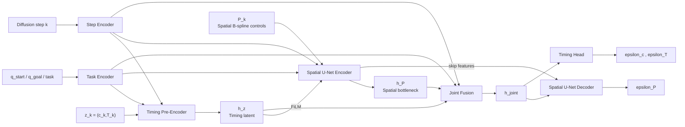
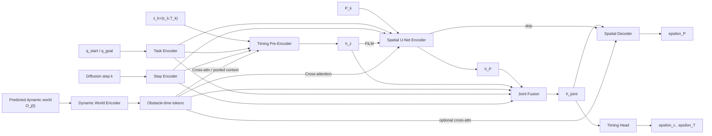
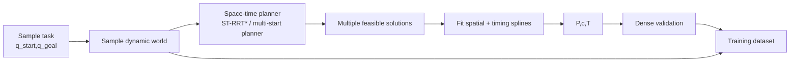
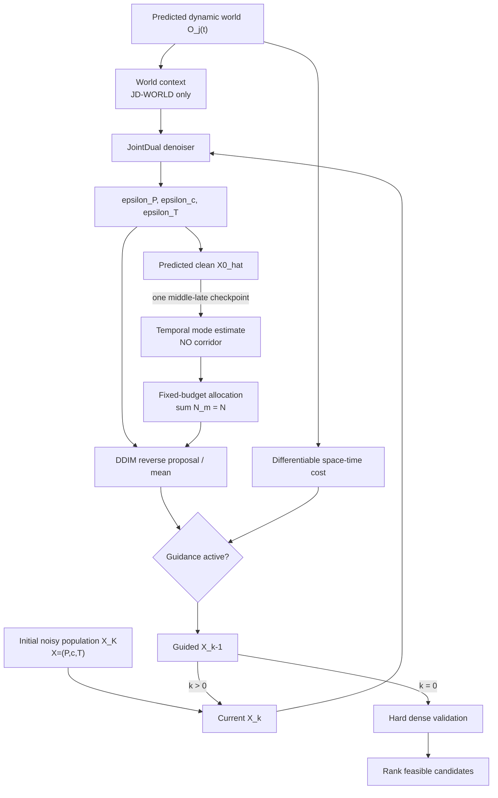

# JointDual 无 Corridor 双版本设计指南：JD-KIN 与 JD-WORLD

## 执行摘要

**建议把第一阶段 JointDual 明确拆成两个、且都不含 corridor 的版本：**`JD-KIN` 学习 \(p_\theta(P,c,T\mid\text{task})\)，动态环境只通过 inference-time space-time cost 进入；`JD-WORLD` 学习 \(p_\theta(P,c,T\mid\text{task},\mathcal W)\)，动态障碍通过 structured world tokens 进入网络，但仍保留后期解析安全 guidance。这个拆分与 MPD 的“learned prior + cost-guided posterior”以及 CAMPD 的“environment-conditioned diffusion”形成清楚的实验对照。citeturn18view0turn20view0

**首版应保持现有 spatial / timing B-spline 控制点数、同一 diffusion schedule、同一 Joint backbone，不加入 corridor，也不把所有 cost 移到 predicted-clean 上。**MPD 本身发现高噪声阶段 cost gradient 效果有限，因此把 guidance 集中在最后几步；这也与你此前静态实验中 intermediate/noisy-state guidance 优于 clean-\(x_0\) guidance 的结果一致。citeturn19view4turn19view1

**推荐网络不是“Timing branch 先预测完，再跑 Spatial U-Net”，而是 `Timing Pre-Encoder → Spatial Encoder → Joint Fusion → Spatial Decoder + Timing Head`。**JD-WORLD 只在此结构上增加 obstacle-time encoder 和有限层 cross-attention；CAMPD 已证明 structured context token + cross-attention 可处理可变数量障碍。citeturn20view0turn21view4

**Mode estimation 与 population allocation 可以保留，但它们应是中后期对 candidate population 的分析，而不是 corridor planner。**总 candidate budget 始终满足 \(\sum_mN_m=N\)，从而测试“固定预算下 mode-aware allocation 能否提高 success@N”，而不是通过 `N × modes` 暴力增加候选。

## 设计依据与总体决策

### JointDual 应该解决什么

原始 spline MPD 的 diffusion variable 是 B-spline control points；使用低维 B-spline 而不是 dense waypoints，是为了降低生成维数、天然获得平滑性，并利用 B-spline 的局部支持性质进行 collision-gradient adaptation。MPD 的网络是条件化 1D temporal U-Net，diffusion timestep 与 task context 通过 FiLM 进入网络。citeturn18view0turn19view4

原 MPD 的一个明确限制是**轨迹持续时间固定**。论文甚至把“使用额外 B-spline 表示 phase-time derivative、进一步优化 duration”列为未来方向。citeturn19view0

因此 JointDual 最自然的扩展不是重新生成 dense \(q(t)\)，而是联合生成：

\[
X=(P,c,T),
\]

其中：

\[
P\in\mathbb R^{N_P\times d_q}
\]

是 spatial B-spline 自由控制点，

\[
c\in\mathbb R^{N_c}
\]

描述 phase-time mapping 的形状，

\[
T>0
\]

表示全局 duration。

相应地，两版模型定义为：

\[
\boxed{
\text{JD-KIN: }
p_\theta(P,c,T\mid q_s,q_g,\text{task})
}
\]

和：

\[
\boxed{
\text{JD-WORLD: }
p_\theta(P,c,T\mid q_s,q_g,\text{task},\mathcal W)
}
\]

其中动态世界：

\[
\mathcal W=
\{O_j(t)\}_{j=1}^{N_{\rm obs}}
\]

包含障碍几何、位姿轨迹、速度以及可选的预测不确定性。

### 为什么首版不要 corridor

这首先是为了**科学归因**。你已经观察到 factorized + corridor 没有明显收益；如果 Joint V1 同时改变：

\[
\text{factorized}\rightarrow\text{joint},
\]

又增加：

\[
\text{corridor},
\]

又增加：

\[
N_P,N_c,
\]

那么结果无论好坏都无法解释。

因此最关键的首轮比较应该保持：

\[
N_P^{\rm Joint}=N_P^{\rm Factorized},
\qquad
N_c^{\rm Joint}=N_c^{\rm Factorized},
\]

保持 sampler、candidate budget、cost、validator 尽可能相同，只比较：

\[
\boxed{\text{Factorized}\rightarrow\text{JD-KIN}\rightarrow\text{JD-WORLD}}.
\]

这也符合 MPD 对 control-point 数量的处理：原论文不是“越多越好”，而是为每个任务选择足以拟合 collision-free paths 的数量；例如 Warehouse-Panda 使用 22 个 B-spline control points，并报告其选择标准是拟合后超过 99% 路径仍保持 collision-free。citeturn19view5

### 相关工作的职责边界

几篇近期工作对 JointDual 的作用最好明确拆开，而不是全部照搬。

| 工作 | 真正值得 JointDual 借鉴的部分 | 不建议直接照搬的部分 |
|---|---|---|
| MPD spline | B-spline diffusion、FiLM、late cost guidance、batch planning | 固定 \(T\) |
| CAMPD | structured environment tokens、cross-attention、context dropout/CFG | dense waypoint 输出 |
| TLMG | predicted-clean 做 trajectory-level reasoning；late release 的 mode guidance | 全部 collision cost 改成 clean-space |
| AMPD | 根据 diffusion noise level 把 expensive guidance 集中在更有价值阶段 | 不应因此改变所有模型结构 |
| TFDP | analytical/local feasibility score；低噪声局部修正 | 依赖 coarse topology initialization，不是 mode discovery |
| SCOPE | 区分 mode probability 与 mode 内 uncertainty | V1 不必训练 precision head |

MPD 已经显示，高噪声阶段对轨迹做 cost gradient 收益有限，所以它只在最后几步启用 cost；其标准设置是 15 个 DDIM steps，最后 3 步 cost guidance、每步 4 次 inner gradient。citeturn19view1 AMPD 的 IEEE 记录同样把“利用 diffusion noise dynamics 提升实时效率”作为主要动机，因此对 JointDual 最合理的解读是**cost computation 应随 denoising stage 自适应，而不是从第一步就满强度计算**。citeturn16search0

TLMG 则解决不同问题。它在 reconstructed clean trajectory 上用 partial prior：

\[
\hat X_0^{prior}
=
w_tX^{prior}
+
(1-w_t)\hat X_0,
\]

通过 mask 只修改部分 waypoint，然后再加 planning-cost gradient；并且 prior 强度随着 reverse diffusion 逐渐释放。citeturn21view3 这非常适合未来的 **mode-preserving guidance**，但并不能推出“静态/dynamic collision cost 一定应该全部在 clean \(x_0\) 上算”。你的旧实验和 MPD 原始设计都支持保留 intermediate-state guidance。

TFDP 更进一步说明 analytical constraint score 很适合做**局部 refinement**：它在 noise-smoothed feasible distribution 上构造 analytical score，并用 annealed Langevin 更新；但其结构化场景实验也显示 coarse initialization 对成功率影响很大，直线/Brownian initialization 在 Room/Shelf 中只有 0–17% success，而 obstacle-aware Voronoi/RRT initialization 可恢复到约 99–100%。因此它更适合作为 JointDual 的 late local score 思想来源，而不是 temporal topology discovery 方法。citeturn15view1turn15view2

**关键来源入口：** [MPD spline 论文](https://arxiv.org/abs/2412.19948)、[MPD 官方实现](https://github.com/joaoamcarvalho/mpd-splines-public)、[CAMPD](https://arxiv.org/abs/2510.14615)、[Trajectory-Level Mode Guidance](https://arxiv.org/abs/2609.36530)、[Training-Free Diffusion Planning](https://arxiv.org/abs/2610.01959)、[SCOPE](https://arxiv.org/abs/2610.12431)、[ST-RRT*](https://arxiv.org/abs/2203.02176)、[AMPD IEEE](https://ieeexplore.ieee.org/document/11432918/)。

## 两版模型架构

### JD-KIN：Joint prior，不看动态环境

JD-KIN 的目标不是“无视动态障碍”，而是让**神经网络本身不依赖 dynamic environment context**：

\[
\epsilon_\theta
=
f_\theta(P_k,c_k,T_k,k,\mathcal C_{\rm task}).
\]

动态障碍只存在于：

\[
C_{\rm dyn}
\]

和 final validator 中。

这与 MPD 的原始哲学最接近：MPD 的 prior 可以没有部署时新增障碍的信息，再通过 inference collision cost 适应新障碍。原论文在 Warehouse 中确实展示了 prior 不知道新增物体、但 cost-guided MPD 可以显著提高 valid fraction。citeturn19view0

推荐结构如下。



这里的核心不是代码执行顺序，而是 information flow：

\[
(c_k,T_k)\rightarrow h_z\rightarrow P
\]

以及：

\[
P_k\rightarrow h_P\rightarrow(\epsilon_c,\epsilon_T).
\]

所以最终输出是一个联合 score/noise prediction：

\[
\boxed{
\epsilon_\theta(X_k)
=
\begin{bmatrix}
\epsilon_P\\
\epsilon_c\\
\epsilon_T
\end{bmatrix}
}
\]

而不是：

\[
P\sim p(P),
\qquad
(c,T)\sim p(c,T\mid P).
\]

**Timing Pre-Encoder 不应该先生成最终 timing。**它只是编码当前 noisy timing state。对目前低维 \(c\) 来说，一个小 ResMLP 已足够：

\[
c_k\rightarrow{\rm MLP}_c\rightarrow h_c,
\]

\[
T_k\rightarrow{\rm MLP}_T\rightarrow h_T,
\]

\[
h_z=
{\rm ResMLP}
([h_c,h_T,e_k,e_{\rm task}]).
\]

建议从 \(h_z=128\) 维开始。MPD 的 Warehouse context dimension 本身就是 128，因此这样与现有 backbone 比较方便。citeturn19view5

### JD-WORLD：同一个 Joint backbone，加 structured dynamic world

JD-WORLD 不应重新设计一套完全不同的 denoiser，否则无法公平回答：

> 收益究竟来自 joint coupling，还是来自 world conditioning？

因此最好：

\[
\boxed{\text{JD-WORLD}=\text{JD-KIN backbone}+\text{World Encoder}+\text{Cross-Attention}}
\]

动态障碍可以表示成 obstacle-time tokens：

\[
o_{j,r}
=
[
{\rm type}_j,\;
p_j(t_r),\;
R_j(t_r),\;
v_j(t_r),\;
{\rm size}_j,\;
t_r,\;
\Sigma_j(t_r)
].
\]

其中 uncertainty \(\Sigma\) 可以首版省略。

CAMPD 已经验证了一个很合适的机制：每个 structured context instance 先由小 MLP 编码成 latent，然后让 U-Net 通过 attention 使用这些 context vectors；因此障碍数量可以变化，而不必将全部环境 flatten 成固定维 vector。citeturn20view0 CAMPD 的实现使用 4-head attention、latent dimension 64，支持任意数量 context instances，这正适合作为 JD-WORLD 的 architecture anchor。citeturn21view4



这里建议**不要所有 U-Net block 都放 cross-attention**。V1 可以只在：

\[
\text{mid-resolution encoder}
+
\text{bottleneck}
\]

放 world cross-attention；task、diffusion timestep 和 timing latent 继续使用 FiLM。

原因很直接：

- \(e_k,e_{\rm task},h_z\) 是固定维 global conditioning，FiLM 很便宜；
- world context 是可变数量 token，cross-attention 更自然；
- CAMPD 证明这种 token conditioning 可行，但也指出结构化环境模型需要较大数据量和高性能 GPU。citeturn20view0turn21view4

### 两版设计差异

| 维度 | JD-KIN | JD-WORLD |
|---|---|---|
| 学习目标 | \(p(P,c,T\mid task)\) | \(p(P,c,T\mid task,\mathcal W)\) |
| 网络是否看到 moving obstacles | 否 | 是 |
| Spatial–Timing coupling | 双向 | 双向 |
| task / timing conditioning | FiLM | FiLM |
| world conditioning | 无 | token cross-attention |
| 动态环境主要决策来源 | analytical guidance | learned prior + analytical guidance |
| 新型障碍运动 OOD | **通常更稳健**，只要 cost 可计算 | 取决于训练分布，但 cost 可兜底 |
| candidate efficiency | 较低 | 预期更高 |
| 网络计算 | 较低 | 较高 |
| gradient-guidance 计算 | 较高 | 目标是降低 |
| CFG | 不需要 | 可选 |
| safety guarantee | 没有，靠 validator | 同样没有，必须 validator |
| 最适合作为 | clean Joint baseline | 最终 world-aware model |

CAMPD 的结果说明 environment-aware conditioning 可以显著减少仅靠 cost adaptation 的负担；但其论文也明确指出大量高质量环境数据、structured geometry 获取以及 GPU 依赖是局限。citeturn20view0turn21view4 因此 **JD-WORLD 绝不能因为看到了环境就删除 late analytical cost 和 hard validator**。

## 训练数据与训练配方

### 最公平的数据设计

这里建议区分“工程 bootstrap”和“论文主实验”。

**工程 bootstrap** 可以直接用你目前已有的 factorized/static 数据训练 JD-KIN，只要每条 spatial path 已经配有 \(c,T\)。这样最快验证：

\[
\text{joint coupling itself}
\]

是否有效。

但正式比较 JD-KIN vs JD-WORLD 时，推荐两者使用**完全相同的 dynamic trajectory solution dataset**：

\[
\mathcal D
=
\{
P_i,c_i,T_i,
task_i,
\mathcal W_i
\}.
\]

训练 JD-KIN 时只扔掉 \(\mathcal W_i\)：

\[
(P,c,T,task,\cancel{\mathcal W}),
\]

JD-WORLD 则保留：

\[
(P,c,T,task,\mathcal W).
\]

这样：

\[
\text{JD-WORLD}-\text{JD-KIN}
\]

才真正测量 **dynamic environment conditioning** 的贡献，而不是数据质量差异。

### 动态数据如何生成

ST-RRT* 非常适合做 offline teacher，因为它直接在 space-time 中处理 moving obstacles、velocity constraints 和未知 arrival time，并针对机器人臂任务做过实验验证。citeturn18view6 它不是唯一选择，但比“先 static path、再随便 retime”更适合生成 JointDual 的 ground truth。

建议数据流水线：



动态障碍推荐用易控的 geometric primitives：

\[
\text{sphere / capsule / box}
\]

并为每个物体采样：

\[
p_j(t),
\quad
R_j(t),
\quad
v_j(t).
\]

CAMPD 本身就以 sphere 等 structured context 作为环境输入，这说明这种表示非常适合作为初期 world encoder 数据格式；之后再扩展到 mesh/point cloud。citeturn20view0

运动类型不要只有 constant velocity。建议至少包括：

\[
\text{linear},
\quad
\text{piecewise linear},
\quad
\text{B-spline},
\quad
\text{stop-and-go},
\quad
\text{periodic}.
\]

更重要的是构造**counterfactual scene pairs**：

```text
same q_start, q_goal
          │
          ├── obstacle phase early  → after/wait
          ├── obstacle phase middle → spatial detour
          └── obstacle phase late   → before
```

否则 JD-WORLD 有可能学习：

\[
task\rightarrow trajectory
\]

而直接忽略：

\[
\mathcal W.
\]

对于每个 task，建议随机改变 obstacle：

\[
\text{initial phase},\;
\text{speed},\;
\text{direction},\;
\text{pause interval}
\]

并重新求解，而不是只改变 context label。

### 多模态数据尤其重要

MPD 的数据由 RRT-Connect 生成，作者选择它的一个原因就是随机搜索可以为相同或相近任务找到不同 collision-free modes。citeturn19view0 JointDual 的 dynamic dataset 更需要这一点：

同一个：

\[
(task,\mathcal W)
\]

最好保留：

\[
(P_1,c_1,T_1),
\ldots,
(P_K,c_K,T_K),
\]

而不是只留下最短的一条。

否则 network 会被训练成：

\[
p(X\mid context)\approx\delta(X-X^*)
\]

再好的 diffusion architecture 也无法凭空恢复不存在于训练分布中的 temporal multimodality。

### 不用 corridor 也可以离线标 mode

Mode label 在 V1 **不用作为 training condition**，只用于：

- 评估 mode coverage；
- inference 中验证 mode estimator；
- 分析 candidate allocation。

可以根据动态 encounter 的相对时间标：

\[
m\in
\{
\text{before},
\text{wait},
\text{after},
\text{detour}
\}.
\]

这不是 temporal corridor；只是 trajectory label。

### B-spline timing 参数化

如果现有 \(c\) 已经工作，V1 应保持不变。

如果当前表示偶尔产生：

\[
\frac{dt}{ds}\le0,
\]

推荐后续把 timing spline 解码成正 phase-time derivative。例如：

\[
r(s;c)
=
{\rm softplus}(B_c(s)c)+\epsilon,
\]

再定义：

\[
t(s;c,T)
=
T
\frac{
\int_0^sr(u;c)\,du
}{
\int_0^1r(u;c)\,du
}.
\]

这样自动满足：

\[
t(0)=0,\qquad
t(1)=T,\qquad
\frac{dt}{ds}>0.
\]

而 wait / slow-through 可以通过局部：

\[
\frac{dt}{ds}\gg1
\]

近似表示。

\(T\) 建议不直接 diffusion raw positive scalar，而使用：

\[
u_T=\log T
\]

标准化后进入 diffusion，再在 decode 时恢复：

\[
T=e^{u_T}.
\]

这样不会出现负 duration。

### 标准化

MPD 对所有训练数据统一 normalize 到：

\[
[-1,1],
\]

并在 normalized control-point space 做 inference update。citeturn19view4turn19view1

JointDual 推荐**按 block 独立 normalization**：

\[
P\rightarrow\tilde P,
\qquad
c\rightarrow\tilde c,
\qquad
\log T\rightarrow\tilde T.
\]

不要让：

\[
P\sim O(1),
\qquad
T\sim O(10)
\]

直接共用同一 noise scale。

首版推荐：

\[
\tilde P,\tilde c,\tilde T
\]

全部约束到近似 \([-1,1]\)，再共用同一个 diffusion schedule。

### Loss

最重要的是**不要把所有维度先 concatenate 再 sum-MSE**。

因为：

\[
\dim(P)\gg\dim(c,T),
\]

空间部分会自然淹没 timing。

应当先分别平均：

\[
L_P=
\operatorname{mean}
\|\epsilon_P-\hat\epsilon_P\|^2,
\]

\[
L_c=
\operatorname{mean}
\|\epsilon_c-\hat\epsilon_c\|^2,
\]

\[
L_T=
\operatorname{mean}
(\epsilon_T-\hat\epsilon_T)^2,
\]

再组合：

\[
\boxed{
L=
\lambda_PL_P+
\lambda_cL_c+
\lambda_TL_T.
}
\]

第一版建议：

\[
\lambda_P=\lambda_c=\lambda_T=1.
\]

只有观察到 timing 学不动之后，才考虑：

\[
\lambda_c=1.5\sim2,
\qquad
\lambda_T=1.5\sim2.
\]

比直接放大 timing head output 更稳妥。

JD-WORLD 的基础 loss 不应额外复杂化：

\[
L_{\rm WORLD}
=
L_P+L_c+L_T.
\]

如果使用 CFG，可以像 CAMPD 那样随机丢弃 world context。CAMPD 的正式设置是：

\[
p_d=0.33,
\]

并在 inference 同时做 conditional/unconditional prediction。citeturn20view0turn21view4 对你的 V1，我会从更温和的：

\[
p_{\rm world-drop}=0.1\sim0.2
\]

开始，以免 dynamic context 本来就难学，还频繁被删除；再把 0.33 作为 ablation。

### 数据增强

MPD 官方仓库本身支持 path post-processing 和把 solution path 反转来扩充数据集。citeturn21view7 但 dynamic world 中要非常谨慎：

**绝不能只 reverse robot trajectory。**

如果：

\[
q(t)\rightarrow q(T-t),
\]

那么 obstacle trajectory 也必须同步：

\[
O_j(t)\rightarrow O_j(T-t).
\]

否则新样本的 collision relation 已经改变。

推荐安全的数据增强包括 obstacle token permutation、相同 scene 的 obstacle-order shuffle、轻微 start/goal perturbation 后重新验证、以及保持 robot/world 同步的 temporal scaling：

\[
t\rightarrow at,
\qquad
T\rightarrow aT,
\qquad
O_j(t)\rightarrow O_j(t/a).
\]

### 推荐训练起点

MPD Warehouse-Panda 的原始配置是 500k trajectories、22 个 B-spline control points、batch 512、3M optimization steps、100 diffusion steps、Adam \(3\times10^{-4}\)。citeturn19view5turn19view1 CAMPD 因为有 attention/context，使用 batch 128、learning rate \(10^{-4}\)、25 diffusion steps 和 RTX 4090。citeturn21view4

因此建议：

| 项目 | JD-KIN V1 | JD-WORLD V1 | 来源/理由 |
|---|---:|---:|---|
| Spatial CP | **沿用 factorized** | 相同 | 保持公平 |
| Timing CP | **沿用 factorized** | 相同 | 保持公平 |
| Train diffusion steps | 100 | 100 | MPD anchor citeturn19view1 |
| Physical batch | 512 | 128–256 | WORLD attention 占显存 |
| Effective batch | 512 | 512 via accumulation | 保持优化尺度 |
| Optimizer | Adam | Adam | MPD |
| Initial LR | \(3e{-4}\) | \(2e{-4}\) 或 \(3e{-4}\) | WORLD 更易不稳定 |
| LR baseline | constant | constant | 最干净对照 |
| 可选 schedule | 5k warmup + cosine | 同左 | 稳定化 ablation |
| Gradient clip | 1.0 | 1.0 | 本文建议 |
| Loss weights | 1/1/1 | 1/1/1 | block-wise mean |
| Context dropout | — | 0.1–0.2 initially | CAMPD anchor 0.33 |
| Mixed precision | 是 | 是 | 工程建议 |
| EMA | 0.999–0.9999 可选 | 同左 | 工程建议 |

## 推理循环、动态 Guidance 与 Mode Allocation

### 两版推理逻辑的本质区别

JD-KIN：

\[
\boxed{
\text{learned kinematic prior}
+
\text{stronger analytical ST guidance}
}
\]

JD-WORLD：

\[
\boxed{
\text{world-aware learned prior}
+
\text{weaker/late analytical safety correction}
}
\]

但两者应使用**完全相同的 hard final validator**。

共同 inference loop：



这里有一个很重要的分工：

\[
\boxed{
\hat X_0
\text{ 用于 mode reasoning}
}
\]

但：

\[
\boxed{
\mu_k/X_k
\text{ 用于局部 collision guidance}
}
\]

这正好吸收了你之前静态实验的结论。

MPD 原方法也不是全过程在 clean \(x_0\) 上做 cost，而是对当前 denoising trajectory 计算 cost，并因为高 noise 阶段 gradient 效果差而只在末期开启。citeturn19view4

### Guidance schedule

若仍沿用 15-step DDIM，则我建议如下。

**JD-KIN：**

```text
reverse progress
0%                       60%           80%           100%
|-------------------------|-------------|--------------|
       no cost             weak ST        strong late
                            guidance       guidance
```

具体可先做：

\[
\lambda_{\rm dyn}(r)=0,\qquad r<0.6,
\]

\[
\lambda_{\rm dyn}(r)
\text{ gradually increases},
\qquad0.6\le r<0.8,
\]

最后 3 个 reverse steps 使用完整 guidance。

MPD 的标准值是 15 DDIM steps、最后 3 步 cost、每步 4 inner gradient steps，总计 12 次 cost-gradient evaluations。citeturn19view1 这是 JD-KIN 很好的 baseline 起点。

**JD-WORLD** 应该更保守：

```text
early               middle                 late
network context      network context        network context
only                 + optional weak cost   + safety correction
```

建议首轮：

- 最后 2–3 steps 才启动 analytical cost；
- 每步先试 1–2 inner gradient updates；
- OOD / low-clearance scene 再自适应提高到 JD-KIN 的 4 steps。

为什么值得这么做？MPD 在一个 Panda benchmark 上报告，15-step diffusion network sampling 本身约 0.057 s，而包含 cost gradients 后总 inference 约 0.56 s；昂贵部分主要是 gradient computation。citeturn19view0 因此 JD-WORLD 的真正价值之一应是：

\[
\boxed{
\text{多花一点 neural attention compute}
\rightarrow
\text{少做昂贵 geometry gradients}
}
\]

而不是仅仅增加一个更重的网络。

### 动态 cost 如何同时产生 \(\nabla_P,\nabla_c,\nabla_T\)

建议固定 phase samples：

\[
s_\ell\in[0,1],
\qquad \ell=1,\ldots,H.
\]

空间轨迹：

\[
q_\ell=q(s_\ell;P),
\]

物理时间：

\[
t_\ell=t(s_\ell;c,T).
\]

对 robot collision body \(b\)：

\[
x_{\ell,b}
=
FK_b(q_\ell).
\]

定义时空 signed distance：

\[
D_j(x,t)
\]

为点/机器人 body 到动态障碍 \(j\) 在时间 \(t\) 的 signed distance。

动态碰撞 cost：

\[
C_{\rm dyn}
=
\sum_{\ell,b,j}
\rho\left(
d_{\rm safe}
-
D_j(x_{\ell,b},t_\ell)
\right),
\]

例如：

\[
\rho(r)=\max(0,r)^2.
\]

那么：

\[
\boxed{
\nabla_PC_{\rm dyn}
}
\]

改变空间形状：

\[
\nabla_PC_{\rm dyn}
=
\sum
\rho'(r)
\left(-\nabla_xD_j\right)
J_{FK,b}(q_\ell)
\frac{\partial q_\ell}{\partial P}.
\]

而：

\[
\boxed{
\nabla_cC_{\rm dyn}
}
\]

主要改变局部 arrival timing：

\[
\nabla_cC_{\rm dyn}
=
\sum
\rho'(r)
\left(-\partial_tD_j\right)
\frac{\partial t_\ell}{\partial c}.
\]

全局 duration：

\[
\boxed{
\nabla_TC_{\rm dyn}
=
\sum
\rho'(r)
\left(-\partial_tD_j\right)
\frac{\partial t_\ell}{\partial T}.
}
\]

这意味着一个 encounter 可以自然产生三种方向：

```text
dynamic collision
       │
       ├── ∇P  → spatial detour
       │
       ├── ∇c  → locally speed up / slow down / wait
       │
       └── ∇T  → globally earlier / later execution
```

实现上不要手写全部 Jacobian，直接保持：

\[
(P,c,T)
\rightarrow
q(s)
\rightarrow
t(s)
\rightarrow
FK
\rightarrow
D(x,t)
\]

全链 differentiable，由 PyTorch autograd 求三组梯度。

但必须保证 \(D(x,t)\) **对 \(t\) 连续可导**。不要：

```python
obs_pose = trajectory[int(t / dt)]
```

因为这种 nearest-frame indexing 对 \(t\) 没梯度。

至少要做：

\[
O(t)
=
(1-\alpha)O(t_i)+\alpha O(t_{i+1})
\]

的 differentiable interpolation；旋转可使用 quaternion interpolation 或平滑 pose spline。

### Timing 与 velocity / acceleration

如果：

\[
q=q(s),
\qquad
t=t(s),
\]

则：

\[
\dot q
=
\frac{q_s}{t_s},
\]

以及：

\[
\ddot q
=
\frac{q_{ss}}{t_s^2}
-
\frac{q_st_{ss}}{t_s^3}.
\]

因此 \(c,T\) 不只影响 collision timing，也影响：

\[
C_{\rm vel},
\qquad
C_{\rm acc}.
\]

这正是 Joint 的重要优势：

\[
\nabla_c C_{\rm dyn}
\]

想让机器人“快速抢先通过”，但：

\[
\nabla_c C_{\rm vel}
\]

可能反对，因为会导致速度超限。

最终 Joint guidance 真正求的是：

\[
\nabla_{P,c,T}
\left[
\lambda_{\rm dyn}C_{\rm dyn}
+
\lambda_{\rm static}C_{\rm static}
+
\lambda_vC_v
+
\lambda_aC_a
+
\lambda_{\rm goal}C_{\rm goal}
\right].
\]

### Mode estimate：不需要 corridor

这部分建议**完全不做 safe-interval/corridor extraction**。

在 predicted clean candidate：

\[
\hat X_0^i
=
(\hat P_i,\hat c_i,\hat T_i)
\]

上 dense decode。

对于每个动态障碍 \(j\)，找到 candidate 与 obstacle 最相关的 encounter：

\[
(\ell^*,\tau^*)
=
\arg\min_{\ell,\tau}
d
\left(
x_i(s_\ell),O_j(\tau)
\right).
\]

定义 relative encounter timing：

\[
\Delta\tau_j
=
t_i(s_{\ell^*})-\tau^*.
\]

直观地：

\[
\Delta\tau_j<-\delta
\Rightarrow
\text{before},
\]

\[
\Delta\tau_j>\delta
\Rightarrow
\text{after}.
\]

对于：

\[
|\Delta\tau_j|\lesssim\delta
\]

再结合局部：

\[
\frac{dt}{ds}
\]

或低 progress speed 判断是否存在 wait/slow-through。

于是可以得到：

\[
\phi_i
=
[
\Delta\tau_{i,1},\ldots,
\Delta\tau_{i,J'},
T_i,
d_{\min,i},
r_{\rm dwell,i}
].
\]

对于单 dominant obstacle，可以直接分：

\[
\{\text{before},\text{wait},\text{after}\}.
\]

多个 obstacle 时不要构造完整：

\[
3^{N_{\rm obs}}
\]

组合 mode；只保留 top-\(J'\) 个真正与当前 population 交互的障碍，或直接对 \(\phi_i\) 聚类并限制：

\[
M_{\max}=3\sim4.
\]

这就是**不使用 corridor 的 temporal-mode estimation**。

### 什么时候做 mode estimate

不要 early。

TLMG 的实验说明 trajectory-level prior 对生成分布影响非常明显，mask 越强，sample diversity 越低；它因此让 prior 约束随着 denoising 推进释放。citeturn21view3 对我们而言，这进一步说明在 high-noise 阶段就强行分 mode 很危险。

15-step sampler 下建议第一次实验只做**一个 checkpoint**：

\[
\boxed{
65\%-75\%
\text{ reverse denoising 已完成}
}
\]

即剩余约：

\[
4\sim5
\]

步时。

这样：

- predicted-clean 已较稳定；
- 仍有足够 reverse steps 供 allocation 后的 candidate 分化；
- 正好位于最后 3 个强 cost steps 之前。

首版不要每一步重聚类。

### Population allocation：固定总预算

假设：

\[
N=64
\]

或：

\[
N=100.
\]

始终要求：

\[
\boxed{
\sum_mN_m=N.
}
\]

绝不能：

\[
N_{\rm final}=N\times M.
\]

先统计当前 empirical mass：

\[
\hat\pi_m=\frac{n_m}{N}.
\]

对每个 mode 计算 top candidates 的 robust cost：

\[
\tilde C_m
=
\operatorname{median}_{i\in {\rm top}\text{-}k(m)}
C_i.
\]

可定义：

\[
w_m
=
(\hat\pi_m+\epsilon)^\alpha
\exp
\left(
-\frac{\tilde C_m}{\tau_C}
\right),
\qquad
0\le\alpha<1.
\]

然后：

\[
N_m
=
N_{\min}
+
\operatorname{Round}
\left[
(N-MN_{\min})
\frac{w_m}{\sum_rw_r}
\right].
\]

推荐：

\[
N_{\min}=2\sim4.
\]

这个 minimum quota 很重要，否则一个暂时看起来 cost 较差、但之后有可能成为唯一 feasible branch 的 rare mode 会直接消失。

SCOPE 在这里给了很好的长期方向：它明确把

\[
\pi_m
\]

作为 mode 间 probability，而用每个 mode 的 structured precision：

\[
\Lambda_m
\]

表示 mode 内 uncertainty，形成 Gaussian trajectory tubes。citeturn15view4 未来可以把 allocation 改成：

\[
N_m
=
f(
\pi_m,
\Lambda_m^{-1},
P_{\rm feasible}(m)
).
\]

但 V1 **不要训练 SCOPE precision head**；先用 empirical mode count + cost 即可。

### Clone 时的一个实现陷阱

如果你用 deterministic DDIM，并把一个优秀 candidate 完全复制：

```text
candidate A
candidate A
candidate A
candidate A
```

后面它们很可能继续完全相同。

因此 population reallocation 应该：

1. prune bad candidates；
2. 保留 selected current noisy states \(X_k\)；
3. clone；
4. 给 clones 一个与当前 noise level 匹配的小 perturbation。

例如：

\[
X_k'
=
X_k+\sigma_{\rm clone}(k)\epsilon.
\]

不要在 clean \(X_0\) 上大幅 perturb 再重新启动，否则容易破坏当前 mode。

### Optional mode lock

首版可以完全不加。

如果发现 allocation 后 before/after candidates 又大量跨 mode，可以做一个很弱的 signed-timing penalty：

before：

\[
C_{\rm mode}^{before}
=
\max(0,\Delta\tau+\delta)^2,
\]

after：

\[
C_{\rm mode}^{after}
=
\max(0,\delta-\Delta\tau)^2.
\]

这仍然**不是 corridor**。

再往后一版，才值得把 TLMG 的 soft partial prior 思想引进来；其原文证明 partial prior 可以作用于 clean 和 matching-noise space，而且 early 较强、随后释放，使 sample 朝目标 region 偏移但仍保留多样性。citeturn21view3

### Late validation

网络输出和 soft cost 都不能作为安全证明。

最终对每个 candidate dense decode，至少检查：

\[
\text{static collision},
\]

\[
\text{dynamic collision},
\]

\[
q_{\min}\le q(t)\le q_{\max},
\]

\[
|\dot q(t)|\le v_{\max},
\]

\[
|\ddot q(t)|\le a_{\max},
\]

\[
\frac{dt}{ds}>0,
\]

\[
T_{\min}\le T\le T_{\max}.
\]

MPD 使用 128 个 dense interpolation points 做 cost evaluation，这是一个很合适的首版起点。citeturn19view1 在动态障碍 min-clearance 附近再自适应增加 temporal samples，防止 128-point discretization 漏掉短暂碰撞。

如果 dynamic obstacle prediction 有 uncertainty，可以在 validator 中使用 conservative inflation：

\[
r_j^{safe}(t)
=
r_j+
k\sigma_j(t).
\]

如果所有 candidates 都失败：

\[
\boxed{\text{不要执行“最不坏”的 infeasible candidate}}
\]

而应触发 replan / fallback / stop。

## 实现与调参建议

### Timing head 首先解决 scale，不要首先扩大网络

最常见的 Joint failure 很可能不是 timing head 太小，而是：

\[
L_P
\]

在训练中占主导。

因此日志必须分别记录：

\[
L_P,\quad L_c,\quad L_T,
\]

以及：

\[
\|\nabla_{\theta_{\rm shared}}L_P\|,
\quad
\|\nabla_{\theta_{\rm shared}}L_c\|,
\quad
\|\nabla_{\theta_{\rm shared}}L_T\|.
\]

推荐调参顺序：

```text
block normalization
      ↓
block-wise mean losses
      ↓
λ_c / λ_T
      ↓
timing head width
      ↓
timing control-point count
```

不要倒过来。

Timing head 首版可用：

```text
h_joint
  ↓
Linear(256, 128)
SiLU
  ↓
Residual MLP
  ↓
├── Linear(128, N_c) → epsilon_c
└── Linear(128, 1)   → epsilon_T
```

只有明确看到：

\[
L_P\downarrow,\qquad
L_c,L_T\text{ 长期不降}
\]

而 gradient scale 已经合理，才把 timing width 从 128 提到 256。

### FiLM 与 cross-attention 的使用边界

推荐非常明确：

\[
\boxed{
\text{fixed-size global conditioning}
\Rightarrow
\text{FiLM}
}
\]

包括：

\[
e_k,\quad
e_{\rm task},\quad
h_z.
\]

而：

\[
\boxed{
\text{variable-set world context}
\Rightarrow
\text{cross-attention}
}
\]

包括：

\[
\{o_{j,r}\}.
\]

MPD 已经通过 FiLM conditioning diffusion timestep 和 task context；CAMPD 则把任意数量 structured context instances 编成 token 后在 U-Net 中做 attention。citeturn18view0turn20view0

JD-WORLD 第一版没有必要：

```text
cross-attention at every resolution
```

建议只做：

```text
encoder mid block
+
bottleneck
```

如果 attention ablation 显示 world utilization 仍差，再扩展 decoder。

### World token 数量

若：

\[
N_{\rm obs}=10,
\qquad
N_t^{obs}=32,
\]

直接得到：

\[
320
\]

个 tokens，对每个 candidate batch 做多层 cross-attention 没必要。

推荐初始：

\[
N_t^{obs}=8\sim16
\]

个 temporal samples/obstacle。

或者编码：

\[
[p(0),v(0),\text{spline coefficients},size]
\]

作为每个 obstacle 的较少 token。

动态 obstacle 本身已用 B-spline/多项式表示时，最好直接输入其 coefficients，而不是重新 dense sample 很多点。

### CFG 不要太强

CAMPD 的 context-aware diffusion 使用 CFG；其实验中 batch 100 时，moderate guidance \(w=1\sim2\) 有很高的 feasible-trajectory rate，而 \(w=5\) 时 FTR 明显下降，说明过强 conditional guidance 会损害生成质量/多样性。citeturn20view0

因此 JD-WORLD 建议先：

\[
w_{\rm CFG}=0
\]

做纯 conditional baseline，

再测：

\[
0.5,\;1.0,\;1.5.
\]

不要一开始就用大值。

而且 CFG 通常意味着 conditional/unconditional 两次 network evaluation；可以 batch 在一起，但 FLOPs 仍接近增加一倍。

### Guidance gradient scale

因为 \(P,c,T\) 的几何意义差异很大，不建议把：

\[
[g_P,g_c,g_T]
\]

直接拼起来后做一个 global norm clipping。

应按 block：

\[
\Delta \tilde P
=
-\eta_P\lambda(k)g_{\tilde P},
\]

\[
\Delta \tilde c
=
-\eta_c\lambda(k)g_{\tilde c},
\]

\[
\Delta \tilde T
=
-\eta_T\lambda(k)g_{\tilde T}.
\]

MPD 在 normalized control-point space 中使用 gradient weight \(1.0\) 和 update clip \(\delta=0.15\)。citeturn19view1 因此首轮可取：

\[
\delta_P=0.15,
\]

\[
\delta_c=0.10\sim0.15,
\]

\[
\delta_T=0.05\sim0.10.
\]

后两者是 JointDual 的建议初值，不是 MPD 原参数。

如果发现：

\[
\|g_c\|\ll\|g_P\|
\]

首先检查 normalization 和 autograd chain，**不要立即把 \(\eta_c\) 放大 100 倍**。

### Candidate budget

MPD 展示了 batch planning 的一个重要优势：GPU 上 batch 采样的增量成本相对小，且 success 随 batch size 增长。citeturn19view0 CAMPD 的核心实验也常使用 batch 100；TLMG 单机器人 conditioning 实验一次展示 64 个 candidates。citeturn20view0turn21view1

推荐：

- 开发阶段：\(N=64\)；
- 正式与已有 MPD benchmark 对齐：\(N=100\)；
- allocation ablation：始终固定相同 \(N\)。

核心 metric 应使用：

\[
\text{Success@N}
\]

以及：

\[
\text{Valid Fraction@N},
\]

而不是给 mode-aware 方法偷偷更多 samples。

还应报告：

\[
\text{unique temporal modes},
\]

\[
H(m)
=
-\sum_m p_m\log p_m,
\]

\[
\text{valid candidates per mode},
\]

\[
\text{best-cost per mode}.
\]

### GPU / CPU 分工

推荐让这些留在 GPU：

```text
JointDual forward
world attention
B-spline dense decode
FK
differentiable SDF / primitive distance
C_dyn
autograd gradients
batched soft validation
```

MPD 本身就是通过 PyTorch GPU vectorization 批量评估 trajectories 和 gradients。citeturn19view4

CPU 更适合：

```text
mode bookkeeping
small K-means / allocation logic
fallback sampling planner
final exact mesh collision checker
logging / visualization
```

但 mode features 如果本来就在 GPU，最好连简单 clustering/allocation 也留 GPU，避免每个 reverse step：

\[
GPU\rightarrow CPU\rightarrow GPU
\]

同步。

**特别不建议**把每个 candidate 每步送 CPU 做 FCL 再回来。Final top-\(K\) exact checker 可以 CPU，inner guidance 不行。

### Candidate-relative world context 是否要进网络

长期看很有价值：

\[
r_{\ell j}
=
[
x_\ell-p_j(t_\ell),
v_j(t_\ell),
d_{\ell j},
t_\ell
].
\]

它直接回答：

> “这条 candidate 到达这里时，障碍在哪里？”

但 V1 我建议**不要加入**，因为它让 context 依赖当前 noisy candidate，网络和 cost path 纠缠明显增加。

先让 JD-WORLD 只吃：

\[
\text{scene-level obstacle-time tokens}.
\]

若 WORLD 有收益但 timing decision 仍弱，再做：

\[
\text{JD-WORLD-REL}
\]

作为清楚的第三阶段 ablation。

### TFDP 应怎样真正影响实现

TFDP 的重要启发不是“删除 JointDual 网络”，而是：

\[
\text{collision feasibility field}
\]

可以随着 noise level 平滑，形成 noise-aware analytical score；TFDP 在 250-step Langevin 实验中将 \(\sigma\) 从 0.1 指数降到 0.0001，并随着 noise 退火 refinement。citeturn15view0

因此 JointDual 后续可测试：

\[
D(x,t)
\rightarrow
D_{\sigma_k}(x,t),
\]

即 early guidance 看到较宽的 obstacle influence，late guidance 才趋近精确 boundary。

但这属于 **V2 analytical guidance**。V1 应先保持现有 collision cost，避免再改变一个变量。

## 可复现伪代码与关键超参

### JointDual 训练

下面的伪代码同时覆盖 JD-KIN/JD-WORLD。`world=None` 即 JD-KIN。

```python
def train_step(batch, model, optimizer, cfg):
    """
    batch:
        P0       [B, Np, dof]
        c0       [B, Nc]
        T0       [B, 1]
        task     start/goal context
        world    dynamic obstacle context, JD-WORLD only
    """

    P0 = normalize_P(batch.P0)
    c0 = normalize_c(batch.c0)
    T0 = normalize_log_T(batch.T0)

    # Only free spatial control points are diffused.
    x0 = JointState(P=P0, c=c0, T=T0)

    B = len(P0)
    k = sample_uniform_diffusion_steps(B)

    eps_P = torch.randn_like(P0)
    eps_c = torch.randn_like(c0)
    eps_T = torch.randn_like(T0)

    xk = JointState(
        P=q_sample(P0, k, eps_P),
        c=q_sample(c0, k, eps_c),
        T=q_sample(T0, k, eps_T),
    )

    world = batch.world if cfg.use_world else None

    # Optional classifier-free world dropout.
    if cfg.use_world and torch.rand(()) < cfg.world_dropout:
        world = None

    pred = model(
        P_k=xk.P,
        c_k=xk.c,
        T_k=xk.T,
        diffusion_step=k,
        task=batch.task,
        world=world,
    )

    # IMPORTANT: mean each block BEFORE weighting.
    loss_P = mse(pred.eps_P, eps_P, reduction="mean")
    loss_c = mse(pred.eps_c, eps_c, reduction="mean")
    loss_T = mse(pred.eps_T, eps_T, reduction="mean")

    loss = (
        cfg.lambda_P * loss_P
        + cfg.lambda_c * loss_c
        + cfg.lambda_T * loss_T
    )

    optimizer.zero_grad(set_to_none=True)
    loss.backward()
    torch.nn.utils.clip_grad_norm_(model.parameters(), cfg.grad_clip)
    optimizer.step()

    return {
        "loss": loss.item(),
        "loss_P": loss_P.item(),
        "loss_c": loss_c.item(),
        "loss_T": loss_T.item(),
    }
```

MPD 使用标准 noise-prediction objective、100 个 training diffusion steps、Adam \(3\times10^{-4}\)；CAMPD 也使用 noise-prediction MSE，并通过 context dropout 训练 conditional/unconditional 分支。citeturn19view1turn20view0 因此上面的 recipe 刻意不引入额外复杂 objective。

### JointDual 推理

```python
def plan_jointdual(task, world, model, cfg):
    """
    Fixed population budget:
        number of candidates never exceeds cfg.N.
    """

    world_tokens = None
    if cfg.use_world:
        world_tokens = model.encode_world(world)

    X = sample_joint_noise(
        batch_size=cfg.N,
        spatial_shape=cfg.spatial_shape,
        timing_shape=cfg.timing_shape,
    )

    mode_ids = None

    for step_idx, k in enumerate(cfg.ddim_steps):

        # ----------------------------------------------------------
        # Learned joint prior
        # ----------------------------------------------------------
        pred = model(
            P_k=X.P,
            c_k=X.c,
            T_k=X.T,
            diffusion_step=k,
            task=task,
            world_tokens=world_tokens,
        )

        X0_hat = predict_clean_joint_state(X, pred, k)

        # ----------------------------------------------------------
        # One middle/late mode-estimation checkpoint.
        # No corridor extraction.
        # ----------------------------------------------------------
        if step_idx == cfg.mode_checkpoint:

            trajectories = decode_dense(X0_hat, H=cfg.H_mode)

            mode_features = compute_relative_timing_features(
                trajectories=trajectories,
                world=world,
            )

            mode_ids = estimate_modes(
                mode_features,
                max_modes=cfg.max_modes,
            )

            target_counts = allocate_fixed_budget(
                mode_ids=mode_ids,
                proxy_cost=evaluate_proxy_cost(
                    trajectories, world
                ),
                total_budget=cfg.N,
                min_per_mode=cfg.min_per_mode,
            )

            X = prune_clone_and_perturb(
                current_noisy_state=X,
                mode_ids=mode_ids,
                target_counts=target_counts,
                noise_level=k,
            )

            # Re-run prediction after population changes if needed.
            pred = model(
                P_k=X.P,
                c_k=X.c,
                T_k=X.T,
                diffusion_step=k,
                task=task,
                world_tokens=world_tokens,
            )

        # ----------------------------------------------------------
        # Standard DDIM reverse proposal / mean.
        # ----------------------------------------------------------
        X_next = ddim_reverse_proposal(X, pred, k)

        # ----------------------------------------------------------
        # Analytical guidance.
        # Evaluate on intermediate/reverse state, not necessarily X0_hat.
        # ----------------------------------------------------------
        if guidance_is_active(step_idx, cfg):

            for _ in range(cfg.inner_guidance_steps):

                X_next = X_next.detach().requires_grad_(True)

                traj = decode_dense(
                    X_next,
                    H=cfg.H_cost,
                )

                cost = total_space_time_cost(
                    trajectory=traj,
                    world=world,
                    task=task,
                )

                gP, gc, gT = torch.autograd.grad(
                    cost,
                    [X_next.P, X_next.c, X_next.T],
                )

                X_next = apply_blockwise_guidance(
                    X_next,
                    gP=gP,
                    gc=gc,
                    gT=gT,
                    step_scale=guidance_scale(step_idx, cfg),
                    clip_P=cfg.clip_P,
                    clip_c=cfg.clip_c,
                    clip_T=cfg.clip_T,
                )

        X = X_next.detach()

    # --------------------------------------------------------------
    # Hard late validation
    # --------------------------------------------------------------
    candidates = decode_dense(X, H=cfg.H_validation)

    valid_mask = hard_validate(
        candidates,
        world=world,
        check_static_collision=True,
        check_dynamic_collision=True,
        check_joint_limits=True,
        check_velocity=True,
        check_acceleration=True,
        check_time_monotonicity=True,
    )

    feasible = candidates[valid_mask]

    if len(feasible) == 0:
        return FAILURE_REPLAN

    return rank_and_select(feasible)
```

### 推荐 Joint V1 超参

下面把“论文中已有 anchor”和“建议初值”严格分开。

| 超参 | JD-KIN 建议 | JD-WORLD 建议 | 备注 |
|---|---:|---:|---|
| \(N_P\) | 现有 factorized 值 | 相同 | 首版不要增加 |
| \(N_c\) | 现有 factorized 值 | 相同 | 首版不要增加 |
| \(T_{\rm train}\) diffusion steps | 100 | 100 | MPD anchor citeturn19view1 |
| DDIM inference steps | 15 | 15 | MPD anchor citeturn19view1 |
| DDIM schedule | quadratic | quadratic | MPD anchor |
| Candidate \(N\) | 64 dev / 100 eval | 相同 | 固定公平预算 |
| Batch | 512 | 128–256 physical | WORLD 用 grad accumulation |
| Effective batch | 512 | 512 | 推荐 |
| Optimizer | Adam | Adam | MPD 使用 Adam |
| LR | \(3\times10^{-4}\) | \(2\!-\!3\times10^{-4}\) | MPD anchor \(3e-4\) |
| LR schedule | constant baseline | constant baseline | 最干净对照 |
| \(L_P,L_c,L_T\) | 1,1,1 | 1,1,1 | 先独立 mean |
| Context dropout | — | 0.1–0.2 | CAMPD 原设置 0.33 citeturn21view4 |
| CFG | — | 0 initially | 后测 0.5/1/1.5 |
| world token dim | — | 64–128 | CAMPD latent 64 |
| cross-attn heads | — | 4 | CAMPD anchor |
| obstacle temporal tokens | — | 8–16 / obs | 本文起点 |
| Cost dense points | 128 | 128 | MPD anchor citeturn19view1 |
| Strong guidance | last 3 steps | last 2–3 steps | KIN 可直接从 MPD 起点 |
| Inner grad steps | 4 | 1–2 initial | MPD 原设置 4 |
| \(\delta_P\) | 0.15 | 0.15 | MPD normalized-space anchor |
| \(\delta_c\) | 0.10–0.15 | 同左 | JointDual 建议 |
| \(\delta_T\) | 0.05–0.10 | 同左 | JointDual 建议 |
| Mode checkpoint | reverse progress 65–75% | 相同 | predicted-clean 已较稳 |
| Max active modes | 3–4 | 3–4 | 避免组合爆炸 |
| Min quota/mode | 2–4 | 2–4 | 防止 temporal collapse |
| Validation samples | \(\ge128\) + adaptive | 相同 | interaction zone 加密 |

### 必须做的消融矩阵

正式实验至少应该把以下比较分开：

| Variant | Joint \(P,c,T\) | World context | Mode allocation | Cost guidance |
|---|---:|---:|---:|---:|
| Factorized baseline | ✗ | ✗ | ✗ | ✓ |
| JD-KIN | ✓ | ✗ | ✗ | ✓ |
| JD-KIN + allocation | ✓ | ✗ | ✓ | ✓ |
| JD-WORLD | ✓ | ✓ | ✗ | ✓ |
| JD-WORLD + allocation | ✓ | ✓ | ✓ | ✓ |
| JD-WORLD no cost | ✓ | ✓ | ✓/✗ | ✗ |

尤其要保留：

\[
\boxed{\text{JD-WORLD no cost}}
\]

这个实验。

它不是为了部署，而是回答：

> network 本身究竟学到了多少 dynamic avoidance？

部署版本仍应该恢复 analytical guidance + hard validation。

指标不要只有 success rate。推荐同时报告：

\[
\text{Success@N},
\]

\[
\text{Valid Fraction},
\]

\[
\text{Best Cost},
\]

\[
\text{Planning Time},
\]

\[
\text{Number of Cost-Gradient Evaluations},
\]

\[
\text{Mode Coverage},
\]

\[
\text{Mode Entropy},
\]

\[
\text{Valid Modes@N},
\]

以及：

\[
\text{before/wait/after recall}.
\]

对 JD-WORLD 还必须做 dynamic-world OOD split：

```text
Train:
linear / low speed / 1-2 obstacles

Test-ID:
same distributions

Test-OOD-motion:
stop-go / curved / faster

Test-OOD-count:
more obstacles

Test-OOD-phase:
same motions, unseen phase offsets
```

CAMPD 已经证明 context-conditioned diffusion 对 unseen environments 有明显潜力，但同时也明确指出其 generalization 依赖训练环境覆盖和 structured context representation。citeturn20view0turn21view4 这个 OOD 分层因此对 JD-WORLD 尤其重要。

## 结论与下一步实验

对于当前项目，最稳妥的路线不是直接做“world-aware + corridor + 更多控制点 + clean guidance”的大版本，而是先建立两个**严格可归因**的 JointDual：

\[
\boxed{
\text{JD-KIN}
=
\text{Joint }(P,c,T)
+
\text{no world input}
+
\text{MPD-style late space-time guidance}
}
\]

以及：

\[
\boxed{
\text{JD-WORLD}
=
\text{same Joint backbone}
+
\text{structured dynamic-world tokens}
+
\text{limited cross-attention}
+
\text{weaker late safety guidance}.
}
\]

网络结构上，推荐坚持：

\[
(c_k,T_k)
\rightarrow
\text{Timing Pre-Encoder}
\rightarrow
h_z,
\]

\[
P_k+h_z
\rightarrow
\text{Spatial Encoder},
\]

\[
h_P+h_z
\rightarrow
h_{\rm joint},
\]

再同时：

\[
h_{\rm joint}
\rightarrow
(\epsilon_P,\epsilon_c,\epsilon_T).
\]

这样才是真正的 joint score，而不是把原 factorized pipeline 塞进同一个 class。

**第一轮实验只做三项：**

\[
\boxed{
\text{Factorized}
\quad vs\quad
\text{JD-KIN}
\quad vs\quad
\text{JD-WORLD}
}
\]

控制点数、candidate \(N\)、dataset solutions、diffusion schedule 尽量不变。若 JD-KIN 超过 factorized，可归因于 space-time joint coupling；若 JD-WORLD 再超过 JD-KIN，则可以归因于 dynamic context 进入 prior。

**第二轮再打开 fixed-budget mode allocation。**先不用 corridor，只根据 predicted-clean candidates 的 relative encounter timing 做 before/wait/after clustering，并保持：

\[
\sum_mN_m=N.
\]

重点测：

\[
\text{Valid Modes@N}
\]

和：

\[
\text{Success@N}.
\]

**第三轮才研究更激进的机制**：TLMG-style soft mode lock、SCOPE-style mode probability/uncertainty、TFDP-style noise-conditioned analytical score，以及是否需要增加 timing control points。TLMG 已说明 partial prior 强度会直接影响 diversity；SCOPE 则说明显式 mode probability 与 mode 内局部 uncertainty 是两个不同层次的信息，因此这些机制最好在基础 Joint 架构成立之后再引入，而不是第一版全部叠加。citeturn21view3turn15view4

总体上，**JD-KIN 是最关键的科学 baseline，JD-WORLD 是最有希望提高 candidate efficiency 的最终方向，而 corridor 当前没有必要进入首版。**最重要的工程原则则是：**predicted clean 用于 mode reasoning，intermediate/reverse state 用于局部 cost correction，最后用独立 hard validator 决定是否真的安全。**这同时与 MPD 的 late-guidance经验、你自己的静态实验，以及近期 mode-guidance / context-conditioned diffusion 的证据保持一致。citeturn19view4turn20view0turn21view3