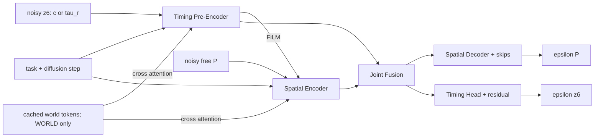

# JointDual 方案评审：基于当前代码、动态数据与相关文献

评审日期：2026-10-17。算法仓库基线：`4684d5d`；runtime 仓库基线：`a368c5e`。同时阅读了工作区中已修改的 multiworld 启动脚本和未跟踪的 storage guard，未修改这些文件。

实际设计文件名为 [jointdual.md](jointdual.md) 和 [jointdual.txt](jointdual.txt)。本文是对方案的评审与落地建议，不代表 JointDual 已实现或已取得实验收益。

实施补充：最终采用公开模型统一的 **P21／16个生成点＋EE pose goal**。raw转换见§19，四版数据/网络/训练/推理的已实现入口、命令与验证见§20。§14～§18保留设计契约；其中旧planner注入与adapter是备选接法，本次采用独立JointDual engine复用物理cost、DenseCheck、ranking及服务协议。原P29审计事实与旧版入口保留。

## 1. 核心判断

**建议实施 JointDual，保留 JD-KIN / JD-WORLD 双分支信息流；V1 统一生成 `P_free + z6`，支持 `KIN-c / KIN-tau_r / WORLD-c / WORLD-tau_r` 四种配置、分别训练 checkpoint。优先解决数据读取、codec 一致性、条件对照及重规划接口问题，不能直接按原文伪代码开训。**

这里 `P_free` 最终指 **16个生成点**，包括15个内部点和1个终点关节配置；解码为P21。goal使用末端位姿，终点关节角不作为网络条件。现有P29标签须从raw重新拟合并重验，转换后再进入四组合的共同训练视图。

理由如下：

1. **网络方向成立。** timing latent 调制空间编码器，空间 bottleneck 回馈 timing head，两端共享 joint fusion，能够学习当前 factorized 模型没有直接训练过的 noisy space-time 联合去噪关系。
2. **当前主要缺口在数据与表示契约。** 新动态数据实际是 `warehouse_spacetime_joint_v1`、`P29 / c8 / tau_r6`；现有 timing loader 读取另一套 `spacetime_mpd_v1` 格式。原文另加 `log T` 会引入第三套表示。
3. **JD-WORLD 更可能改善的是有限预算下的候选有效率。** 现有训练数据已有障碍未来轨迹，足以开始验证 world conditioning；它是否减少 guidance、是否提升闭环成功率，仍需实验。
4. **现有两批数据各有用途。** 按障碍数配比的大数据适合训练基础分布；同 family 的 multiworld 适合补足条件变化与配对评估；另外还需要小规模、严格控制变量的 phase/speed/direction 反事实数据。
5. **首轮不要加入 corridor、mode allocation、precision head。** 先把联合先验与条件收益测清楚。原文的 mode 估计与 quota 公式需要修改，不能直接作为 V1 的组成部分。

优先级建议：

| 优先级 | 必须完成的事 | 不完成会影响什么 |
|---|---|---|
| P0 | raw→P21/EE转换、新动态数据 loader 与全局 family split | 当前训练入口不能直接消费主数据 |
| P0 | 统一 `tau_r` 编解码的积分、`T_min` 网格与期限 | 同一标签在训练与推理时可能变成不同的轨迹 |
| P0 | 相同数据、任务边界和表示下重训 factorized 对照 | 无法把提升归因于 joint coupling |
| P0 | 区分 oracle world 与 runtime prediction，明确 rest-to-rest 范围 | 离线结果不能直接解释动态重规划性能 |
| P1 | JD-KIN → JD-WORLD，配对与 world-shuffle 检验 | 确认模型确实使用世界信息 |
| P2 | 多解保留、mode 分析、固定预算重分配 | 在有效先验成立后再改善模式覆盖 |

## 2. 仓库现状：已经有什么，还没有什么

### 2.1 可复用部分

| 模块 | 已有实现 | 对 JointDual 的意义 |
|---|---|---|
| 空间网络 | [TemporalUnet](../mpd/models/diffusion_models/models.py)，已有 FiLM、attention、horizon padding | 可复用 residual block 和编码／解码结构 |
| timing 学习 | [timing_training/model.py](../mpd/timing_training/model.py)，六维 timing diffusion、路径编码器 | 可复用训练工具；当前不是 joint denoiser |
| timing 表示 | [normalized_timing.py](../mpd/parametric_trajectory/normalized_timing.py)、[learned_timing.py](../mpd/inference/learned_timing.py) | 现有 learned codec 已支持 `c` 与 `tau_r`，均为六维；无需另起 `c + log T` |
| factorized 推理 | [factorized_sampler.py](../mpd/inference/factorized_sampler.py)、[factorized_guidance.py](../mpd/inference/factorized_guidance.py) | 可作为 F1/F2/F3 对照，复用物理 cost |
| 动态代价 | [space_time_guidance.py](../mpd/inference/space_time_guidance.py)、[dynamic_collision.py](../mpd/inference/dynamic_collision.py) | 已支持候选各自的物理时间及 timing 梯度 |
| 数据生成 | [generate_warehouse_spacetime.py](../scripts/spacetime_data/generate_warehouse_spacetime.py)、[warehouse_trajectory_fit.py](../scripts/spacetime_data/warehouse_trajectory_fit.py) | 已保存 teacher、拟合参数、world、质量与 robot 指纹 |
| runtime 输出 | [timing_contract.py](../scripts/runtime/timing_contract.py) | 已有 trajectory schema v3、逐候选时间数组，无需推翻输出协议 |

搜索模型、训练和推理代码，未发现 JD-KIN / JD-WORLD 的完整实现。`phase5_joint` 表示推理阶段空间／时间联合优化，**不等于已训练 joint diffusion**；F1/F2/F3 也仍是独立空间先验与 path-conditioned timing prior。

### 2.2 文档与当前代码的几个实际差异

- 现有 `TimingDenoiser` 以完整、干净的路径编码为条件；不能把它原封不动接到 noisy `P_k` 后，就视为已经得到联合模型。必须训练对应输入分布。
- 当前 factorized sampler 的 `_space_step` / `_timing_step` 先预测 clean state，在 clean state 上 refine，再做 DDIM 更新。旧空间 sampler 则另有 `compute_costs_with_xrecon` 开关。原文“沿用现有 intermediate guidance”没有区分这两条路径。
- 当前主数据固定 joint start / joint goal、静止起终点。公开空间模型是完整P21、16个生成点及EE pose goal。本方案统一这个结构，再用转换后的动态数据训练；公开checkpoint仍因训练分布不同而不能作为唯一的因果对照。
- `TemporalUnet.forward` 目前把 attention context 从 `[B,D]` 扩成单 token；world 输入需要 `[B,M,D]` 与 mask，不能只修改配置选项。

## 3. 对现有数据的实际审计

### 3.1 五批主数据的规模与划分

读取了 `data_trajectories_spacetime/Warehouse-TorchSpaceTime-v1-{1..5}obstacle` 的全部 `config.json`、`report.json` 和 `index.json`。下表接受率的分母为生成 attempts，包含源路径检查失败等情况，**不是纯 planner 求解成功率**。

| 动态障碍数 | 已接受样本 | 接受／attempts | train / validation / test | 平均 duration（秒） | 源路径方向 |
|---:|---:|---:|---|---:|---|
| 1 | 33,750 | 33,750 / 52,593 | 27,107 / 3,271 / 3,372 | 5.885 | reverse |
| 2 | 45,000 | 45,000 / 83,904 | 35,903 / 4,516 / 4,581 | 6.729 | forward |
| 3 | 67,500 | 67,500 / 149,908 | 54,108 / 6,576 / 6,816 | 7.316 | forward |
| 4 | 33,750 | 33,750 / 87,658 | 27,056 / 3,360 / 3,334 | 7.840 | reverse |
| 5 | 22,500 | 22,500 / 73,331 | 18,045 / 2,201 / 2,254 | 8.205 | forward |
| 合计 | **202,500** | — | **162,219 / 19,924 / 20,357** | — | — |

五批内部比例为 `3:4:6:3:2`。以上不包含少量 OMPL/smoke/verify 数据，也不把旧静态 timing 数据混入统计。

跨五批索引合并后：

- 共有 **139,524 个不同 family**；同一 family 的 split 冲突数为 **0**。
- 84,099 个 family 只出现在一种障碍数下；47,874 个出现在两种下；7,551 个出现在三种下。现有数据已经有部分跨 world 的 family 配对，可以先利用。
- 方向绑定来自生成器 `row = (start_index + current * source_group_size) % len(paths)`，主数据的 `source_group_size=2`，每批固定奇偶性；每批抽查的 32 个 HDF5 样本也一致。

**判断：数量足够开展 V1，family split 已有良好基础；但“更多障碍使轨迹变慢”目前混合了任务、方向、采样范围及筛选效应，不能只依据上表作因果解释。** 不需要废弃现有数据，应补齐同一方向、同一 family 下的 world 变化。

### 3.2 实际 teacher 与多模态监督

主数据 config 的 backend 为 `torch-forest`。代码 [batch_spacetime_rrt.py](../scripts/spacetime_data/batch_spacetime_rrt.py) 明确说明：这是 ST-pRRTC-inspired directed space-time RRT-Connect + arrival-time forest，**不是 OMPL STRRTstar，也没有声明渐近最优性**。少量 `Warehouse-STRRTstar-*` 数据才使用 `ompl-strrtstar`。训练集与论文描述应保留这个区别。

teacher 最多保留三个 raw solutions，按 arrival time 排序；`validate_result` 依次拟合并在第一个成功处退出。写入训练标签的是一组 `P/c/tau_r`，其余 raw solutions 虽保存，却未自动成为独立监督样本。

本次每批 32 条、共 160 条确定性抽查中：26 条被选中的 raw 路径含纯等待边，41 条使用了非首个 raw solution 才成功拟合。这说明原始 teacher 有一定等待与候选差异；**尚不能说明训练标签具有充分的同 context 多模式覆盖**。

建议离线重新处理已有 raw solutions：

1. 对每个 raw solution 独立拟合并重新检查 `c` 与 `tau_r` 两种实际解码轨迹。
2. 对几何／通行顺序近似相同的解去重，保留 2～4 个有效差异解；少量关键 context 再多 seed 求解。
3. 增加 `solution_id / parent_world_id / fit_reject_reason / encounter_label`。训练按 context 再按 solution 采样，避免有多解的 context 被无意加权数倍。
4. `report.object_motion_mode_counts`、index 中的 `modes` 是障碍物运动类型，不能作为机器人 before/after/wait 的模式覆盖证据。

### 3.3 当前筛选会改变 timing 分布

生成器使用 `max(event_times)+0.25` 作为 arrival lower bound 的输入；[interaction_audit](../scripts/spacetime_data/warehouse_world.py) 又要求每个事件都位于机器人实际执行时间的 5%～95% 之间，并检查障碍曾进入 workspace。

这有助于避免“障碍在机器人结束后才出现”的简单样本，但也会排除**在最后一个障碍事件前已完成任务**的可行解。它不等于每个物体都与最终机器人路径产生了实际 encounter，更不等于所有 before 模式都被排除。

后续新增数据版本建议：以运动学可达时间定义基本 arrival range；把 event/workspace 检查保存为标签，并以固定 nominal 机器人轨迹的碰撞／近碰情况定义难度。保留部分 early-finish、无关障碍与空 world，避免学出“所有事件结束后才到达”的捷径。已有运行中的生成版本保持冻结，用新版本做对照。

## 4. P0：统一 timing 表示，解决已复现的解码偏差

### 4.1 推荐联合变量

当前 `c8` 是 softplus timing spline 的八个完整系数，端点成对重复，六个独立变量；它的积分本身已经决定 duration。原文若不加区分地在这套 `c` 外再生成独立 `T`，语义会重复。

V1 同时支持 `c` 和 `tau_r`；下列公式描述 `tau_r` 分支，`c` 分支的完整契约见 §14。两者共享网络输入输出形状，不共享 latent 语义、归一化统计或 checkpoint：

\[
X_0=(P_{\mathrm{free}},z),\quad z=(\tau,r),\qquad
P_{\mathrm{free}}\in\mathbb R^{16\times7},\quad r\in\mathbb R^5,\quad\tau\in\mathbb R.
\]

完整空间 spline 采用 **21个控制点、degree5**，与公开模型一致。记生成点 `Y[16,7]`，完整 `P=[q_start×3,Y[:15],Y[-1]×3]`：起点三重固定，终点关节配置由网络生成并重复三次，保持rest-to-rest。EE目标通过条件、guidance和最终误差检查满足；不能把teacher的q_goal作为固定终点输入。16点已经满足U-Net长度要求。

当前动态拟合固定phase gauge：`s=0.95*归一化累计弦长+0.05*归一化时间`，给raw wait留出phase区间。转换到P21仍保持这个gauge，以免同时改变CP基数和phase分布；每条新拟合轨迹重新验收。旧公开先验的参数分布仍不同，`adapt_spatial_basis`触发的basis适配不能代替对新分布的训练。

沿用 `decode_shape_latent` 的八系数展开：

\[
g(s;r)=B_8(s)[0,0,r_0,r_1,r_2,r_3,r_4,r_4]^\top,
\]

\[
\rho(s;r)=\epsilon+(1-\epsilon)
\frac{e^{g(s;r)}}{\int_0^1e^{g(u;r)}du},\qquad \epsilon=10^{-3}.
\]

令 `T_min(P,r)` 为当前 codec 对**给定路径及 timing shape**计算的 sampled 速度／加速度 duration 下界，含 2 秒 floor。它不是对所有 timing shape 求解的全局最短时间，也不能替代连续约束证明。

\[
T=T_{\min}(P,r)+[T_{\max}-T_{\min}(P,r)]_+\,\sigma(\tau),
\qquad t(s)=T\int_0^s\rho(u;r)du.
\]

首版期限沿用当前数据的 **14 秒**。`tau_r` 的 z 顺序固定为 `[tau,r0,...,r4]`，shape 已去 gauge，方便复用数据与运行时导出逻辑。`log T` 可以留作独立消融，不应默认替换现有标签。

### 4.2 实测：2049 点标签不能直接换成 128 点 codec

数据生成的 `tau_r` 使用 2049 点计算密度积分、`T_min` 及解码审计；当前 `LearnedTimingCodec` 则默认使用 128 点，并跟随运行时 `num_T_pts`。这不仅改变输出分辨率，也改变 latent 对应的物理 duration。

使用同一组保存的 `P/r/tau`、相同 limits/floor/deadline，每批按索引等距抽取 32 条，共 160 条，CPU 重算结果：

| 检查 | 实测结果 |
|---|---:|
| 2049 点重解码 duration 与保存 duration 的最大绝对误差 | `7.87e-8 s` |
| 128 点重解码 duration 与保存值的误差中位数 | `-0.01995 s` |
| 128 点重解码最大缩短 | **`0.130624 s`** |
| 128 点 `T_min` 相对保存值的最大下降 | `0.154132 s` |

可定位的最差样本：`Warehouse-TorchSpaceTime-v1-3obstacle/shards/shard-000134.hdf5`，group `samples/000024196`，保存 duration `7.639770833 s`，128 点重解码为 `7.509146574 s`。

同一样本又直接调用了现有 Torch `LearnedTimingCodec`：输出 `7.509146587 s`，与 NumPy 对照一致，排除了仅由审计复算公式引入偏差的解释。

**这是 codec 重建偏差的证据，不是本次已经证明发生了执行碰撞。** 但动态碰撞依赖具体时间，不能把 2049 点下通过审计的样本安全性自动转给 128 点解码轨迹。

建议将以下三种分辨率分开：

1. `codec_grid_size=2049`：定义积分常数、`T_min` 和标签语义；保存到 checkpoint。
2. `cost_grid_size=128`：在需要的 phase 上查询 q/t/dq/ddq，用于 FK、cost 和 guidance；复用 codec 的归一化常数与 duration，不在这里重新定义它们。
3. final validator：在 phase 与物理时间两种网格上检查，并在低 clearance／大相对速度处加密。

高分辨率 `T_min` 只需要 spline 的 joint derivatives，不需要在全部 2049 点做 FK。可以单独优化这一部分。若要采用更便宜的积分与极值算法，先通过 round-trip 与约束对照，再升级 codec version；不能静默改现有版本。

### 4.3 tau_r 会改变联合梯度，原文公式需要补项

原文把 `P/c/T` 视为独立变量，空间梯度只写了 FK／距离项。选择本仓库的 `tau_r` 后：

\[
\frac{\partial t(s)}{\partial P}
=\left(\int_0^s\rho(u;r)du\right)\frac{\partial T}{\partial P},
\quad
\frac{\partial T}{\partial P}
=(1-\sigma(\tau))\frac{\partial T_{\min}}{\partial P}
\]

在 `T_min < T_max` 区域成立。因此空间变量也能通过 duration 改变 encounter 时间。`r` 同时影响密度、`T_min` 和 duration；`tau` 主要控制可用 duration 区间中的位置。

这里应保留 autograd 全链路，不应沿用“空间梯度只有 FK 项”的手写近似。`T_min` 的 max 和 obstacle 插值／SDF 可为分段可导，不必苛求全局连续可导；需要在远离切换点的位置做有限差分对照，并检查切换点的数值稳定性。

当 noisy path 导致 `T_min > T_max` 时，当前 codec 有意输出超期限 duration，交由 penalty 与 validator 处理；此时仅改变 tau 不能修复，需要改变 P/r。不要把 `T_min` 强行截到期限内来伪造可行性，这也是 guidance 应以低噪声阶段为主的实际原因。

### 4.4 tau_r 的取舍与独立 duration 消融

`tau_r` 的优点是复用已经验证的数据与 duration 约束；代价是 `T_min` 的 active constraint 切换、对 noisy P 的敏感性，以及固定期限附近的 sigmoid 饱和。`c` 也有已验证标签，且解码不依赖 `T_min(P,r)`，但期限与 v/a 可行性更多依赖 guidance 和 validator。四种组合用于实测这个取舍，不预设哪种表示一定更优。

如果实验显示 duration head 长期饱和、P 的更新主要通过 `T_min` 引起非预期时间变化，可在同一套 P/r 标签上增加 `u_T=log T` 消融：直接从现有已审计样本恢复 T，无需重做 teacher；生成时不再通过 `T_min` 解码，改由 v/a 与期限代价、最终 validator 约束。两种 codec 需分别版本化，并让各自的 F-matched 与 Joint 使用相同标签和检查流程。

若未来需要可变 deadline，必须把期限作为 task condition，并按新期限重编码 tau；当前只在 14 秒标签上训练的模型不能被假定已学会任意期限。

## 5. 数据接入与 multiworld 的修改建议

### 5.1 先生成P21派生数据，再增加独立 loader

`SpaceTimeTimingDataset` 要求 `manifest.schema_version=spacetime_mpd_v1`、`part-*.hdf5` 和按字段排列的数组；主数据则使用 `manifest.schema=warehouse_spacetime_joint_v1`、`shard-*.hdf5`、`samples/<id>/...` 分组，以及 `index.json` 的 split。

本次实际尝试读取主数据，入口直接报：

```text
ValueError: unsupported schema in .../manifest.yaml: None
```

当前已有 [refit_warehouse_eegoal.py](../scripts/spacetime_data/refit_warehouse_eegoal.py)，从原 `warehouse_spacetime_joint_v1` 的raw轨迹重拟合并写为 `warehouse_spacetime_eegoal_v1`。新训练loader读取这个P21派生schema；原始schema可用于转换与审计，不能直接当作P21训练标签。建议新增 `WarehouseJointDataset`，从派生 `index.json` 中读取entry，保留原loader服务旧timing训练：

| 返回字段 | 来源／约束 |
|---|---|
| `P_full / P_free` | 派生数据的 `spatial/control_points[21,7]`／`spatial/learnable_control_points[16,7]`；验证knots、degree和重建关系 |
| `z_raw[6]` | `c`：编码 `timing/control_points`；`tau_r`：直接读取 `timing/tau_r`，固定 `[tau,r0,...,r4]` 顺序 |
| `task` | `condition/q_start`、`condition/ee_goal_pose`；q_goal仅作为label/分析字段保存 |
| `world` | times / positions / shape / size；与数据 evaluator 完全一致 |
| `sample_key` | 数据内容 namespace、family、direction、world、solution |
| `split` | 现有 `train/validation/test`；显式处理 `validation` 与旧 `val` 命名 |
| `quality` | c 使用 `quality_json`；tau_r 使用 `tau_r_quality_json` 并要求 `tau_r_valid`；四组合主对照取共同有效样本 |

`execution/*` 当前由 c codec 导出；它与 tau_r 重建结果很接近也仍是两种表示。训练 tau_r 的辅助重建目标应从 tau_r 对应轨迹生成，避免同时对齐不完全一致的两个目标。不要只学习保存的 `T_min`，推理必须对新 P/r 重新计算。

所有根目录沿用相同的 family split，禁止拼接后重新逐样本 random split。长期建议把 namespace 从 size/mtime 升级为稳定的 source 内容指纹；源文件复制后 size/mtime 契约可能改变。

### 5.2 当前 multiworld 做对了什么

[run_warehouse_multiworld.sh](../scripts/spacetime_data/run_warehouse_multiworld.sh) 调用 guarded wrapper，底层为 [generate_warehouse_multiworld.py](../scripts/spacetime_data/generate_warehouse_multiworld.py)。其当前行为是：

- 从曾在 ≥3 障碍历史数据中成功的 family catalog 抽样；catalog 有 104,319 个 family。
- 每个 family 选择一个方向，六个 0～5 障碍 world 共用这个方向和 start/goal。
- 为每个 count 独立采样 world；场景失败、teacher 未解、拟合拒绝保存在 ledger，不悄悄用另一个 family 替代。
- split 继续按 family 决定，能够与旧数据合并；空 world 是新增的有用基准。

这些设计有助于缓解旧数据中障碍数／方向绑定，也保留了失败分母。**建议保留当前生成任务，按已有 contract 完成；在此之外新增实验数据版本。** 本次未在默认本地数据目录找到已发布的 multiworld index/report，因此这里评价的是当前脚本行为，不推断实际在跑任务的规模或完成率。脚本默认 `NUM_FAMILIES=200` 也不代表实际运行一定用了 200。

### 5.3 它还不是严格的单因素反事实数据

world seed 包含 count；障碍 shape、motion、event、anchor 都重新抽样；1～2 障碍与 3～5 障碍的 event/anchor fraction 范围又分别为 `[0.25,0.65]` 与 `[0.25,0.80]`。所以六个 world **不是同一组障碍逐个增加的嵌套序列**。

这不影响其作为“同任务、多世界”的训练数据，但不能单独隔离 count 或 phase 的作用。`world_id=count` 也只适用于每个 count 一个 world 的当前协议，新增变体必须增加真正的 world/variant id。

建议补两类数据，而不是把所有要求塞进正在运行的生成器：

| 数据类 | 固定什么 | 改变什么 | 用途 |
|---|---|---|---|
| nested-count | family、方向、前 k 个 obstacle tracks | 从 0 增至 5 个障碍，共同范围采样 | 估计障碍数影响 |
| phase/speed counterfactual | family、方向、障碍数、几何、空间轨迹 | 单个／少数障碍的 phase、速度或方向 | 检验时序条件是否被使用 |

新增 phase 数据时，所有 world 使用相同 observation/forecast 时间网格，不能让“插入的精确 event knot 位置”单独成为标签捷径；每个变体都重新求解、拟合、验证。

还应在同一个 world 下多 seed 求解，区分两件事：**同任务不同 world 的适应能力**与**同任务同 world 的多解能力**。目前 multiworld 主要强化前者。

### 5.4 如何组合数据

先将现有主数据转换为P21/EE派生版本，按各障碍数和family报告重拟合保留率，再训练JD-KIN与JD-WORLD初版。WORLD不必等完整的大规模multiworld才开始，但必须使用已转换并重验通过的样本。

配对集进入训练后，建议固定 train family 集合，先按 family、再按 world、最后按 solution 采样；起点可用 70% 主数据、30% 配对数据，随后用验证结果调整。这是工程初值，不是论文结论。小批配对数据反复过采样可能只记住少数任务，应报告有效 family 数与重复次数。

测试集同时保留自然配比结果与按 obstacle count 等权的 macro 平均。不要只对六个 world 全部成功的 family 评估：catalog 本来已经偏向历史可解任务，若再按六 world 全解筛选，会进一步偏向容易问题。另设从全源任务随机抽取的外部测试集，保存 teacher-unsolved、fit-rejected 等状态；teacher 超时不等于场景不可行。

## 6. 建议采用的 V1 模型与训练方式

### 6.1 保留双分支，不要求同步执行顺序

原文和 txt 的信息流合理，推荐落成下面的网络；这里的“两路”指特征流，不是先后调用两个已经训练好的生成器。



首版可沿用空间通道 `[32,64,128,256]`、timing latent 128、joint fusion 256、4 heads；它们都是起点，不是必须追求的最优参数。两个输出都依赖 joint fusion，保持 timing residual path。

补充四个实现点：

1. **显式提供phase／控制点位置信息。** 16个生成点无需padding；V1的timing聚合使用固定长度、有序bottleneck flatten。最后一个点是生成的终点关节配置，不能mask掉。CP顺序不是物理时间顺序，时间由所选codec决定。
2. **WORLD attention 单独接入。** 不把 task context 替换为 world tokens。空间中层／bottleneck 与 timing 单 query 各一个 cross-attention 块即可先验证。
3. **预训练迁移需按层核对。** 现有 FiLM 使用 `scale*h+bias`，原文写 `(1+gamma)*h+beta`；若改成残差调制，初始化和权重加载要匹配。额外 timing/world adapter 可以零初始化，但最终必须解冻骨干学习 joint 关系。
4. **旧 timing path encoder 是 clean-path encoder。** 若复用其 q/q_s/q_ss 特征处理 noisy P，导数会放大噪声；先从空间 bottleneck 给 timing head 供信息，别强制重复运行这一套路径编码器。

### 6.2 同一个 diffusion step，两块独立噪声

对归一化后的 P 和 z 使用同一 cosine schedule 与同一个 k，每个元素独立采样 Gaussian noise。联合相关性由 denoiser 学习，不需要人为关联噪声。四组合主实验采用相同的两块 mean loss：

\[
L=\lambda_P\operatorname{mean}(\hat\epsilon_P-\epsilon_P)^2
+\lambda_z\operatorname{mean}(\hat\epsilon_z-\epsilon_z)^2.
\]

`lambda_P=lambda_z=1` 为起点；空间块是112维，z是6维。tau_r另外记录tau与r各自的mean loss，但默认不把它们各加一次：`mean(z_error²)=(tau_error²+5*mean(r_error²))/6`。若改用独立tau/r权重，须作为额外消融，避免与c的表示比较混入loss加权差异。

- P 使用固定 joint limits 或明确保存的 spatial normalizer；task 的 q 用同一坐标变换。
- c6 与 tau_r6 各用 **train split** 统计的逐维标准化，同表示的 KIN/WORLD 共享统计；保持无界 latent 语义，不把 timing 块硬截到 `[-1,1]`。
- 保存 codec version、grid、rho floor、duration floor/deadline、robot hashes、phase gauge、normalizer 与 dataset identity。
- V1 不加训练 collision loss。若之后加，低噪声启用并单独消融；先排除 codec/标签错误，避免让额外 loss 掩盖它们。

建议先用 100 diffusion levels、AdamW `1e-4`、effective batch 256、EMA 0.999、gradient clip 0.5～1.0；物理 batch 依显存选 64～128。先做 256～1024 个样本的训练／采样重建检查，再训练 10k steps 观察 trend；按验证规划结果决定是否延长至约 30～100 个 epoch。不要直接照搬静态论文 3M steps，也不把这些超参当成已验证结果。

WORLD dropout 建议按**样本**进行，首轮 0.1；保持 task 和硬边界，别照伪代码把整个 batch 一起随机删 world。零障碍 world 与未知／drop world 使用不同状态或 token，否则 CFG 的无条件分布会与真实空场景混淆。

## 7. World encoder：重点是时间基准与可部署性

### 7.1 token 的最小输入与缓存

V1 token 包含 `position / velocity / shape / size / physical time embedding` 并配合有效性 mask；`observation age / uncertainty` 留给有相应标签的 prediction-conditioned 扩展。现有离线障碍没有变化的姿态，不必凭空加 orientation 标签；以后支持旋转时再扩展。

以统一的 `execution_start` 为零点，按固定秒制 horizon 采样 16～32 个时间点／障碍作起步，保留真实时间 PE。当前 0～5 障碍时约 0～160 tokens；runtime 最大 16 障碍时需单独检查计算和分布外表现。8～16 个时间点未必足够区分 stop_go／zigzag 的短事件，应该用上下采样对照决定。

世界 token 编码在一次 plan request 内缓存，候选共享。token 不应随每条 noisy candidate 的 T 改变采样窗口；若使用归一化时间，还必须提供物理 horizon，避免同一时间 token 在不同候选里表示不同的秒数。

object permutation 应不改变输出。单纯 flatten obstacle-time tokens 可以先试，但应保留同一 obstacle 的 track 分组与运动连续性；必要时加轻量 per-object temporal encoder。无需使用随意编号的 object ID embedding 来记忆障碍。

padding、0 障碍、world dropout 必须显式处理。现有底层 `CrossAttention` 有 mask，`TemporalUnet` 上层尚无对应的 variable-token 接口；全 mask 也不能当作正常 attention。推荐 EMPTY / NULL token 保证至少一个合法 K/V。

不要将 `family_id`、teacher 的 reference path、anchors、event_times、fitted solution index、生成器已知 motion-type 标签输入网络。它们可以用于分析与构造 paired data，runtime 通常没有这些信息。world position/time 曲线本身才是预测接口能提供的内容。

### 7.2 oracle 与 runtime 有实质差别

离线数据存的是 14 秒内完整、确定的 piecewise-linear oracle 轨迹；runtime 的 [dynamic_world.py](../../../physical_ai_runtime/src/motion_planning/motion_planners/mpd_dynamic_planner_adapter/mpd_dynamic_planner_adapter/dynamic_world.py) 使用常速度 Kalman tracker，MPD 的 `FixedCapacityDynamicWorld` 按位置＋速度外推，并按预测时间膨胀不确定性。

因此应分三个层次报告结果：

1. **Oracle planning**：网络、cost、validator 使用同一离线 world，验证算法能力。
2. **预测鲁棒性**：网络和规划 cost 使用 runtime 形式的预测，独立评估使用真实未来；加入观测延迟、速度误差、短 prediction horizon。
3. **闭环重规划**：按当前 tracker、handoff、deadline、collision guard 执行，记录任务完成／停机／切换。

不建议把标签对应的 oracle W 随机改坏后，仍强制模型逐点回归同一“最优解”。较稳妥的路径是先训练 oracle 版，再从真实或模拟 observations 生成 prediction-conditioned 数据：记录预测与真值的角色，必要时重新规划／验证，明确这是不确定条件下的监督。

### 7.3 对齐 handoff，而不是请求发送时间

adapter backend 已把 `handoff_unix_ns` 作为 trajectory start 传给 worker。现有动态 cost 使用：

\[
t_{\mathrm{obs-relative}}=t_{\mathrm{candidate}}
+(t_{\mathrm{handoff}}-t_{\mathrm{world-stamp}}).
\]

JD-WORLD token 也必须做同样平移，并与 cost/validator 使用同一 `world_version`。同一个 snapshot 若 handoff 改变，token 缓存必须失效；不能只以 world version 做 key。若手头 prediction 的有效期不足以覆盖 handoff＋candidate duration，应明确失败或更新预测，而不是越界外推后称为同一实验。

## 8. Guidance 与安全验证：保持对照一致，再优化效率

### 8.1 原文哪些建议保留，哪些需要改

| 原建议 | 评审判断 |
|---|---|
| 同步 joint denoising、最后几步解析修正 | 保留，符合当前 codec 的低噪声可解释性 |
| 把所有代价改为 clean-space | 不要求；应作为独立算法选项 |
| 默认 intermediate 一定优于 clean | 证据不足；当前 factorized 本身使用 clean refinement |
| WORLD 首轮少做 guidance | 效率实验可以，主因果实验先与 KIN 使用相同 guidance |
| 固定 phase 点上直接 sum 动态 cost | 不建议替换现有时间加权 mean/CVaR，避免引入新的目标偏差 |
| 网络输出＋soft cost 代表安全 | 不成立；继续走独立验证与 runtime guard |

第一版推荐以当前 factorized 的 clean-refine 路径作为可核对基准，另实现 late intermediate/reverse-state 选项，并用相同 cost、梯度次数、步长搜索预算比较。原文提到的个人静态实验没有在本次工作中重新复现，不能直接推出新 timing codec 上也有同样排序。

DDIM 回写方式也要一致：现有 factorized `ddim_update` 会根据修改后的 clean state 重算 effective epsilon；旧空间 clean A1 分支则保留原始 denoiser noise。主实验必须选定同一配方并记录，不能只把两者都标为“clean guidance”。

### 8.2 物理时间加权与梯度审计

当前 `SpaceTimeCostEvaluator` 已有基于实际时间的 dynamic mean/CVaR，以及按 `dt/ds` 积分的 velocity/acceleration 代价，优先复用。

\[
\dot q=q_s/u,\qquad
\ddot q=q_{ss}/u^2-q_su_s/u^3.
\]

其中 c 分支 `u=0.05+softplus(Bc)`，tau_r 分支 `u=T*rho`；两者向同一个 cost evaluator 提供物理量。

以固定 phase 下的简单 sum 代替物理时间积分，会让机器人通过调整时间密度改变风险权重；改变采样点数也会改变 cost 尺度。复用现有实现更有利于解释 joint 的单独作用。

新 joint guide 应检查 P/z 梯度的方向、norm 与 clip ratio，tau_r 再分列 tau/r；不要重复叠加旧固定时间 velocity/acceleration cost。已有 guide 里“spatial descent direction”与 autograd gradient 的符号不同，封装新类时需明确接口含义。

若 P 每步都更新，factorized 的 fixed-path FK cache 不能跨步复用；只有明确固定 P 的 timing block 可以复用。可以缓存 world 编码、B-spline basis 和 robot 静态结构。

### 8.3 最终检查的边界

最终必须检查候选自己的 q/dq/ddq/time、期限、joint limits、静态／自身／动态碰撞，并保持选中 trajectory 与 top-K 对应时间数组一致。输出分辨率为 128 不代表只在 128 个点做最终验收。

现有数据审计已明确是 sampled sphere/primitive collision；本次也没有运行连续碰撞认证。建议在统一时间网格与 phase 极值附近补样，记录时间步长及最小 clearance。只有使用了带界的 swept-volume/连续检查时，再声称连续安全保证。

## 9. Mode allocation：暂缓，先修正定义

原文 mode reasoning 放在 predicted-clean 上、总候选预算固定，这两个原则合理，但实现上有四个问题：

1. **`before / after` 是通过顺序，`wait / detour` 是行为。** wait-then-after、detour-and-before 都可能同时成立，不能简单分成四个互斥类。建议分开记录 encounter order 与行为属性，并允许 `uncertain / no-encounter`。
2. **全局 swept 最小距离的 argmin 不稳定。** shuttle/orbit 可多次经过同一位置，robot 也可能多次接近；单个 `(s*,t*)` 会任意选择一次 encounter。应按相关 robot body、空间接近区间和障碍经过事件提取多个关联，再比较顺序；这不要求建立 corridor。
3. **大 `dt/ds` 不等于真等待。** 真实速度还取决于 `q_s`；应排除起终点天然低速区，比较内部 q/progress 在一定时间窗内的变化。有限正 timing density 通常只能近似等待，当前 spatial fit 的时间混合 phase gauge 也会参与表示等待。
4. **逐 mode Round 不保证总和正好 N。** 应使用 largest-remainder 分配，显式处理 `M*N_min>N`、空簇、无效簇。统计 clone 后有效独立候选数，不能把完全相关复制视为新增覆盖。

将这一层定位为启发式 candidate allocation，而不是“恢复真实模式概率”或“提供安全保证”。先在不 allocation 的模型上测出已生成的有效模式，再做单个中后期 checkpoint 的干预；固定 N 外，还要计入聚类、重新预测和额外 cost 的时间。

## 10. 怎样实验才能判断 JointDual 值不值得

### 10.1 四组合矩阵与 factorized 对照

Factorization 在概率论上并不丢失表达能力：

\[
p(P,z\mid task,W)
=p(P\mid task,W)\,p(z\mid P,task,W).
\]

所以“joint 一定比 factorized 更强”不是理论结论。当前 factorized 的具体限制是空间 prior 未看 W、timing 只看 clean P、训练与交替采样存在分布差异。应比较实现中的这些差异。

| 对照 | prior 输入与训练 | 主要回答什么 |
|---|---|---|
| F-matched | 相同派生数据、P21/16点、同选定c/tau_r、EE goal；独立空间／timing训练 | 当前factorized在公平数据下的水平 |
| JD-KIN | 同数据、joint noisy state、不给 W | 联合去噪是否值得 |
| JD-WORLD | 同数据、同 joint backbone、加入 W | world conditioning 是否改善候选效率 |
| F-WORLD（第二阶段必要） | 空间与 timing 两个 factorized prior 都看同一 W | 收益来自 joint，还是主要来自环境输入 |

额外保留旧公开空间 checkpoint＋旧 timing checkpoint，作为现有系统参照，但单独列示。静态 path＋TOPPRA 与 Torch teacher／OMPL teacher 可作非学习型 baseline；TOPPRA 本身不处理动态 world，额外调度或修正必须计入时间。

JD-KIN / JD-WORLD 各自训练 c 与 tau_r，共四个 JointDual checkpoint。表中 F-matched 也应按表示分别匹配；不能用 `F-c` 对 `JD-tau_r` 直接推断 joint coupling 收益。首轮四种 JointDual 配置的完整约定见 §14～§18。

主因果比较固定数据划分、CP/codec、joint boundaries、candidate N、cost、validator、diffusion schedule 与 guidance site/budget。容量差异应报告，必要时增加参数量接近的 KIN 对照。效率结论再通过 N、去噪步数、guidance 次数的 sweep 得到。

### 10.2 必须测先验与引导后的两套结果

- `Guidance=0`：看 prior valid fraction、Success@N、模式与 world 敏感性。
- 相同 late-guidance：比较在相同几何修正预算下的提升。
- N 取 `{1,8,32,64}` 起步；比较同 N 与同总耗时下的 success，而不只看 N=100 是否饱和。
- 全部报告 denoising、world encoding、guidance、dense validation、通信／handoff 的时间。WORLD 若加倍做 CFG，两个网络 forward 都计入。

CFG 统一定义为 `eps_u + s*(eps_cond-eps_u)`：`s=1` 才是普通 conditional。原文采用 CAMPD 的 `w` 记法时 `s=1+w`，因此“CFG=0”必须说明指哪个参数，避免误用无条件分支。

### 10.3 World 是否真正被使用

在同一 family、同一方向的 paired worlds 上，尽可能使用同一组初始 noise；做以下对照：

1. 正确 W；同 family 内打乱 W；全部 NULL W。先关闭 guidance，否则 cost 可能修复错误 context，掩盖模型忽略 W。
2. 对严格 phase counterfactual，记录遇到障碍前后的通行顺序、局部慢行／等待和实际可行性变化。并非每对 W 都要求轨迹变化：两边共用一条安全路径时，保持输出合理。
3. 将从 W_a 生成的轨迹放到 W_b 下交叉验证，选择“可行策略确实变化”的测试子集；不能只把输出差异大当作使用 context 的证据。
4. obstacle token 顺序打乱应近似不变；物理时间 shift 或速度方向改变应在相关任务上产生有意义的影响。

### 10.4 测试集与判据

按 family 留出，额外分别测试 unseen world、6～8 障碍、未见运动／速度、短 forecast、延迟观测及真实 runtime prediction。bootstrap 置信区间按 family 重采样，避免把同 family 的多个 world 当作完全独立任务。

核心指标：Success@N、prior valid fraction、最小 clearance、v/a violation、duration、有效 encounter 模式数、规划延迟 p50/p95、deadline miss，以及闭环任务完成率／制动次数／切换次数。短路径和短 duration 只在可行样本中比较，同时给出失败率。

建议阶段判据如下；它们是决策门槛示例，不是保证达到的数值：

| 阶段 | 继续投入的证据 | 不满足时先检查 |
|---|---|---|
| codec/loader | GT round-trip 在规定容差内，重建轨迹通过同一 validator | 采样网格、phase gauge、limits、z 顺序 |
| 小数据拟合 | P/z loss 下降，采样重建正确，无 NaN 与边界错误 | normalizer、padding、固定点、端点语义 |
| JD-KIN vs F-matched | 多 seed 下 Success@N 或同预算成功率稳定提升，或相近质量下减少计算 | clean/noisy 条件差异、采样配方与模型容量 |
| JD-WORLD vs KIN | prior 效率提升，paired/shuffle 证据支持使用 W | 时间基准、反事实强度、token 信息与可行多解 |
| WORLD 降低 guidance | 相同成功率、clearance 和 deadline 要求下总时延下降 | geometry/validator 是否才是瓶颈 |
| 闭环 | prediction 误差与 handoff 下仍有收益 | oracle gap、移动边界和执行接续 |

## 11. 接入动态重规划时必须补的一层

实际 adapter 路径为 `physical_ai_runtime/src/motion_planning/motion_planners/mpd_dynamic_planner_adapter`。

当前 `FactorizedMpdRuntimeEngine.plan` 明确拒绝非零起终点速度／加速度；adapter 的 replan job 则可能从 active trajectory 的 handoff 点取 dq/ddq。**因此 rest-to-rest joint 模型跑通，不等于已经支持运动中的重规划。**

V1 建议先限定在静止起点、离线规划与对应 plan-only 测试；随后沿现有 prefix/bridge/validator 处理接续。若采用 bridge 到静止新段，必须把 bridge 的物理时间加入新段 world offset，不能把整个新轨迹仍当作从 handoff 即刻静止启动。

进一步支持 moving-start 时，需要训练标签和条件同时包含 `q_start/dq_start/ddq_start`。例如给定 `u=dt/ds`，边界应满足：

\[
q_s(0)=\dot q_0u(0),\qquad
q_{ss}(0)=\ddot q_0u(0)^2+\dot q_0u_s(0).
\]

这时空间端点控制点依赖 timing，不能再用固定三重 `q_start`。`T_min` 与边界构造也会耦合，必须作为下一阶段设计，不能只删掉 runtime 的 rest-to-rest 检查。

输出继续使用 schema v3 / timing schema v1 的逐候选数组。新增 `planner_kind=jd_kin/jd_world`、checkpoint/codec identity；health 必须报告实际 mode，而不是长期冒用 `phase5_joint`。adapter 的 `SpaceTimeMpdGlobalTrajectoryBackend` 当前检查 exact expected mode，接入时需同步设置。r/tau 应导出为 `timing_latents` 并标 representation，不能标成 physical c control points。

还要保留 `world_version / request_seq / handoff / deadline` 检查，继续走现有 candidate selector、prefix/bridge 验证、collision guard 和 braking。新增学习模型应替换候选生成部分，避免同时改掉已建立的执行契约。

## 12. 文献核查及对本方案的实际启示

以下为本次核对的原始论文／官方实现资料。原文中的内部 `turn...` 引用不适合留在工程设计文档，应换为可追溯的 URL、版本和具体章节。不同论文的机器人、预测假设、检查器和硬件不同，其 success/latency 数字不直接作为本仓库目标。

| 工作 | 核对后的相关内容 | 对 JointDual 的判断 |
|---|---|---|
| [MPD，arXiv:2412.19948v3](https://arxiv.org/html/2412.19948v3)，2025-08 | B-spline prior＋cost-guided sampling；固定 duration；§V 提出用额外 spline 表达 phase-time derivative 的方向 | 支持扩展时间参数，但没有替本项目证明 joint training 的收益 |
| [CAMPD，arXiv:2510.14615v2](https://arxiv.org/html/2510.14615v2)，2026-03 | structured context、可变数量 context、attention、world dropout/CFG；实验含静态 sphere/furniture 场景 | 支持 world token 路线；不等于已验证 variable-duration、动态 forecast 的联合学习 |
| [ST-RRT*，ICRA 2022](https://arxiv.org/abs/2203.02176)／[OMPL STRRTstar](https://ompl.kavrakilab.org/classompl_1_1geometric_1_1STRRTstar.html) | 在 space-time 中处理已知动态障碍、速度限制、未知 arrival time；理论有明确前提 | 支持 teacher 方向；拟合后的轨迹还须独立审计 |
| [ST-pRRTC，arXiv:2609.30533v1](https://arxiv.org/html/2609.30533)，2026-09 | shared forward tree＋goal-time forest；interval-root 版本的理论与 practical recycling 的经验结果区分明确 | 与本仓库 Torch teacher 最接近；不能把论文理论转移到当前简化实现 |
| [TOPPRA](https://arxiv.org/abs/1707.07239)，TRO 2018 | 给定几何路径，利用可达性求解受约束时间参数化 | 适合静态／运动学基准；不能自动解决动态障碍通行顺序 |
| [TLMG，arXiv:2609.36530v1](https://arxiv.org/html/2609.36530)，2026-09 | reconstructed-clean trajectory 上整合 partial prior 与 cost，并在 matching-noise 空间注入逐步释放的 prior | 可启发后期 mode 干预；没有证明所有 cost 都应改在 clean 上，也不是本方案 mode clustering 的验证 |
| [TFDP，arXiv:2610.01959v1](https://arxiv.org/html/2610.01959)，2026-10 | 用 analytical local scores 做训练外 refinement；§A.8 显示 structured layouts 对 coarse initialization 敏感 | 支持保留解析局部修正；不足以替代高维动态模式发现 |
| [SCOPE，arXiv:2610.12431v1](https://arxiv.org/html/2610.12431)，2026-10 | 为 mode-conditioned diffusion 构造、校准局部 precision tubes，并用于控制／预测 | 模式概率与模式内不确定性值得区分；当前数据和主问题不需要先引入 precision head |

CAMPD 的具体 context-attention 架构可参考 §III-B，但其公开 sphere 输入主要是位置与半径；把它扩为 obstacle-time tokens 是**本项目的设计推断**。TFDP 的局部 score、TLMG 的 partial prior 以及 SCOPE 的 precision 都不能作为“JD-WORLD 必然学出 before/wait/after”的证据。

原文 AMPD 的 IEEE 页面本次未获得可读取的论文正文，故不据此引入 SmoothLoss 或特定 adaptive schedule，也不引用二手性能数字作为工程依据。late guidance 的建议已能由 MPD 与当前 codec 的数值行为支持。

## 13. 建议的实施拆分与验收

| 顺序 | 建议新增／修改位置 | 可 review 的交付及验收 |
|---|---|---|
| 0 | 已新增 `scripts/spacetime_data/refit_warehouse_eegoal.py` | 原raw→P21/EE/timing，保留split与失败ledger；先抽样再全量转换 |
| 1 | `mpd/datasets/warehouse_joint_dataset.py`；新文件 | 读取两类新动态数据，固定 split，返回 P/z/task/W；训练／验证 family 零交叉 |
| 2 | 新共享 `mpd/parametric_trajectory/joint_timing_codec.py`，或版本化扩展已有 codec | 分开 codec/cost 网格；Numpy/Torch round-trip、一致的 q/dq/ddq/time 与梯度对照 |
| 3 | 新factorized训练配置与P21派生数据视图 | 同P21/16点、同c/tau_r、同EE goal的F-matched checkpoints |
| 4 | `mpd/models/diffusion_models/jointdual.py`、joint trainer / sampler | 两种 KIN 跑通，再覆盖 WORLD；两路依赖检查，固定预算、正确 hard constraints |
| 5 | `world_encoder.py` 与 JD-WORLD 配置 | 空 W、NULL W、mask、token permutation、配对 world swap 均有明确定义 |
| 6 | 新 counterfactual generator / version | 旧生成任务可继续 resume；新数据有 manifest、ledger、固定 family split、多解记录 |
| 7 | `scripts/runtime/jointdual_runtime_engine.py` 与独立 server/socket | schema v3、codec identity、world/handoff 一致；先 rest-to-rest plan-only |
| 8 | adapter 配置与必要接口扩展 | expected mode、latents 字段、handoff/bridge 及 deadline 检查通过后再测闭环 |

这些是建议的文件边界，不代表需要立即把所有模块全部拆开。应尽量复用现有 cost、validator 和 runtime 输出协议，新增 joint 路径，保持旧 checkpoint 与旧训练入口可用。

最先值得做的实验是：**共同有效数据上的四种 JointDual 组合，以及各表示的 F-matched；配对测试中同时报告无 guidance 与相同 guidance；codec round-trip 通过后再看规划收益。** 如 WORLD 的收益主要来自 W 而不是 joint，则继续保留有竞争力的 F-WORLD；不需要为了名称坚持 joint 必须胜出。

## 附录：本次审计范围与可复核记录

- 仅读取主数据的全部索引／report/config，未全量重跑 202,500 条几何碰撞验证。
- HDF5 抽查：每个 root 按 `index.splits` 的保存顺序展开 entry，用 `np.linspace(0, len(entries)-1, 32, dtype=int)` 取样；共 160 条。检查完整 P/knots、tau_r/T_min、质量、raw solutions、source_row 与 world 字段。
- duration 对照：使用保存的 P/knots/r、机器人 limits、floor=2、Tmax=14，分别运行 `NormalizedTimingSplineNumpy(num_phase_points=128/2049)`、`minimum_duration_for_path`，再以保存 tau 重建 T。这里没有把 c 的 execution 时间误当作 128 点目标。
- 实际执行过 loader 兼容性检查，失败信息见 §5.1；没有改训练代码、启动训练、调用 ROS／仿真或打断数据生成。
- 尚未实证：JointDual 相比各 baseline 的收益、重解码偏差是否在具体样本造成碰撞、WORLD 在 tracker 预测下的闭环改善。本文分别把它们列为待做实验，而不是现有结论。
- 实施补充时另从五个主数据 root 各取 train 首条，共5条，确认 P29→P23、knots35、tau_r6、端点条件及 `decode_timing_latent(encode_timing_control_points(c))` 精确还原；此检查不代替前述审计，也不代表全量重验证。另检查本文本地链接、Markdown 分隔与 YAML 示例语法。

主要本地证据入口：

- [新数据 schema 与写入／划分](../scripts/spacetime_data/generate_warehouse_spacetime.py)
- [teacher 与 arrival forest](../scripts/spacetime_data/batch_spacetime_rrt.py)
- [空间／时间拟合和 dense audit](../scripts/spacetime_data/warehouse_trajectory_fit.py)
- [旧 timing loader](../mpd/datasets/spacetime_timing_dataset.py)
- [归一化 timing 定义](../mpd/parametric_trajectory/normalized_timing.py)
- [运行时 learned timing 解码](../mpd/inference/learned_timing.py)
- [同 family multiworld](../scripts/spacetime_data/generate_warehouse_multiworld.py) 与 [独立 world 采样](../scripts/spacetime_data/multiworld_sampling.py)
- [历史可解 family catalog](../scripts/spacetime_data/assets/warehouse_solved_families_ge3_v1.json)
- [factorized runtime 的边界与 representation 检查](../scripts/runtime/factorized_runtime_engine.py)
- [adapter backend 的版本／handoff／schema 检查](../../../physical_ai_runtime/src/motion_planning/motion_planners/mpd_dynamic_planner_adapter/mpd_dynamic_planner_adapter/backend.py)

## 补充：multiworld 能否用、两版数据怎么处理、原计划哪些必须更正

本节对应后续追问。“两版数据”指按障碍数配比的主数据与同 family 的 multiworld 数据；它们都可以供 JD-KIN / JD-WORLD 使用。

### A. 当前 multiworld 生成规则可用，不要求推倒重做

**按当前规则生成并通过验收的multiworld样本，可作为时空联合模型的数据来源。** 统一P21/EE方案下需先从raw重拟合并重验，不再直接训练原P29标签。非嵌套world、没有单因素phase对照，都不是原始样本不合法的理由；补反事实数据针对实验解释力度。

具体依据是：multiworld 最终调用同一个 `base.validate_result` 与 `fit_teacher`，保存相同的 P29、c8、tau_r6 和完整 world；启动脚本默认传入 `--require-tau-r`，因此进入训练候选的样本同时有 c 与 tau_r 的独立验收结果。存储 guard 不改变这条算法与验收链。

三个需要准确解释的边界：

- 六个 world 表示同起终点、同方向下的六次环境变化，不表示相同障碍逐个增加。因此可训练跨世界适应，不能直接作纯 count 因果实验。
- 相同 world 下目前只有一组拟合监督，不表示已有六种机器人通行模式；六个 count 也不是六个 mode label。
- family 有失败 slot 时，其余成功 slot 仍可进入训练。配对评估按对应 pair 是否存在组织；不必把整 family 删除。失败 ledger 保留用于评估分母，不能把 teacher 未解当作已证不可行。

不要求立即改变原生成器的 event lower bound 或 interaction gate；它们定义了当前训练分布。若研究 early-finish 或单因素时间反事实，再新增版本。训练可用性与分布覆盖是两项不同判断。

### B. 两版都先转换P21，再建立训练视图与一致性处理

| 处理 | 原配比数据 | multiworld 数据 | 是否必须 |
|---|---|---|---|
| 验证 manifest/config/shard identity，读取 group/attrs | 需要 | 同一 writer，可共用 | 必须 |
| 检查 `accepted`、有限值及所选 codec 质量；tau_r 另查 `tau_r_valid` | 需要 | 需要，不能仅看整次运行 complete | 必须；四组合取交集 |
| raw→P21重拟合，提取16个生成点和EE goal | 相同 | 相同 | 统一公开模型结构必须；不能切片P29替代 |
| z 按所选 codec 明确编码 c6 或读取 `[tau,r0,...,r4]` | 相同 | 相同 | 必须 |
| 按 source namespace＋family 统一 split | 保留现有 split | 与原数据对齐 | 必须 |
| 仅用训练部分拟合 normalizer | 需要 | 合并采样方案下统一统计 | 必须 |
| 2049 点 codec 与训练／推理 round-trip | 需要 | 相同拟合链，同样需要 | 必须 |
| world tokens 的 padding、mask、时间与尺寸约定 | 需要 | 额外覆盖 0 障碍 | WORLD 必须 |
| 重新拟合P和timing，重算T_min并独立重验 | 必须 | 必须 | P21方案必须；每world默认仅保留一组通过标签 |
| 严格 phase/speed 反事实与 nested-count 数据 | 可补充 | 可补充 | 专门归因实验需要 |

应创建独立P21派生数据与训练快照，保留原HDF5。两个数据根里相同family的所有world、正反方向和后续raw-solution增广都须落在同一个split。转换脚本消费已提交、身份一致的shards并冻结输入清单；运行中的生成器不受影响。

multiworld 的 `index.json` 没有包含全部额外 attrs，`obstacle_count / direction / world_seed` 等应从 group attrs 或 ledger 补入训练索引。旧配比数据的障碍数可从 config 获取、direction 可从 `source_row % 2` 恢复；不要要求先重写原 shard。

world 原始 times 含额外 event knots，且不同样本长度可能不同。网络可以对原 piecewise-linear evaluator 查询固定时间点得到 token；原始 world 仍保留给 cost/validator。零障碍时保留原来的 14 秒 horizon 和“已知为空”状态，不能把空 track 数组解释为 world 丢失。

### C. 原计划书的事实／契约更正清单

| 原计划中的表述或默认前提 | 以本地仓库为准应改成什么 |
|---|---|
| `X=(P,c,log T)` 可作为当前数据的直接变量命名 | 当前已有两种 codec：raw c8 的六个自由量已经决定 duration；tau_r6 为一个 tau 加五个 shape。必须选定其一或显式转换，不能给 raw c 原样再附加独立 T |
| 所有 T 相关公式都按独立标量求导 | 若采用 tau_r，T 通过 `T_min(P,r)` 依赖 P/r；梯度、约束和解释都须修改 |
| spatial / timing CP 计数只需“沿用旧 factorized” | 原始动态数据是P29/joint goal；统一方案从raw转为P21/16点/EE goal。timing完整系数8，latent为6维 |
| 换路径就能沿用 timing loader | 主动态 schema、分组式 HDF5 和 split 索引与旧 loader 不兼容；两版都需要新读取视图 |
| 当前 TemporalUnet 的 attention 已能接任意 world tokens | 它把 context `[B,D]` 变为一个 token；需增加 `[B,M,D]` 接口，并将 mask 传过 wrapper 到底层 attention，同时保留 task/FiLM 通路 |
| 文中 `(1+gamma)*h+beta` 就是当前 FiLM | 现有实现为 `scale*h+bias`；残差式 FiLM 可采用，但属于结构／初始化变化 |
| 现有 timing branch 可直接当 joint timing head | 它目前以 clean P 的有序路径特征为条件；joint 需要针对 noisy joint state 重新训练，缓存和输入分布随之变化 |
| 只有两个 head 都显式读取同一 `h_joint` 才算 joint | 共享 fusion 是推荐实现，不是数学必要条件；应检查联合输入、联合训练和双向跨分支依赖，避免把某个模块名当作 joint 的定义 |
| 目前默认 guidance 就是 intermediate-state | F1/F2/F3 当前 refine predicted-clean，再做 DDIM；旧空间 sampler 另有开关，需要逐路径说明 |
| 128 点只是降低输出／cost 分辨率，不影响标签 | 现有 learned codec 同时在该网格重算密度积分与 `T_min`，会改变 T；要把 codec 定义网格与查询网格分开 |
| world token 中直接加入 R、v、uncertainty 即有对应标签 | 本地离线数据主要存位置曲线、shape、size；v 应从同一 evaluator 导出，R 可按现有固定姿态约定处理，uncertainty 需要另建预测数据，不能当作已有动态观测标签 |
| world 输入与现有动态 cost 天然对齐 | 离线是 execution-start oracle；runtime 是带 stamp 的预测，必须平移到 handoff，并随 world version/handoff 更新缓存 |
| 当前数据已有充分 robot before/wait/after mode 监督 | `modes` 是障碍运动类型；每 world 仅一组拟合监督。机器人模式需分析／多解加工后另标注 |
| `phase5_joint` 表示 joint 模型已训练 | 它是现有推理优化 mode；现有 learned timing 仍限定 rest-to-rest，移动起点必须另行设计 |

其中 `log T`、残差 FiLM、shared fusion、pooling 与 attention 层数都可以是合理的新设计，**问题在于不能将它们写成现有仓库已经具备、且与当前数据无须适配的事实**。是否采用这些新设计应与“修复事实描述”分别列出。

V1 的明确数据／模型契约可以写为：

\[
\epsilon_\theta(P_{\mathrm{free},k},z_k,k,
q_{\mathrm{start}},G_{\mathrm{EE}},W)
\longrightarrow(\hat\epsilon_P,\hat\epsilon_z),
\]

其中 KIN 在网络侧不提供 W，WORLD 提供相同样本的 world；同表示的两者训练使用同一批 P/z 标签，解码复用同一套物理与 codec 契约。四种组合的实施细节如下。

## 14. 实施契约：四种配置、两种 codec、一条联合状态链

### 14.1 配置矩阵与范围

| 配置 ID（建议命名） | `variant` | `representation` | 网络条件 | timing 输出 |
|---|---|---|---|---|
| `jdkin_c` | `jd_kin` | `c` | task、k、noisy P/z | 六个 c 自由量的噪声 |
| `jdkin_tau_r` | `jd_kin` | `tau_r` | 同上 | `[tau,r0,...,r4]` 的噪声 |
| `jdworld_c` | `jd_world` | `c` | 同上，另加 W tokens/mask | 六个 c 自由量的噪声 |
| `jdworld_tau_r` | `jd_world` | `tau_r` | 同上，另加 W tokens/mask | `[tau,r0,...,r4]` 的噪声 |

实现一套 denoiser / diffusion / sampler 类，以 `variant` 控制 world 通路，以 `representation` 选择标签、normalizer 和 codec；四种配置分别训练并保存 checkpoint。六维输出形状相同不意味着可在加载时切换解释方式。V1 不做一个 checkpoint 内混合两种表示，也不添加第三个独立 duration head。

固定任务契约：Panda 7 DoF、固定Warehouse静态环境、joint start＋EE pose goal、rest-to-rest、P21/degree5、16个生成点、timing degree3/full8、期限 `[2,14] s`、原有phase gauge。WORLD的W表示动态世界；固定静态Warehouse由相同环境与geometry hash确定。公开模型的CP基数和goal表示可对齐，但新phase gauge与动态训练分布仍须通过微调或重训适配。

KIN 的“不看 W”只限制网络输入。loader 保留 world，guidance、最终 validator 和评估仍使用真实对应的 W；不能为 KIN 删掉动态碰撞检查。

### 14.2 编码、解码及导出

| 项目 | c | tau_r |
|---|---|---|
| 标签来源 | `timing/control_points[8]` | `timing/tau_r[6]` |
| raw z | `c8[[0,2,3,4,5,7]]` | `[tau,r0,r1,r2,r3,r4]` |
| 完整系数 | `[a0,a0,a1,a2,a3,a4,a5,a5]` | log-density 系数 `[0,0,r0,r1,r2,r3,r4,r4]` |
| `u=dt/ds` | `0.05+softplus(B8*c8)` | `T*rho(s;r)`，定义见 §4 |
| `u_s` | `sigmoid(B8*c8)*(B8_s*c8)` | `T*rho_s` |
| duration | canonical 网格积分 `u` | `T_min(P,r)+relu(14-T_min)*sigmoid(tau)` |
| P 对时间的影响 | 固定 c 时 `dt/dP=0` | 通过 `T_min(P,r)`；不得 detach |
| 有效标签依据 | `accepted`、`quality_json`、有限值及端点对相等 | 再要求 `tau_r_valid`、`tau_r_quality_json`、有限值 |
| 输出附加字段 | raw `timing_latents[6]`、physical `timing_control_points[8]` | raw `timing_latents[6]`、`timing_tau`、五维 `timing_shape_control_points` |

c 编码复用 [encode_timing_control_points](../mpd/parametric_trajectory/timing_fitting.py)，先检查端点对，不能静默平均不相等的标签。tau_r 的五维 shape 与完整八维 log-density 系数要区分命名。现有 `LearnedTimingCodec` 在 c 分支返回的 `tmin` 只是常数 duration floor，**不是该路径的运动学下界**，新接口可将此项设为 `None`，避免误用。

推荐新增 `JointTimingCodec`，统一提供以下语义接口；名称是实施建议：

```python
encode_label(sample, representation) -> z_raw                 # [..., 6]
normalize(z_raw) -> z_normalized
denormalize(z_normalized) -> z_raw
prepare(P_full, z_normalized) -> decode_context
evaluate(decode_context, phase_query) -> TimingSplineEvaluation
export(z_normalized) -> representation_specific_arrays
```

实现中，标签编码与标准化由 `WarehouseJointDataset` 负责，codec提供 `raw / full_path / prepare / evaluate / phase_at_times / export`，上述是职责划分，不是逐字的函数名保证。

`prepare` 接收物理空间P21，在固定2049网格上算q_s/q_ss、density normalization、T_min（仅tau_r）、u和累计时间表；其结果只属于这一组P/z，任一变化都重新计算。`evaluate`在任意查询phase求q/q_s/q_ss/u/u_s，时间来自同一累计积分表的插值，duration取canonical表末端。禁止在128点或validator网格重新归一化density、重算T_min或重置duration。累计梯形积分及插值规则、数值dtype都写入codec version；解析导数与离散积分之间的误差需要通过重建与网格收敛测试量化。

最终物理时间网格通过同一单调累计表反求 phase，再查询解析 q/dq/ddq。禁止单独线性缩放导出的 time 数组来修复期限：这会使 dq/ddq、碰撞时刻与 latent 不一致。c、tau_r 都保证正 u，但均须拒绝 NaN/Inf、数值下溢导致非严格递增时间及超期限结果。

新 codec 的新契约独立版本化，例如 `joint_timing_c_v1` / `joint_timing_tau_r_v1`；不静默改变旧 factorized checkpoint 的128点语义。公平对照另建匹配 canonical codec 的 factorized 配置。

## 15. 数据加载实施

### 15.1 冻结索引与预检查

建议新增 `scripts/spacetime_data/build_jointdual_snapshot.py` 和 `mpd/datasets/warehouse_joint_dataset.py`。前者一次性生成训练清单、过滤报告、normalizer 与 identity；后者只读这个快照，不在每个 epoch 扫描仍在增长的目录。

先运行§19的转换脚本得到P21派生数据，再按以下顺序建立训练快照。原始数据输入由转换脚本处理，训练loader不混入尚未转换的P29：

1. 显式给出P21派生数据根目录，检查schema为 `warehouse_spacetime_eegoal_v1`。读取每个root的manifest/config/index；同一root内config hash必须与shard一致。不同root的config hash可以不同，合并依据是兼容的机器人、静态几何、spline、单位、frame和codec契约。
2. 只读取 index 指向的已提交 `shards/shard-*.hdf5`，忽略 `.inprogress` 和 `.batch-staging`。multiworld 运行未结束也能使用已发布的完整条目；快照保存当时 entry 清单与 shard 身份，后续续训不自动纳入新增条目。
3. 检查完整P `(21,7)`、生成点 `(16,7)`、knots `(27,)`、degree5、合法knots及展开关系；核对EE pose为 `FK(q_goal_label)`，q_goal仅是标签，网络不读取。检查c8、tau_r6、phase_eta、limits、world times及数组维度。先在原数据精度上检查，再转float32。
4. 分别计算 `valid_c` / `valid_tau_r`；主实验使用二者交集 `valid_both`，四组合共享完全相同的 sample IDs。可另开 c-only 扩展训练，但单列实验，不与交集模型直接作表示归因。无效条目记录原因和数量，不在 `__getitem__` 中随机换另一条掩盖错误。
5. 对齐 source 内容身份，再以 `(source_identity,family_id)` 分组校验 split。已有 split 保留；同族所有 direction/world/solution 不可跨集。发现冲突就停止构建快照并列出冲突，不重新逐行 random split。现有 writer 用 family 的 SHA bucket 划分，本次新增 namespace 用于区分不同源，不重哈希现有 split。
6. 补齐 `direction / obstacle_count / world_id / solution_id / provenance`。主数据 direction 可按已核对的源布局从 `source_row%2` 恢复；multiworld 从 attrs/ledger 取。multiworld 的 `world_id=count` 只在对应生成上下文内有效，不能单独充当全局 world key。
7. 样本唯一键至少含 source identity、root/config identity、file/group、family、direction、world 与 solution；另外用标签和 world 内容指纹识别复制数据。多个 world 共享 P 或相同 family 不等于重复样本，不能据此去重。
8. 输出冻结清单、各 split/来源/count/direction 的样本及 family 统计、拒绝原因、重复情况、采样策略和 normalizer。预检查覆盖全索引与必需字段；完整几何重验证另行批处理，不能把结构检查报告写成全量安全认证。

### 15.2 Dataset 与 batch 契约

| 字段 | 单样本／batch | 用途 |
|---|---|---|
| `p` | `[16,7]` / `[B,16,7]` | 归一化生成点，即 `concat(P_full[3:-3],P_full[-1:])` |
| `z` | `[6]` / `[B,6]` | 按当前 representation 标准化后的标签 |
| `task` | 原始19维／对应embedding | q_start7＋EE position3＋rotation matrix9；不含q_goal与teacher duration，可保留公开模型的分路encoder接口 |
| `world_features` | `[M,L,F]` / padding 后 batch | WORLD 条件，KIN 不传入 denoiser |
| `world_mask` | `[M,L]` / batch | 有效 observation token；与 attention mask 语义一致 |
| `world_state` | `KNOWN / EMPTY / NULL` | NULL 由 dropout 或明确缺失产生，EMPTY 是已知零障碍 |
| `sample_key / family_key / split / provenance` | 元数据 | 抽样、复现与评估；不输入模型 |
| raw world / label quality | 可按需读取 | codec 审计、cost、validator；不用 token 重建高精度 world |

world 原始值为 `times[K]`、`positions[K,M,3]`、`shape[M]`、`size[M,3]`，K 可变。shape0 为 sphere、size[0] 为半径；shape1 为轴对齐 box、size 为半边长；shape2 为 z-capsule、size 前两维为半径和半长。保持 `panda_link0 / execution_start / piecewise_linear_v1`，不能把 box 半边长当整尺寸。

HDF5 handle 采用每个 DataLoader worker 自己打开、只读、有限 LRU 缓存，pickle 时不携带打开的 handle；不把整批 world/raw solutions 常驻 GPU。训练通常只读 P/z/task 和预处理 world features，原始细网格 world 留给独立验证路径。token 可以按 world 内容和预处理 version 做磁盘缓存，但训练中的 world encoder 仍参与反向传播，不缓存过期的网络 embedding。

空间规范化V1使用joint limits affine：`p=(P-mid)/half_range`，q_start使用同一变换；只有空间clean state可按该约定限制到 `[-1,1]`。EE position和9维rotation沿用公开模型的字段与规范化接口；迁移公开条件encoder时使用兼容normalizer，否则用train-only统计并保存身份，不能拿joint limits归一化EE坐标。c6、tau_r6各自用训练集有效交集计算mean/std并记录std floor；同表示KIN/WORLD共享统计。统计不读取val/test，也不随过采样次数变化。

按 §5.4 的 source mixture 作为可配置初值，随后在来源内按 family→world→solution 抽样；固定随机种子与每个 epoch 的采样预算。原始数量比例与训练实际抽样比例分别报告。如果 multiworld 规模很小，降低其混合权重，不把少数 family 重复训练次数误写成数据规模提升。

### 15.3 与旧 planner 的数据接口分开

训练batch不能直接替换旧 `TrajectoryDatasetBspline`。若接旧planner，需下述 `JointPlanningDataAdapter` 接口；**本次独立engine直接从checkpoint构造task、codec与sampler，不走旧dataset/model初始化，因而无需该兼容adapter或训练HDF5。** 以下adapter约定保留用于后续接旧planner的备选方案。

该adapter的 `control_points_dim=(16,7)`、`n_learnable_control_points=16`、`context_qs=True`、`context_ee_goal_pose=True`。`hard_conds={}`；完整P扩回 `[q_start×3,P_free[:15],P_free[-1]×3]`。最后一个生成点必须接受去噪、guidance与EE误差梯度，不能钉到teacher的q_goal。非零dq/ddq请求在进入sampler前拒绝。

[get_planning_task_and_dataset](../mpd/utils/loaders.py)已有精确CP开关。新配置明确写 `bspline_num_control_points_desired=21`、`bspline_num_control_points_exact=true`、degree5、zero vel/acc=true、context_qs=true、context_ee_goal_pose=true；与公开配置 `desired=18` 经自动调整后的实际P21一致。保持精确开关便于审计，dataset分派仍需支持新schema。原P29/joint goal曾对应P23，与当前P21/EE的16点语义不同，不能沿用旧切片规则。

## 16. 网络与训练实施

### 16.1 一套双分支骨干

新增 `mpd/models/diffusion_models/jointdual.py`，建议接口：

```python
JointDualDenoiser.forward(
    p_noisy,             # [B,16,7], normalized
    z_noisy,             # [B,6], standardized
    diffusion_step,      # [B], discrete diffusion index
    task,                # q_start + EE position/orientation; raw 19D
    world_tokens=None,   # [B,M_tokens,128], WORLD only
    world_mask=None,     # [B,M_tokens], True means valid
) -> (eps_p, eps_z)      # [B,16,7], [B,6]
```

当前四个训练配置采用 `model.architecture_version: v2`；省略此字段仍构造历史v1，保证旧checkpoint可加载。v2计算图如下：

1. task MLP 输出128维，k embedding 输出128维；timing pre-encoder 从 z6 与 task/k 得到128维 `h_z`。c 与 tau_r 都使用同形状 MLP，分别训练参数；可额外记录 tau/r 分块误差，但第一版不另换 timing head 容量。
2. P的7维输入投影到32通道并加CP位置编码；无需padding，编码通道32/64/128/256，长度16/8/4/2。前15个变量使用P21/degree5完整样条第3..17号控制点的Greville坐标，最后一个绑定第18..20号控制点的终点变量使用s=1；索引均从0开始。编码为 `sin/cos(s * pi * 2**linspace(0,3,16))`。这是样条顺序坐标，控制点不等于q(s)采样点，s也不等于物理执行时间。task/k/h_z提供FiLM，沿用 `scale*h+bias` 语义。迁移公开权重逐层检查维度，不兼容的新投影单独初始化。
3. 有序 `[B,256,2]` bottleneck按channel-major flatten为512维，直接与128维h_z、task/k拼接；先投影为 `u=Linear(concat(flatten,h_z,k,task))` 的256维，再取 `h_joint=u+Linear(Mish(Linear(LayerNorm(u))))`。不做mean pooling，也没有单独的空间256维预投影。
4. spatial decoder接收bottleneck、skips和h_joint调制，恢复16点输出eps_P；timing head从 `[h_joint,h_z]` 输出eps_z6。h_joint实际进入两路输出，最后一个空间点为生成的终点配置。
5. WORLD：先以 h_z 为 query cross-attend W，再将更新后的 h_z 用于 spatial FiLM；在 spatial bottleneck 加第二个 W cross-attention。两处均为带独立attention/FFN门控的Pre-LN块，公式和初始化见§21。query依赖当前noisy state，每步重算；同请求缓存的是world encoder输出tokens，attention的K/V投影仍在每步计算。KIN跳过world encoder和这两个块，其余结构保持一致。本次没有增加中层attention。

当前 TemporalUnet 未暴露完整 encoder/bottleneck/decoder 接口，建议复用其 residual/down/up block 编写 JointDual 子类或独立类，不靠 forward hook 拼接。当前 `BasicTransformerBlock.forward` 和 `SpatialTransformer.forward` 不传 mask；可在新 world attention 块直接使用底层带 mask 的 `CrossAttention`，或以可选参数向下透传，保证旧调用默认行为不变。不得把 `[B,M,D]` 塞入旧 `[B,D]` context 路径。

16个空间点均参与loss，包括终点配置。若以后允许可变P长度，需要另定义位置编码与mask；此版固定16点。

### 16.2 World encoder 的首版具体选择

新增 `mpd/models/diffusion_models/world_encoder.py`。输入数据契约 `jointdual_world_v1` 固定 L=32 个 `0..14 s` 查询时间点，通过原 piecewise-linear world evaluator 得到 position；velocity 取所在分段斜率，端点与拐点的左右段约定固定并版本化。每个原始token包含position3（m）、velocity3（m/s）、shape one-hot3、size3（m）、相对规划起点的秒数。架构v2保留前12维的固定SI单位数值，时间编码为 `concat(t/14, sin/cos((t/14)*pi*2**linspace(0,3,8)))`，共17维，与前12维组成29维MLP输入。使用固定14秒尺度，不按candidate duration、当前batch或扩散步k缩放时间；输入HDF5、snapshot及world数据契约不变。历史架构v1仍使用原28维输入及原时间频率。

V1 oracle 数据没有真实 uncertainty/observation-age 标签，因此先不把它们做成声称已学会的输入维度；prediction-conditioned 扩展再定义字段及数据。32点是起步超参，需要用更密 token 的对照检查短事件丢失；cost/validator 始终保留原高分辨率曲线。

共享 token MLP 输出128维，可先不增加 object ID 或额外 track transformer；flatten 同一对象的时间点，保留时间 PE。对象 permutation 只改变 token 顺序，不改变物理含义。batch padding mask 设 false；EMPTY/NULL 各有独立可学习 token，保证至少一个有效 K/V。训练 world dropout 每样本概率0.1，替换整条 W 为 NULL，task/边界不变。CFG 条件和 NULL 分支同时预测两块噪声，并对两块使用相同 `eps_u+s*(eps_cond-eps_u)`；默认 `s=1`，不额外执行无用的 NULL forward。

### 16.3 JointDiffusion、checkpoint 与训练入口

新增 joint diffusion/trainer，复用现有 [TimingDiffusion](../mpd/timing_training/model.py) 的 schedule、EMA、优化与保存思路，不直接调用它的 path-conditioned `training_loss`：

```python
k = randint(0, diffusion_steps, size=(batch_size,))
eps_p, eps_z = randn_like(p0), randn_like(z0)
pk = sqrt(alpha_bar[k]) * p0 + sqrt(1 - alpha_bar[k]) * eps_p
zk = sqrt(alpha_bar[k]) * z0 + sqrt(1 - alpha_bar[k]) * eps_z
pred_p, pred_z = denoiser(pk, zk, k, task, world_tokens, world_mask)
loss = mse_mean(pred_p, eps_p) + mse_mean(pred_z, eps_z)
```

alpha广播分别适配 `[B,16,7]` 与 `[B,6]`。P0/z0原标签不裁timing latent，噪声态Pk也不硬截到空间限位。默认纯epsilon loss，训练每step不需要FK/T_min；验证采样运行codec、cost、validator及EE目标误差检查。

建议新增 `scripts/train/train_jointdual.py`、`mpd/joint_training/trainer.py`，四个 YAML 只覆盖两个枚举和 run name，其余共同配置集中管理。以下是待实现配置契约示例，**不是当前可直接执行的入口**：

```yaml
variant: jd_world                 # jd_kin | jd_world
representation: tau_r             # c | tau_r
data:
  snapshot: /path/to/jointdual_snapshot.json
  eligibility: valid_both
spatial:
  num_control_points: 21
  num_free_control_points: 16
  degree: 5
  normalization: joint_limits
condition:
  joint_start: true
  ee_goal_pose: true
  joint_goal: false
timing:
  latent_dim: 6
  codec_grid_size: 2049
  u_min: 0.05
  density_floor: 0.001
  duration_min: 2.0
  duration_max: 14.0
model:
  spatial_channels: [32, 64, 128, 256]
  timing_width: 128
  joint_width: 256
  world_width: 128
  world_time_points: 32
  attention_heads: 4
  world_dropout: 0.1
diffusion:
  num_diffusion_steps: 100
  schedule: cosine
  prediction_type: epsilon
training:
  learning_rate: 0.0001
  effective_batch_size: 256
  ema_decay: 0.999
  gradient_clip_norm: 0.5
  loss_weight_p: 1.0
  loss_weight_z: 1.0
```

KIN 校验 world 设置不生效，不能自动把 W 拼到 task；c 的 density_floor 参数不参与解码，也不因此改变标签。训练 seed、AMP、batch accumulation、weight decay、验证频率与 sampler 配方均另行显式保存。四组合共享数据顺序和实验预算；若 loss 不收敛先调试契约，不同时加入 collision loss、mode allocation。

checkpoint 建议使用版本化 state_dict payload：`checkpoint_version / variant / representation / model_config / diffusion_config / model_state_dict / ema_model_state_dict / normalization / spatial_contract / codec_contract / world_contract / dataset_snapshot_hash / robot_hashes / static_geometry_hashes / step / optimizer / RNG state`。空间与 timing normalizer 都属于模型身份；resume 检查 identity，不允许用 c 的 optimizer 或统计恢复 tau_r 训练。推理校验枚举、CP基数、knots、limits、dtype/积分网格、deadline及 world 预处理版本，再 strict load。

## 17. 推理实施：复用 Phase5 外层，替换联合生成内层

### 17.1 与 phase5_joint 的职责分界

**四组合共用一套 JointDual 推理流程；它可沿用 Phase5 的 world/handoff、物理 cost、最终检查和候选输出，但不能只换 U-Net 权重。** 当前 `InferenceOnlySpaceTimeGuide.reset` 会生成线性 c 和四分组 timing 初值，并维护独立的 timing optimizer；JointDual 的 timing 是扩散状态的一部分，必须从 Gaussian z 经联合去噪产生，不能再被该 reset 或旧 optimizer 覆盖。

| 现有部件 | JointDual 接入方式 |
|---|---|
| `SpaceTimeCostEvaluator` | 继续传 `SpaceTimeTrajectoryState`，复用动态 mean/CVaR、v/a、duration、smoothness |
| 静态/自身空间 cost manager | 复用，其 descent direction 转为一致的梯度符号；避免重复计入旧固定时间 v/a |
| `FactorizedCostGuide` | 复用 full-path/物理 state/clip/backtracking 思路；新 codec/grid 和联合状态管理需适配 |
| `FactorizedSampler` | 复用 schedule/DDIM 数学，不复用 F1/F2/F3 的两个 denoiser 调度 |
| `InferenceOnlySpaceTimeGuide` 的 c reset/Adam | 不进入 JointDual；joint guide 不持有第二份可独立更新的 timing |
| Phase5 postprocess/ranking/top-K | 保留候选与时间配对、排序策略；改查询与 validation 网格接口 |
| runtime 服务和 adapter | 复用请求与执行保护链，增加真实 mode/representation/checkpoint identity |

首版禁止 corridor A。当前 postprocess 用 `hasattr(guide,"codec")` 将 learned codec 路径认作 factorized，启用 corridor 时还会访问 `factorized_settings.method`；JointDual 不能只加一个 codec 属性就沿用这一分支。后续 corridor 扩展需改为显式 capability 判断。

离线 oracle 还需要一个 world 查询适配层，例如新增 `mpd/inference/oracle_forecast_world.py`：将 HDF5 piecewise-linear 轨迹暴露为 `minimum_signed_distance(points[B,H,S,3], trajectory_times[B,H]) -> [B,H,S]`，并为 dense validator 的 collision field 提供逐障碍距离接口。它只对障碍轴做 min，返回机器人球心到障碍的 SDF，由现有 cost/validator 减球半径与 margin。不能直接用 `ForecastBatch.clearance` 替代：该函数已减球半径，并把机器人球和障碍两个轴都约简了；直接接入会丢失每球距离或重复减半径。复用其插值和 primitive 公式即可，时间查询保留 autograd，零障碍返回 `+inf`，越界时间单独判无效。runtime 继续使用当前预测 world 接口；离线 oracle 不能被压成初始位置＋常速度后仍标作 oracle。训练条件、guidance 与最终检查引用同一份原始 oracle 曲线，分别验证这些查询结果一致。

### 17.2 联合 sampler 的明确顺序

新增 `mpd/inference/jointdual_sampler.py` 与 `jointdual_guidance.py`，主对照使用 `eta=0` 的 clean-refine DDIM。令 a_k 为累计 alpha，同一个 k 同时更新 P/z：

1. 校验q_start、EE目标、静止边界和deadline，冻结world snapshot/version与handoff。构造task，WORLD编码对应窗口；初始化 `p_k~N(0,I)[N,16,7]`、`z_k~N(0,I)[N,6]`。默认32个反向步，使用同一100级训练schedule。
2. 一次 joint forward 得 eps_P/eps_z；如启用 CFG，则明确计入两个 forward。分别预测 `p0=(pk-sqrt(1-a)*epsP)/sqrt(a)` 与 z0。只投影 clean p0 到保存的 joint-limit 坐标范围，z0 不做统一 `[-1,1]` 裁剪。
3. 最后30%反向步（按实际反向步序号）在 `(p0,z0)` 上默认做一次joint refinement。展开当前P21，计算EE位置/姿态、静态/自身/动态、运动学及时长代价，反向得到两块梯度；默认步长 `lr_p=.01 / lr_z=.02`，分别做每候选norm clip。终点配置参与EE误差和整条轨迹的梯度。
4. 更新后的 clean P 再投影到 joint-limit 范围，然后以候选为单位对 P/z **一起** backtrack，最多8次折半，沿用现有 duration violation 不恶化规则；有限值失败则回退本次两块更新。这个规则只约束期限修复，不保证动态 cost 单调下降或轨迹安全。c 六个自由量都可更新，不能继承旧 phase5 固定首尾两对、只优化中间四个 c 的 mask。
5. 用修改后的 clean state 重算 effective epsilon，再按现有 `factorized_sampler.ddim_update` 分别更新两块。下一个 level 仍为 noisy state，不把完整 p_k/z_k 强行截为可行轨迹；最终 level 的 next_alpha=1。两块使用相同 step pair，不能沿用 factorized 的不同 space/timing 步数。
6. 结束后可默认追加5次 joint refinement，计入 guidance 总预算；输出最终 `(p,z)`、codec identity、每候选状态与统计。所有消融固定这一预算，也可配置为0。之后只通过同一个 codec 做最终解码、验证和导出。

V1 的 joint guide 仅缓存 world 编码、spline basis 和静态机器人信息；不跨 P 更新缓存 q/FK/T_min。每次 guidance 以当前预测 clean P/z 重新启用 autograd，模型参数冻结，但不能把物理解码包在 `no_grad` 内。tau_r 保留 P→T_min→T→动态碰撞时间的梯度。

对 `T_min>14`、c 超期限或预测窗口不足的候选，分别记录不可行原因。超出可用 world 时间域时不静默 clamp/extrapolate 后当作完整动态验证：可先仅用空间、运动学和期限代价修复，待完整时间域可评估再加入动态项；最终未满足覆盖与期限就拒绝。离线 WORLD 与 cost 使用同一个 oracle；部署预测窗口使用 §7.3 的 handoff 时间平移。

若额外支持旧 phase5 的 intermediate-state guidance，作为独立 sampler 配方实现，并记录作用位置与 DDIM 回写规则。比较时不能一边使用 clean+effective-epsilon、另一边 intermediate，却把差异全部归因于网络。

### 17.3 runtime 初始化与 model adapter

建议新增 `scripts/runtime/jointdual_runtime_engine.py`、`infer_jointdual_server.py` 及离线 `scripts/inference/infer_jointdual.py`。服务采用现有 `DynamicResidentPlannerService` 的 engine factory 和独立 socket。

当前 [MpdRuntimeEngine 初始化](../scripts/runtime/runtime_engine.py) 先读 model `args.yaml`，调用旧 `get_planning_task_and_dataset`，然后构造 [GenerativeOptimizationPlanner](../mpd/inference/inference.py)。后者直接 `torch.load` 完整模型，按 `GaussianDiffusionModel / CVAEModel` 分派并 warmup。因此新 state_dict checkpoint **不能直接传给现有构造函数**；仅模仿 factorized 在 `super().__init__()` 之后换模型，会先加载并 warmup 旧模型，也继承了其 dataset/任务配置。

推荐在这两个构造层增加可选task/data/model工厂或注入对象，默认保持旧行为；JointDual在warmup前构造P21/EE任务、`JointPlanningDataAdapter`、joint denoiser和sampler。model分派需显式认识joint adapter，不能伪装成GaussianDiffusionModel。新任务设置 `keep_last_control_point=True`，由生成的终点点扩回P；旧request如携带q_goal，只能用于解析EE目标或兼容元数据，不得将其作为终点硬约束。独立engine也需保留原请求、world与版本检查。

初始化次序须显式处理：先建 task/data/model 和静态 cost，再建 dynamic/oracle world、joint codec/guide 并绑定 sampler，最后执行 joint warmup。需要时给旧构造链增加延迟 warmup 开关；不能让模型工厂在 dynamic field 尚不存在时执行完整采样。warmup 的虚拟 task/world 不可残留到首个真实请求。

`JointDualModelAdapter.run_inference`对接现有调用：确认horizon16，从qs与EE position/orientation构造task，返回normalized生成点的 `[1,N,16,7]` 最终帧以兼容 `return_chain=True`；同批z、candidate IDs与metadata由 `JointSampleResult` 保存供postprocess。这个单帧输出不应标作完整去噪chain。

如短期复用 `guide.timing_control_points` 这个历史槽位，必须只把它作为最终 z 的只读兼容镜像，并像 factorized export 一样在输出前换成正确 representation 字段；禁止另行初始化或优化镜像。长期使用命名明确的 `timing_latents_normalized`。请求之间 reset 清空全部结果和缓存，候选筛选/排序时以同一 candidate index 同步 gather P/z/time，不能按 duration 再独立排序 z。

旧 planner 可能传入 `initial_x / initial_noise_timestep` 作空间 warm-start。V1 如尚无 joint warm-start，就显式拒绝这些参数；不能吞掉参数，也不能只接 P 而遗漏对应 z。支持时需将上一条同 codec 的 P/z 在同一 k 前向加噪，重新对齐边界和 world。

### 17.4 最终验证、导出与 adapter

当前 `SpaceTimeMpdRuntimeEngine._postprocess_plan_results` 要求 `dense_cfg.runtime_points == evaluation.q.shape[1]`，需要为 joint 分支拆成以下接口：

- cost 在128个 phase 点查询物理 state；canonical codec 仍是2049点。
- final validation 从同一 decode context 查询更密 phase 点，以及例如每0.01秒的物理时间点；按需要加入低 clearance/高相对速度加密。可分两次调用现有 dense validator 后合并 validity，或者分桶/逐候选处理变长采样，不能 padding 后把假点当真实时间。
- 选中候选按统一输出长度查询，生成匹配的 q/dq/ddq/time；top-K 每行都携带自己的时间。重采样不重算 codec duration，任何后处理修改 P/z 都使之前的 validation 失效，需要重验。

旧空间 planner 可能先做固定 nominal duration 的 preliminary 检查；它不得作为 joint 候选最终有效性、v/a 拒绝或动态碰撞筛选的依据。JointDual postprocess 需对候选自己的物理轨迹重验，并以该结果驱动有效集合与排名。保持 Phase5 的排名权重作为首轮基准，之后再独立调权。

最终有效性还须包括EE位置/姿态误差，并将容差写入runtime配置与报告；不能只验证teacher标签的q_goal，也不能把soft EE cost当作已到达目标。输出沿用trajectory schema3/timing schema1。timing_latents导出raw六维，并记录representation、codec/grid及normalizer identity；c导出full8，tau_r导出tau/shape，dq/ddq按真实时间计算。无有效候选返回失败。

建议 `space_time.mode=jd_kin/jd_world`，另设 `representation=c/tau_r`，四组合由两个字段确定。当前 [timing_contract.py](../scripts/runtime/timing_contract.py) 的 `TIMING_MODES` 和 `SpaceTimeGuidanceSettings.from_mapping` 的 `SPACE_TIME_MODES` 都只接受三个 phase5 名称，需要扩展允许值，或为 joint 单独定义设置并复用其 cost 字段。health、artifact metadata 和 adapter 的 `expected_timing_mode` 同步配置；新 mode 不能因此进入旧 timing optimizer 分支。不能只在最终 JSON 改字符串，而内部 contract 仍报不支持。

保留 world_version、request_seq、handoff、deadline、schema 验证以及 prefix/bridge、collision guard 和 braking。WORLD token cache key 至少含 world version/content identity、handoff、坐标变换和 world encoder/checkpoint identity。V1 health 标记 `rest_to_rest_only=true`；运动中 handoff 的扩展仍按 §11 另行实施。

## 18. 实施交付顺序与验收清单

此表保留阶段验收要求；当前D0/D1/D2、四版训练和rest-to-rest推理链已实现，具体测试、入口及未验证的部署范围见§20。正式规划收益与闭环实验仍待执行。

| 阶段 | 交付 | 必须通过的检查 |
|---|---|---|
| D0 raw转换（已实现） | `refit_warehouse_eegoal.py` | 原始两版可读；raw重拟合P21/EE/c/tau_r/T_min；独立重验；原数据只读；失败ledger与resume |
| D1 数据快照 | snapshot builder、Dataset、normalizer、过滤报告 | 派生schema可读；family split无冲突；四组合sample IDs一致；16点/EE条件不泄漏q_goal；多worker读取一致 |
| D2 codec | 两种表示、prepare/query/export、version contract | c encode/decode 与原函数一致；tau 顺序正确；2049点 NumPy/Torch 重建；改 query 点数不改 duration；固定端点 q/dq/ddq；超期限不伪装可行；P/z 梯度对照 |
| M1 网络 | 四种配置、joint diffusion、trainer/checkpoint | 16点输入输出与P21展开；终点配置参与梯度；P/z双向依赖；WORLD mask/EMPTY/NULL/permutation；KIN对W不敏感；checkpoint表示不匹配拒绝 |
| M2 小数据训练 | 256～1024样本 smoke/overfit，四组合各一次 | 两块 loss 与采样结果改善、有限梯度、EMA/保存恢复一致；同表示 KIN/WORLD 共享 normalizer；统计不读取 val/test |
| I1 离线采样 | joint sampler/guide、oracle world adapter | 同步 k、guided clean 回写、两块 backtrack、仅一份 z；oracle 插值/SDF/margin及时间梯度一致；guidance=0与开启均跑通；候选各自物理时间；无效候选的失败路径 |
| I2 runtime | 数据/model 注入、engine/server、schema 输出 | 无旧模型隐式 warmup 依赖；mode/representation 可追踪；candidate gather 一致；与当前 cost/ranking 行为匹配；schema3 round-trip；有限值/期限/窗口检查 |
| I3 rest-to-rest 接入 | plan-only 与 adapter 配置 | world/handoff 变化使缓存失效；拒绝非零边界；best/top-K/time 一致；沿用执行保护链；旧 phase5/factorized 入口回归 |
| E1 对照实验 | 四组合及对应 F-matched 报告 | 固定共同样本、种子、预算、codec、validator；prior与guided结果；按family统计及world-shuffle；记录总延迟而非只报网络forward |

codec 数值验收先以 float64 原始标签对照设定紧容差，再为实际 float32 推理给出明确容差。例如 GT duration 可先用 float64 `1e-6 s`、float32 `1e-3 s` 作为工程目标；q/dq/ddq 需分别报告最大绝对/相对误差及对 v/a、clearance 判定的影响。它们是拟定门槛，未实测前不能写成已达到。非切换点的有限差分用 double precision 检验 P/z 梯度；max 活跃项与插值结点处另测有限性和稳定性。

网络依赖测试在非退化参数下检查 `eps_P` 随 z 改变、`eps_z` 随 P 改变；WORLD 还需检查 W 输入有梯度通路。此测试只证明计算图连通，模型是否学到可用 world 信息仍由 §10 的配对、shuffle 与可行性实验决定。

建议按D0→D1→D2→KIN两表示→WORLD两表示→I1/I2/I3交付。当前P21方案必须先完成raw转换及重验；counterfactual新生成、额外多解增广和moving-start不作为开工前置条件。

## 19. 已实现：原spacetime raw→P21／EE goal派生数据

入口：[scripts/spacetime_data/refit_warehouse_eegoal.py](../scripts/spacetime_data/refit_warehouse_eegoal.py)。它复用原来的phase gauge、timing拟合及phase/time双网格验收；`fit_teacher`新增可选 `spatial_control_points` 参数，默认仍为29，原生成器行为不变。转换器固定传21，不从旧P29降采样，也不复制旧c、r、tau或T_min。

### 19.1 输入、输出和处理顺序

输入支持按障碍数配比数据与multiworld，两者均须为 `warehouse_spacetime_joint_v1`，并包含 `raw/solution_*` 和原world。旧 `spacetime_mpd_v1` timing-only数据不在此入口支持范围；不能缺少raw时偷偷用旧样条替代。

每个已发布原样本执行：

1. 保留原split、family、direction、world及来源，冻结输入清单；转换期间原index继续增长，不会自动改变本次输入。
2. 优先尝试原 `raw/fitted_solution_index`，失败则依次尝试其他raw；每个world最多写一组有效标签。raw起终点必须与原条件一致，原始时间仍从0严格递增。
3. 在原phase gauge下重拟合P21，保持teacher起终点、零速度/加速度；仅拟合时固定teacher终点。写入完整P21和 `concat(P[3:-3],P[-1:])` 的16个生成点。
4. 对新P21从raw时间重新拟合c8；再拟合去gauge的r5，使用2049点重新计算T_min和tau。若尝试整体放慢，会重新验证与原world的相互作用，不假设放慢必定安全。
5. c和tau_r分别检查v/a、期限、静态/自身/动态碰撞及原interaction gate；任一表示失败则继续尝试raw或记拒绝。没有因为改成EE goal而放宽已建立的碰撞检查。
6. 使用当前Panda的 `get_EE_pose(q_goal_label)` 写 `[R|p]` 的 `condition/ee_goal_pose[3,4]`、position3和row-major rotation9。保留 `condition/q_goal` 作为label/分析字段，manifest明确禁止将其作为网络条件。
7. 新schema为 `warehouse_spacetime_eegoal_v1`。分组HDF5保留所有原raw路径和world数值，附带原root/file/group/config/namespace、原与新fitted raw index、multiworld额外attrs。每个shard保存 `conversion_outcomes`，包括每条输入的状态及各raw尝试的拒绝原因。

输出包含 `manifest.yaml`、`config.json`、`input_snapshot.json`、原子提交的 `shards/*.hdf5`、派生 `index.json` 和 `report.json`。`accepted`表示新两种codec均通过；`run_finished`只表示冻结输入处理完成，不代表全部保留。按count报告accepted/rejected，先用pilot估计P21压缩造成的保留率变化。

### 19.2 使用命令

从MPD仓库根目录运行。先对一批数据做小样本pilot：

```bash
python -m scripts.spacetime_data.refit_warehouse_eegoal \
  --dataset-root data_trajectories_spacetime/Warehouse-TorchSpaceTime-v1-1obstacle \
  --output-root data_trajectories_spacetime/Warehouse-P21-EE-pilot-1obstacle \
  --max-samples 100 --shard-size 16 --device cpu
```

`--max-samples`是按root/split/index顺序的前缀，0表示全部；它不是随机或按count均衡抽样。正式转换五个配比root可重复传参，按实际CUDA环境选择device：

```bash
python -m scripts.spacetime_data.refit_warehouse_eegoal \
  --dataset-root data_trajectories_spacetime/Warehouse-TorchSpaceTime-v1-1obstacle \
  --dataset-root data_trajectories_spacetime/Warehouse-TorchSpaceTime-v1-2obstacle \
  --dataset-root data_trajectories_spacetime/Warehouse-TorchSpaceTime-v1-3obstacle \
  --dataset-root data_trajectories_spacetime/Warehouse-TorchSpaceTime-v1-4obstacle \
  --dataset-root data_trajectories_spacetime/Warehouse-TorchSpaceTime-v1-5obstacle \
  --output-root data_trajectories_spacetime/Warehouse-P21-EE-main-v1 \
  --shard-size 64 --publish-every 16 --device cuda:0
```

multiworld可单独转换到另一个root，也可在首次命令中追加其 `--dataset-root`；路径由实际生成任务决定。正式转换默认不限制样本数。转换器的CPU线程默认4，`--collision-chunk`控制碰撞检查块大小；SciPy拟合在CPU执行，device主要影响FK/碰撞，不表示所有拟合都在GPU上。

中断后使用**原命令原参数**追加 `--resume`。恢复以已提交shard及ledger为准，可重建丢失/滞后的index/report；不重复处理已提交输入。拟合代码、选项、机器人/静态几何或已提交源shard身份变化时拒绝续跑，改用新输出root。2026-10-19的进程隔离修复仅对白名单中的初版转换器（`2b7edf2`）开放控制流程升级：保留旧config、config_hash和已提交shard，仍逐项校验其余软件/参数；当前控制器身份另记于 `refit_runtime.json`。改变 `max-samples`、来源root或新增数据仍使用新输出root，不在已有快照上扩充。

输出root必须与输入分开，禁止输入目录本身及其祖先/子目录；脚本使用独占writer lock、staging文件和原子rename，不修改原shard。index/report默认每16个shard发布一次，结束时强制发布；意外中断的未提交staging批次在resume时重算。

默认 `--worker-shards 128`：父进程管理恢复与派生索引，独立的spawn进程执行拟合、CUDA/FK/碰撞与HDF5写盘，每128个shard重建进程，不继承已初始化的CUDA/HDF5句柄。worker持有父进程writer lock的副本，父进程意外退出也不会放行第二个writer。原生信号退出默认 `--worker-retries 2`，从最后提交处重试；同一位置连续失败则报错停止，绝不当作fit rejection或跳过输入。Python异常直接报错。worker在rename之后、发送完成通知之前崩溃，也按已提交shard恢复。`--worker-shards 0`保留单进程诊断方式；这两个运行控制参数可在续跑时调整，不改变标签定义。

`refit_faults.log`保存worker启动位置、原生异常的Python栈和重试记录；`refit_worker_status.json`记录当前输入或写盘区间。它们用于定位，不替代提交ledger。原命令追加 `--resume --audit-only`只核验冻结来源、提交ledger和数据集身份，并重建index/report，不初始化CUDA或重拟合，也不将未提交staging文件当作有效分片。

### 19.3 本次验证及尚未实现部分

新增测试 [test_warehouse_eegoal_refit.py](../tests/test_warehouse_eegoal_refit.py)，覆盖P21/16点展开、EE字段、T_min重算、raw回退、碰撞拒绝、空world、来源保护、family split冲突和提交后中断恢复。连同原fit与multiworld测试共 **24项通过**，默认P29生成行为保持兼容。真实Panda/Warehouse/原动态world上，一障碍train前3条已完成转换并接受3条，输出位于 `/tmp/jointdual_p21_eegoal_smoke_final`；同参数resume成功，原raw/world数值逐项保留，重算T_min及tau duration往返检查通过。这是功能检查，不是202,500条全量保留率结论。

后续实现已补齐loader、四版网络/训练与独立推理入口，见§20。与公开模型对齐的是CP数量、生成点布局、EE字段及静止边界；权重迁移及规划性能需要另行实验。

### 19.4 2026-10-19 全量转换段错误恢复

现场 `Warehouse-P21-EE-main-v1` 有2,767个已提交分片，最后一个为 `shard-002766.hdf5`，ledger覆盖 `[0,177088)`。已用 `--resume --audit-only`完成全部提交分片的身份、范围与accepted ledger核验，并将滞后的index/report从176,128条更新到177,088条：接受172,027条、拒绝5,061条，剩余25,412条。原始数据、冻结快照、config和已提交shard保留。

下一分片 `.refit-staging/shards/shard-002767.hdf5.inprogress`无法正常打开，未提交；它对应的 `[177088,177152)` 输入将在恢复时重算。现场表明中断发生于临时分片写入期间，但没有可用原生堆栈，不能据此断言是CUDA、SciPy或HDF5本身的缺陷。进程隔离限制原生状态的存活时间并补上诊断与恢复，尚未证明底层故障根因已消除。

续跑命令如下，保持原来的来源顺序、device及拟合参数：

```bash
python -m scripts.spacetime_data.refit_warehouse_eegoal \
  --dataset-root data_trajectories_spacetime/Warehouse-TorchSpaceTime-v1-1obstacle \
  --dataset-root data_trajectories_spacetime/Warehouse-TorchSpaceTime-v1-2obstacle \
  --dataset-root data_trajectories_spacetime/Warehouse-TorchSpaceTime-v1-3obstacle \
  --dataset-root data_trajectories_spacetime/Warehouse-TorchSpaceTime-v1-4obstacle \
  --dataset-root data_trajectories_spacetime/Warehouse-TorchSpaceTime-v1-5obstacle \
  --output-root data_trajectories_spacetime/Warehouse-P21-EE-main-v1 \
  --shard-size 64 --publish-every 16 --device cuda:0 --resume
```

新增恢复测试覆盖未提交临时文件残留、提交后通知丢失、连续原生失败不丢输入、worker保留writer lock、初版输出身份兼容与无CUDA的audit；连同原fit、multiworld和JointDual数据/codec测试共 **34项通过**。实际Panda数据还完成了两个CPU分片、每分片重启一次的功能检查。当前工具环境无法连接NVIDIA驱动，未复现原CUDA段错误，也未自动启动剩余全量转换。

## 20. 分阶段实现记录

### 阶段1：数据与codec

已实现 `WarehouseJointDataset`、`build_jointdual_snapshot.py` 和 `JointTimingCodec`。快照检查family划分与机器人/静态资产身份，过滤共同有效标签，统计train-only的c/tau_r/EE normalizer。两种表示共用同一批样本；KIN/WORLD在网络侧决定是否读取world，不更换标签。分组HDF5采用有界只读handle缓存，序列化时不带活跃handle。训练默认单进程读取；多worker使用spawn和超时，当前环境的多进程IPC测试超时，未将其列为已验证路径。

codec使用double precision的2049点canonical积分，独立查询任意phase或physical-time网格，保留tau_r的P→T_min梯度，不把超期限结果截为可行。测试覆盖标签往返、任意网格duration一致、样条重建、梯度、序列化读取及冻结文件变更拒绝；连同转换/原fit测试，阶段1共14项通过。

```bash
python -m scripts.spacetime_data.build_jointdual_snapshot \
  --dataset-root data_trajectories_spacetime/Warehouse-P21-EE-main-v1 \
  --output data_trajectories_spacetime/jointdual-main-snapshot.json
```

可重复 `--dataset-root` 合并P21派生multiworld，输出快照文件必须尚不存在。旧P29生成与旧timing loader入口保留。

### 阶段2：四版网络与训练

已实现 `JointDualDenoiser`、`WorldEncoder`、`JointDiffusion`、独立trainer和四份配置。网络保持P16/z6联合输入、双向fusion；WORLD用带有效性mask的两处cross-attention，区分EMPTY/NULL，KIN不读取W。trainer使用family→world抽样、EMA、梯度裁剪和可恢复的optimizer/RNG状态，microbatch索引由seed/step确定。已验证中断续训与连续训练权重逐位一致；旧空间/timing训练入口不变。

```bash
python -m scripts.train.train_jointdual \
  --config scripts/train/cfgs/jdworld_tau_r.yaml \
  --snapshot data_trajectories_spacetime/jointdual-main-snapshot.json \
  --output-dir data_trained_models/jointdual/jdworld_tau_r
```

另三份配置为 `jdkin_c.yaml`、`jdkin_tau_r.yaml`、`jdworld_c.yaml`。`--device`、`--max-steps`可覆盖配置；`--resume path/to/last.pt`恢复，数据、表示、结构与训练配方不一致会拒绝。最后checkpoint和周期性step checkpoint均包含normalizer、codec/world/static/robot身份，不依赖旧公开checkpoint或原训练HDF5才能加载模型。训练默认100,000 optimizer steps，未在本次自动启动正式长训练。

阶段2新增7项测试，覆盖双向梯度、WORLD对象顺序不变性、空mask和四组合保存/恢复；实际3条P21动态样本上，四组合各训练2步完成并保存至 `/tmp/jointdual_four_smoke`。这些是训练链路检查，不是收敛或规划性能结论。

### 阶段3：四版联合推理、独立CLI与socket服务

已实现 `JointDualSampler`、`JointDualCostGuide`、`OracleForecastWorld` 和 `JointDualMpdRuntimeEngine`。checkpoint中的variant/representation决定四种方式，禁止加载时改解释。stage1提交 `2b7edf2`，stage2提交 `7bd5858`；推理作为第三阶段单独提交。

实现选择与关键约束：

- engine直接构造Panda/Warehouse/P21 task，在加载joint checkpoint后执行自己的warmup，不加载公开模型或旧训练数据。旧空间、Phase5、factorized的CLI/server和配置保持原入口。共享 `timing_contract.py`只新增两个joint输出mode，原Phase5 CLI的mode枚举不变。
- P/z在同一个k同步DDIM，clean estimate上做late guidance，修改后用effective epsilon回写；c六个自由量全部可更新。z始终由sampler持有，不经过旧c reset/Adam。WORLD每请求编码一次并给候选共享；缓存不跨request复用，CFG及其额外forward计入统计。
- 物理代价复用 `SpaceTimeCostEvaluator` 的动态mean/CVaR、时间加权v/a、duration和smoothness。空间使用原SDF hinge及self field，EE使用原SE(3) log误差；静态primitive缺少显式gradient时通过SDF值autograd，self采用原解析梯度的局部代理。空间项按phase mean聚合并记录 `legacy_sdf_hinge_se3_phase_mean_v1`，与旧guide的数值步长、phase聚合及clip仍需在F-matched实验中统一，不能仅凭相同cost名称声称完整采样配方已一致。
- 超期限候选先做明确拒绝/期限修复，不向越界world查询动态代价。有限时长候选分别在2049 phase点与≤0.01s物理时间网格调用现有DenseCheck，要求collision margin、joint/v/a、rest边界和EE误差均通过。`dense_checked`记录实际几何检查数，`bounds_rejected`记录期限预拒绝，所有候选均有决策。
- 排名复用原weighted metrics与Phase5 selection score；导出的top-K、z、q/dq/ddq、collision spheres和各自time使用同一候选索引。无有效候选返回 `no_valid_trajectory`，失败CLI会清理旧成功artifact。输出schema3/timing schema1；health报告 `jd_kin/jd_world`、representation与rest-to-rest能力。
- oracle入口保留HDF5整条piecewise-linear曲线；request/world入口复用CV动态预测及handoff offset、world version、预测有效期。WORLD v1拒绝旋转box/capsule条件，KIN的动态cost仍可处理已有runtime的旋转primitive。两者仍需区分oracle与预测结果；本次未新增prediction-conditioned训练或moving-start。

离线oracle规划：

```bash
python -m scripts.inference.infer_jointdual \
  --joint-checkpoint data_trained_models/jointdual/jdworld_tau_r/last.pt \
  --dataset-root data_trajectories_spacetime/Warehouse-P21-EE-main-v1 \
  --split test --sample-index 0 \
  --output-dir results/jointdual/oracle-0000 --device cuda:0
```

也可使用 `--request request.json --world world.json --trajectory-start-unix-ns <handoff>`；此模式读取现有runtime snapshot格式，缺省world为显式空场景。runtime配置默认为 [config_EnvWarehouse-RobotPanda-jointdual.yaml](../scripts/inference/cfgs/config_EnvWarehouse-RobotPanda-jointdual.yaml)，可通过 `--config`调整候选数、步数、guidance和EE验收容差。checkpoint为默认100级schedule时可用默认32步；短smoke checkpoint须使用不超过其训练levels的采样步数。

独立resident服务：

```bash
python -m scripts.runtime.infer_jointdual_server \
  --joint-checkpoint data_trained_models/jointdual/jdworld_tau_r/last.pt \
  --socket /tmp/mpd-jointdual.sock \
  --output-root results/jointdual/runtime --device cuda:0
```

服务复用 `DynamicResidentPlannerService` 的world上传、request_seq、handoff、deadline和artifact写入。接现有adapter时配置独立socket、匹配 `EnvWarehouse` 的scene以及 `expected_timing_mode=jd_world`（或jd_kin）；representation由worker health/metadata标识。本次没有修改physical_ai_runtime配置或自动启动仿真/执行。

阶段3新增7项检查，含真实Panda的c/tau_r guidance与GT轨迹验收、错误EE目标/移动边界拒绝、旧dynamic服务dispatch及NPZ导出。GT候选被显式注入以验证解码/验收/协议，不计作学习模型的规划成功率。四个仅训练2步的checkpoint均已运行真实sampler＋guidance CLI，并正确以 `no_valid_trajectory` 结束；这验证失败路径，不代表模型已收敛。CPU链路已验证，CUDA与正式长训练/闭环性能尚未验证。

最终相关回归范围包含joint数据/训练/推理、原P29拟合与multiworld、旧timing训练、factorized sampler/guide/CLI/server、Phase5 guidance/CLI、动态SDF与timing contract：**112项通过、1项CUDA检查因当前环境无GPU跳过**。不支持的移动边界等请求以可恢复的PLAN_FAILED返回，worker保留READY；未修改physical_ai_runtime、原multiworld启动脚本或storage guard。

## 21. 网络v2：残差fusion、门控Pre-LN与坐标编码（2026-10-19）

本次修改限定于JointDual网络、公共训练配置、对应测试及本文。保留原Conv1d骨干、16/8/4/2长度、FiLM、decoder skip、timing residual和有序flatten。四种 `jd_kin/jd_world × c/tau_r` 共享v2结构选择；表示方式仍由codec及normalizer区分。数据标签、数据加载、采样schedule、guidance和validator无须随本次网络更新重建。

WORLD恰有两处门控Pre-LN块：early timing query（128维）和spatial bottleneck query（256维）。令 `d=concat(k_embedding,task_embedding)`，每处各自计算：

```text
alpha_attn, alpha_ffn = Linear(Mish(d)).chunk(2)
h1 = h  + alpha_attn[:,None,:] * CrossAttention(LN_query(h), LN_world(W), LN_world(W))
h2 = h1 + alpha_ffn[:,None,:] * Linear(Mish(Linear(LN_ffn(h1))))
```

两个门控各为每样本、每通道的可学习系数；不手工规定高噪声阶段关闭world，也不把它们解释为概率。FFN中间维度为query宽度的2倍。门控Linear的weight/bias初始化为0，attention/FFN输出层保留正常随机初始化：初始块为恒等映射，第一步梯度先打开门控，之后分支和world encoder开始学习。不能再把两条分支的输出层同时置零，否则会阻断门控启动。KIN无这两个world块。

空间坐标、物理时间与扩散步使用独立编码：

| 坐标 | v2含义与实现 | 不应混用的含义 |
|---|---|---|
| s | 前15个自由CP的Greville坐标与终点s=1，固定空间Fourier PE，详见§16.1 | 不声称CP位于q(s)，也不从CP序号计算秒数 |
| t | 从本次规划handoff起算的秒数，固定除14，并保留归一化标量及8对Fourier分量 | 不除以候选duration，不用wall-clock绝对时间，不用batch min/max |
| k | 保留原独立 `SinusoidalTimeEmbedding + MLP`，驱动FiLM、fusion和门控 | 不作为world预测时间，不改变world token的时间轴 |

world时间频率为 `pi..8*pi`（作用于t/14），最高为14秒内4个周期，低于32点采样的Nyquist频率。此选择避免原最高1000 rad/s与稀疏token时间网格严重失配，但32点仍不能恢复未采样的短时事件；原高分辨率world继续用于cost/validator。空间PE的终点绑定规则与本仓库P21展开一致，不适用于任意CP基数。

默认参数量如下；未测量GPU延迟，参数增长不能直接换算为运行时间：

| 模型 | v1 | v2 |
|---|---:|---:|
| JD-KIN | 3,675,987 | 3,742,291 |
| JD-WORLD | 3,960,275 | 4,554,963 |

四个原训练YAML/入口不改名称，通过公共配置显式写入 `model.architecture_version: v2`，checkpoint将该字段保存在model_config中，推理自动构造对应结构。历史checkpoint没有此字段时严格按v1加载；直接调用构造函数而省略字段也保持v1。旧checkpoint续训应使用其保存的原始 `run/config.json`（CLI的YAML loader也接受JSON），保持原model_config及训练配方；不要用现已切到v2的公共配置去resume旧模型。v1→v2不是精确resume，本次不增加部分权重热启动，也不静默迁移权重。旧snapshot和已经转换的数据可直接用于v2新训练，无需重新refit。

本次CPU验证覆盖v1/v2两套结构、四种组合的训练/保存/精确续训、跨架构resume拒绝、双向P/z梯度、门控首步启动与后续分支梯度、world排列/有效性mask/EMPTY、物理时间敏感性、缓存token等价性、CFG采样及坐标规则。运行 `tests/test_jointdual_training.py tests/test_jointdual_inference.py tests/test_jointdual_data_codec.py`：**28项通过，2项因本地真实数据smoke文件缺失而跳过**。额外对照修改前的v1网络，同seed下state_dict与forward输出逐位一致。门控为零时world暂不影响输出属于初始化设计，条件敏感性测试须先打开门控。未开展正式长训练，不能据此声称规划成功率提升；CUDA当前不可用。

## 22. 训练张量缓存与运行工具（2026-10-19）

### 22.1 一次性训练张量缓存

新增 [warehouse_joint_cache.py](../mpd/datasets/warehouse_joint_cache.py)，训练默认 `training.tensor_cache: auto`。首次从冻结snapshot顺序读取HDF5，一次性生成归一化P16、task19、c6、tau_r6以及原始world token/mask/state。两种timing标签同存，四个训练组合复用同一缓存；每个split的样本顺序、family抽样、normalizer和sample_index与HDF5视图一致。缓存保存的是确定性输入张量，扩散噪声/k、world dropout、world encoder输出仍在每次训练时计算。

固定字段使用 `.npy`，world token使用连续二进制文件和逐行offset，避免按最大障碍数padding整个数据集。读取时用NumPy memory map，按需交由操作系统页缓存，不把全量缓存一次装入Python堆内存。KIN不映射、不组装world字段；未启用缓存的KIN也跳过world读取。CUDA时默认启用pin_memory和non_blocking传输；缓存模式仍默认num_workers=0，可按实际机器测量后调整。

```bash
# 可提前构建；不执行此命令也会在首次训练时自动构建。
python -m scripts.spacetime_data.build_jointdual_tensor_cache \
  --snapshot data_trajectories_spacetime/jointdual-main-snapshot.json

# --output可指定共享缓存目录；训练时使用同一路径。
python -m scripts.train.train_jointdual \
  --config scripts/train/cfgs/jdworld_tau_r.yaml \
  --snapshot data_trajectories_spacetime/jointdual-main-snapshot.json \
  --output-dir data_trained_models/jointdual/jdworld_tau_r
```

自动路径是snapshot旁 `.jointdual_tensor_cache/<identity>`；身份绑定snapshot和归一化、world/codec契约、缓存/数据读取实现的代码hash。指定 `--tensor-cache /path/to/cache` 可共享自选目录，`--no-tensor-cache` 保留直接HDF5读取。缓存设置不改变checkpoint的模型/数据契约，允许在精确resume时切换读取方式。

首次构建通过文件锁串行化，临时目录完整写入和flush后原子发布；异常时不发布半成品，不覆盖已有缓存。复用时校验manifest身份、字段shape/dtype、缓存文件size/mtime，以及snapshot冻结源shard的size/mtime；完整内容SHA在构建时保存，不在每次训练启动时重新扫描全部GB文件。源shard、snapshot或读取实现改变后使用新缓存，不能静默沿用旧张量。缓存仍依赖源文件存在以完成身份检查，不能作为独立的数据归档。

实际本地数据前4096条上，以同一组2048个随机索引、batch64、CPU单进程读取与collate测得：HDF5约913 samples/s，缓存约54,630 samples/s；首次构建约4.55秒，占9.36MB。此结果包含操作系统热缓存，数据为该子集的障碍分布，不能直接作为全量数据或GPU端到端训练的加速倍数。默认全量构建由用户启动训练时执行，本次只构建了 `/tmp` 中的4096条基准缓存。
