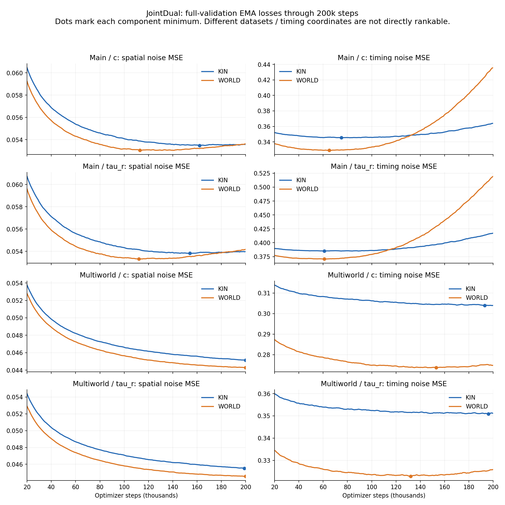
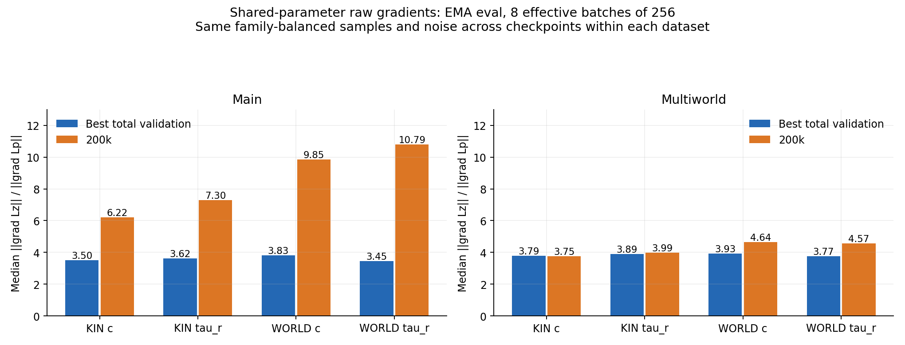

# JointDual：两组数据、八个模型的 200k 步分析（2026-10-22）

结论：main 的四个模型均已发生不同程度的时间泛化退化，WORLD 最严重；multiworld 明显推迟并减轻了这一现象。WORLD 在 multiworld 上提供了更强的时间条件收益。梯度诊断显示尺度失衡比持续方向冲突更突出，但约 4 倍的时间梯度占优本身不等于训练失败。当前优先选择合适 checkpoint、验证物理规划质量，随后再做小规模 loss 权重对照。

## 统计口径

- 读取八个目录的 TensorBoard 与 metrics.jsonl，按恢复训练后的有效记录去重；统一截取至 200,000 optimizer steps。main 的 WORLD tau_r 使用 jdworld_tau_r_1，排除早期中断的同名无后缀目录。
- 八组均为 v2 网络，lr=1e-4、AdamW weight_decay=1e-4、batch=64×4=256、clip=0.5、EMA=0.999、AMP=false；WORLD 的 world_dropout=0.1。main 三个恢复训练记录没有改变配方。
- 验证为完整 split，main 19,289 行，multiworld 39,362 行；曲线使用 EMA。JSON 与 TensorBoard 的验证数值差异小于 5e-8。原 WORLD tau_r 日志末尾一行损坏被跳过，不影响 200k 内结果。
- 单个训练 seed，没有多次独立训练置信区间；下面的诊断不等同于运动规划成功率评估。

## 验证曲线与 checkpoint

| 数据 | 模型 | 总 loss 最佳 step | 最佳时 P / Z | 最佳总 loss | 200k 总 loss | 相对最佳变差 | 空间/时间折中 step |
|---|---|---:|---:|---:|---:|---:|---:|
| main | KIN c | 91k | 0.054318 / 0.345509 | 0.399827 | 0.417438 | +4.405% | 123k |
| main | KIN tau_r | 89k | 0.054573 / 0.385056 | 0.439629 | 0.471131 | +7.166% | 114k |
| main | WORLD c | 65k | 0.054093 / 0.329060 | 0.383153 | 0.489298 | +27.703% | 89k |
| main | WORLD tau_r | 61k | 0.054388 / 0.370619 | 0.425007 | 0.573508 | +34.941% | 82k |
| multiworld | KIN c | 199k | 0.045147 / 0.303899 | 0.349046 | 0.349088 | +0.012% | 199k |
| multiworld | KIN tau_r | 196k | 0.045562 / 0.350877 | 0.396439 | 0.396650 | +0.053% | 195k |
| multiworld | WORLD c | 153k | 0.044673 / 0.273663 | 0.318336 | 0.319084 | +0.235% | 181k |
| multiworld | WORLD tau_r | 132k | 0.045192 / 0.322794 | 0.367986 | 0.370431 | +0.664% | 170k |

折中点按 min max(P/P_min−1, Z/Z_min−1) 选择，是相对退步幅度的一个启发式 Pareto 选择，不是新增训练目标或物理最优保证。具体候选 checkpoint 位于各运行目录的 step-XXXXXXXX.pt；推理应加载 EMA。

- main WORLD c 在 65k 达到总 loss 最佳，空间到 113k 最佳；WORLD tau_r 对应 61k / 112k。200k 时间 loss 比各自最小值高 32.4% / 40.1%，已不只是空间换时间的轻微取舍。
- main KIN c / tau_r 的空间最低点分别为 162k / 154k，时间最低点为 75k / 61k；KIN tau_r 的总 loss 最佳现更新为 89k。200k 时间项已退化 5.36% / 8.36%。
- multiworld KIN 两个模型仍接近各自最佳点，后 20k 下降已经很慢。WORLD c / tau_r 的时间最低点分别为 153k / 132k，空间到 200k 仍改善；200k 时间项仅比最低点高 0.42% / 0.95%。应看成轻微权衡，不能与 main 的严重退化混为一谈。
- multiworld WORLD c 的 181k 折中点距空间/时间各自最低值仅 +0.269%/+0.221%；WORLD tau_r 的 170k 为 +0.367%/+0.327%。部署评估可以保留 best-total、折中点、200k 三个候选。

## 数据差异及比较边界

| 数据 | 训练样本 | 训练 family | 每 family 平均样本 | 验证样本 | 验证零动态障碍物占比 |
|---|---:|---:|---:|---:|---:|
| main | 157,028 | 109,574 | 1.433 | 19,289 | 0.00% |
| multiworld | 324,982 | 80,191 | 4.053 | 39,362 | 24.50% |

训练采样器先均匀抽 family，再均匀抽该 family 内样本。20 万步均对应 51.2M 次样本抽取；平均每个训练 family 的抽取次数 main 为 467、multiworld 为 638。multiworld 的独立 family 更少，但每 family 的 world 变体更多；不能解释为“独立任务数量翻倍”。
两组快照内 train/validation/test 的 family 均不重叠；两组快照之间也没有 train 对 validation/test 的 family 交叉。相同 split 存在大量共享 family，因此两组数据并非两个完全独立任务集合。
multiworld 来源于历史上已在 ≥3 障碍物集合求解成功的 family catalog，重新生成 0–5 障碍物场景；成功/通过 refit 后的计数不是六档均衡。数据源记录的高障碍物 event_fraction 范围也从 main 的 [0.25,0.65] 变成 [0.25,0.8]。任务筛选、世界生成规则、零障碍物比例和归一化均有变化。
因此，不能直接把 multiworld 更低的总 loss 全部归功于多世界设计；也不能用 c 比 tau_r 的原始 Z loss 更低来证明 c 的物理时间效果更好。两种时间坐标不同，两套快照的 Z 和 EE 条件归一化统计也不同。
训练按 family 均衡，默认验证按行均匀平均，存在权重口径差异。本次补充的 family 均衡验证保持了 WORLD 的时间收益结论；后续建议同时报告样本加权、family 均衡和障碍物分桶结果。

## WORLD 是否真正利用了环境条件

额外以各模型 best-total EMA checkpoint 在完整验证集做 CPU 配对复测：同一组数据共享样本和固定噪声，batch64；WORLD 另做同输入、同噪声的 NULL 条件消融。CPU 随机流与原训练 CUDA 验证不同，所以这部分数值不与日志逐位相等。

| 数据 | 表达 | WORLD 相对 KIN：全量 Z 降低 | 仅 1–5 障碍物 Z 降低 | 仅 1–5 障碍物 P 降低 |
|---|---|---:|---:|---:|
| main | c | 4.29% | 4.29% | 0.32% |
| main | tau_r | 3.57% | 3.57% | 0.25% |
| multiworld | c | 9.90% | 8.22% | 1.09% |
| multiworld | tau_r | 7.94% | 6.65% | 1.02% |

multiworld 的收益并非只来自 EMPTY 世界：每个 1–5 障碍物桶都有 WORLD 时间收益。把同一个 WORLD 模型的环境输入设为 NULL 后，multiworld 动态样本的时间 loss 分别恶化 9.59%（c）和 7.90%（tau_r）。
multiworld tau_r 在动态样本上，WORLD 相比 KIN 的 τ 分量 loss 下降 21.93%，r 下降 3.56%；全量对应 24.85% / 4.21%。因此 WORLD 主要改善 τ 通道，而空间改善约 1%。τ 是与 Tmin 相关的时间余量潜变量，不能将其噪声 MSE 直接当作轨迹时长的秒数误差。
在去除零动态障碍物样本后，本次 CPU 复测的 WORLD c 时间 loss 为 main 0.33018、multiworld 0.33605；tau_r 为 0.37131 / 0.38192。这进一步说明不能用两套快照的整体 loss 排名模型。上述仍是不同数据与归一化下的数值，不构成反向性能排名。

## 空间/时间梯度复核

对每个模型的 best-total 与 200k checkpoint，使用 EMA/eval、8 个有效 batch，每个由 4×64 累积，合计 2,048 次 family 均衡训练样本抽取；同一快照各模型、各 checkpoint 的样本和噪声固定。只统计共享参数，排除各自独占的输出头/空间 decoder。数值为裁剪前原始梯度，不能直接等同于 AdamW 预条件化后的实际更新。与上轮 batch32 诊断口径不同，绝对比值不宜横比。

| 数据 | 模型 | 共享梯度 ‖gZ‖/‖gP‖：best → 200k | 200k 平均 cosine | 末 5k 训练实际裁剪比例 |
|---|---|---:|---:|---:|
| main | KIN c | 3.50 → 6.22 | +0.015 | 95.38% |
| main | KIN tau_r | 3.62 → 7.30 | +0.015 | 100.00% |
| main | WORLD c | 3.83 → 9.85 | -0.003 | 100.00% |
| main | WORLD tau_r | 3.45 → 10.79 | +0.022 | 100.00% |
| multiworld | KIN c | 3.79 → 3.75 | +0.022 | 5.34% |
| multiworld | KIN tau_r | 3.89 → 3.99 | -0.002 | 3.48% |
| multiworld | WORLD c | 3.93 → 4.64 | +0.042 | 11.84% |
| multiworld | WORLD tau_r | 3.77 → 4.57 | +0.010 | 12.64% |

仓库当前损失为 L=Lp+Lz，两个 block 分别取 mean；P 有 16×7 个坐标，Z 有 6 个，不能简单按维数或 loss 数值大小推断哪个任务主导。tau_r 下 Lz=(Ltau+5Lr)/6，不是 Ltau+Lr。
本次所有 checkpoint 的共享梯度平均 cosine 在约 −0.003 到 +0.042，确有负 cosine batch 和局部参数组，但没有持续强负相关的证据。main 后期 WORLD fusion 的时间/空间梯度比升到约 23–30，multiworld 仅约 10–11。
解释：main 存在时间分支继续拟合训练数据而验证退化的现象，同时伴随梯度尺度失衡扩大。它与梯度失衡相关，但这些观测不能建立失衡导致过拟合的因果关系。multiworld 在约 4 倍时间梯度占优时仍获得良好泛化，因此“不等于 1”不能作为必须改权重的判据。
全局 norm clipping 同比例缩放合并梯度，不会恢复空间/时间之间的相对权重；频繁裁剪也不等于梯度爆炸。multiworld 只有约 3–13% 的后期步骤裁剪，现有 0.5 阈值并不是明显瓶颈。

## 后续实验建议

1. main 四个模型停止按原配方延长 200k；保留表中的 best-total 与折中 checkpoint 用于推理评估。后期 WORLD 的退化不能靠换一个更晚 checkpoint 解决。
2. multiworld KIN c / tau_r 如需继续，从 200k resume 到 230k–250k，lr=3e-5，其他配方保持不变；每 1k 验证，10k–20k 的短窗口无收益则停止。这里只是建议实验预算，不保证继续训练有收益，也没有启动训练。
3. multiworld WORLD c / tau_r 优先分别从 153k / 132k 的原 optimizer checkpoint resume，用 lr=3e-5 做 20k–30k 短对照。181k / 170k 是偏向空间的推理候选；不要默认 200k 必须更好或已经不可用。改变配方/回滚要使用新 output-dir；不要把快照之间的迁移当作 resume。
4. 若要检验空间/时间权重，先选 multiworld WORLD c 的 153k，在相同 lr=3e-5、seed、batch、EMA 下做 λz=1 与 λz=0.5 两个 10k–20k 分支，Lp 权重固定为 1；λz=0.25 仅作为第二轮探索。原始 Lp、Lz、Lp+Lz 和物理指标都继续记录，不能用下降后的加权总 loss 自证改进。当前 training_loss 硬编码 Lp+Lz，尚无已接入的 loss 权重配置，需要先实现，不能仅加 YAML 字段。
5. 暂时保持 weight_decay=1e-4、clip=0.5、有效 batch256、AMP=false、EMA=.999、WORLD dropout=.1。world_dropout 是整条环境条件随机置 NULL，不是隐藏层 dropout；随意加大可能削弱已观察到的环境收益。
6. 如果权重对照能稳定改善 Pareto 前沿，再考虑 GradNorm；若后续按共享层/噪声步长期记录发现稳定负梯度方向，再评估 PCGrad。本次优先级为数据与选点/物理验证 > 固定权重对照 > 自适应平衡 > 梯度投影。噪声步 k 的冲突与空间/物理执行时间的冲突也应分开诊断。
7. 不要求两项在同一步同时达到全程最低；选择满足空间与时间容忍阈值的非支配 checkpoint，再比较动态碰撞、静态碰撞、EE goal 误差、速度/加速度约束、时长/Tmin、规划成功率。空间与时间是耦合 denoiser，不能直接拼接分别最优 checkpoint 的两套输出头。
8. 最终对 c/tau_r 及 main/multiworld 的比较使用共同任务与世界、共同推理预算、相同 guidance 设置和物理指标。先在 validation 选方案，固定后在保留的 test 上一次性报告；不用 test 调参。

## 依据及可复现材料

- [损失定义](/home/eric/Projects/MotionPlanningDiffusion/mpd/mpd/models/diffusion_models/jointdual.py:170)、[family 采样和完整验证](/home/eric/Projects/MotionPlanningDiffusion/mpd/mpd/joint_training/trainer.py:185)。
- [GradNorm, ICML 2018](https://proceedings.mlr.press/v80/chen18a.html)：针对多任务梯度尺度和训练速度的动态权重方法。
- [Gradient Surgery / PCGrad](https://arxiv.org/abs/2001.06782)：通过投影处理任务梯度冲突；并非所有不同步下降都适用。
- analysis.json：完整曲线、最佳点、末期统计、快照统计；gradients.json：每个有效 batch 的共享参数组诊断；stratified_validation.json：完整验证的障碍物分桶、噪声步分桶与 NULL 消融。
- 同目录 analyze_jointdual_eight.py、probe_jointdual_eight.py、eval_jointdual_eight.py、plot_jointdual_eight.py 保存本次分析脚本。运行项目导入脚本时需要 PYTHONPATH 指向 mpd 仓库、MPLCONFIGDIR 指向可写目录，并使用 mpd-splines-public 环境。
- 本次只读取训练产物并生成分析文件，没有修改仓库源代码、checkpoint 或训练数据，也没有进行新的优化步骤。
